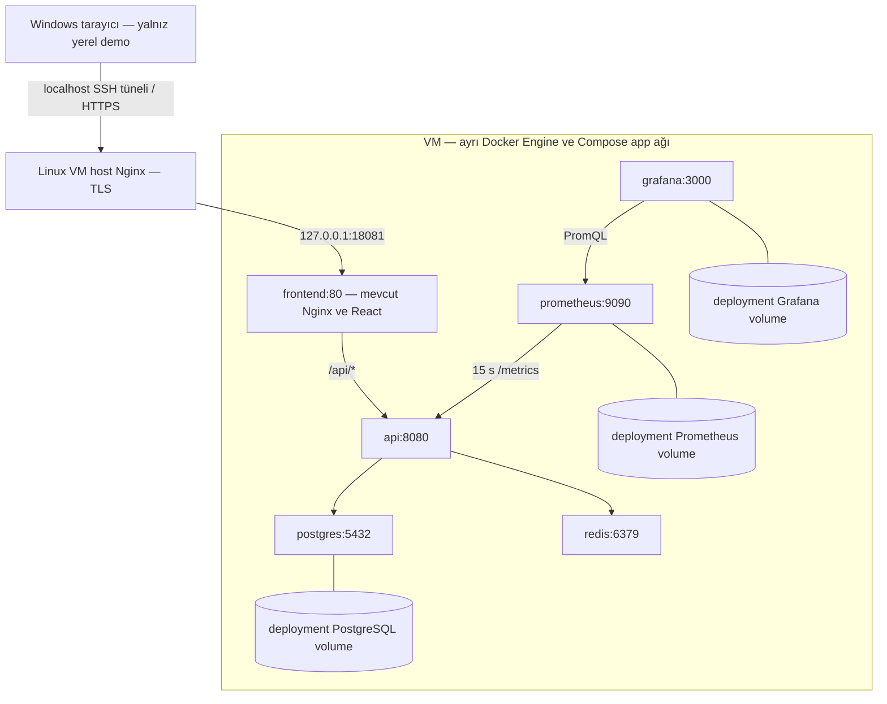

# Deployment Lab planı — GHCR, yerel Linux VM, HTTPS ve rollback

**Plan tarihi:** 11 Ekim 2026. **Güncel durum (14 Ekim):** VM/Docker, aktarım/env/digest pull, ayrı PostgreSQL ve InitialCreate kabulü PASS. Aynı seçilmiş digestlerle altı servisli image-only başlangıç, internal health, Windows loopback SSH/tarayıcı erişimi ve Nginx HTTP contract/Redis cache kabulü de PASS. Kalan asset/monitoring kabulü ve sonraki kapılar bekliyor. Aşağıdaki planlama kararları tarihsel bağlamıyla korunur; güncel kanıt son bölümde kayıtlıdır.

Kaynak incelemesi: `0613f581009d18fee22aa0e57b99fadd65697b56`. Başlangıç `main` çalışma alanı temiz ve `origin/main` ile eşleşiyordu. [Issue #3](https://github.com/EnsarAslannn/fullstack-ops-lab/issues/3) salt okunur incelendi; issue değiştirilmedi. Bu belge [şartnamenin](../PROJECT_SPEC.md) **Advanced Lab E — Deployment** isteğe bağlı kapsamına dayanır. Zorunlu final kabul ve bekleyen manuel öğrenme değerlendirmesi değiştirilmez.

## 1. Amaç ve kullanıcı kararları

Mevcut uygulamayı bir sunucu gibi yönetilen ayrı ortamda, GHCR'den çekilmiş image'larla çalıştırmayı öğrenmek: ilk kurulum, HTTPS, veri kalıcılığı, güncelleme, rollback ve küçük bir yedek/restore pratiği.

| Konu | Kullanıcının kararı |
| --- | --- |
| Bütçe | Sunucu, domain ve yedekleme için toplam **0 TL**; satın alma yok |
| Hedef | Önce kendi bilgisayarında sunucu provası |
| Erişim | Domain yok; erişimi sınırlı, yalnız sahte verili demo |
| Kesinti | Güncellemede birkaç dakika kabul edilebilir |
| Veri kaybı hedefi | Günlük yedek; en fazla bir gün geriye dönme kabul edilebilir |
| İzolasyon | Development env, user-secrets, database ve volume'lar korunacak |

**Önerilen yol:** mevcut Windows bilgisayarda ayrı bir Linux x86_64 VM, VM içinde kendi Docker Engine'i ve altı servisli Compose. Bu **internete açık deployment değildir**. Yerel HTTPS pratiği, public domain ve internet üzerinden güvenilir sertifika kabulünün yerine geçmez. Issue'nun internet/domain gerektiren kısmı bu provayla tamamlandı sayılmaz; daha sonra ayrıca karar verilmelidir.

## 2. Ücretsiz ortam değerlendirmesi

11 Ekim 2026 tarihinde resmî belgeler incelendi. Hesap, ödeme yöntemi veya kaynak oluşturulmadı; bölgesel kapasite ve hesap uygunluğu denenmedi. Koşullar değişebilir; ileride kayıt öncesi yeniden okunmalıdır.

| Seçenek | Kart / süre | Sonradan ücret veya kayıp koşulu | Altı servis ve mevcut image'lar açısından değerlendirme |
| --- | --- | --- | --- |
| Oracle Cloud Always Free | Kimlik doğrulamada kredi kartı veya uygun debit kart, geçici provizyon; trial 300 USD / 30 gün. Always Free ayrı, süre sınırı olmayan kota | Ücretli hesaba geçişte kota üstü kullanım ücretlenir. Ücretsiz hesapta kapasite bulunmayabilir; düşük kullanımlı VM geri alınabilir | AMD Micro başına 1 GB RAM / 1⁄8 OCPU. ARM A1 toplam 2 OCPU / 12 GB RAM; mevcut GHCR amd64 image'ları ARM için uygun değil. Multi-arch yayın yeni kapsam olur; sırf ücretsiz sunucuya uymak için burada eklenmez. [Kotalar](https://docs.oracle.com/en-us/iaas/Content/FreeTier/freetier_topic-Always_Free_Resources.htm), [kart ve trial](https://www.oracle.com/cloud/free/faq/), [hesap yükseltme](https://docs.oracle.com/en-us/iaas/Content/FreeTier/freetier.htm) |
| Google Cloud Free Tier | Geçerli ödeme yöntemi; trial 300 USD / 90 gün. Free Tier için uygun billing hesabı gerekir | Trial yükseltilmezse süre/kredi sonunda kaynaklar durur. Paid hesapta kota dışı kullanım, ek disk/ağ/IP maliyetleri doğabilir | Uygun üç ABD bölgesinde bir e2-micro, 30 GB standart disk, 1 GB outbound kota. e2-micro 1 GB RAM ve paylaşımlı CPU; altı servis için ölçülmüş yeterlilik yok. [Free program](https://docs.cloud.google.com/free/docs/free-cloud-features), [makine özellikleri](https://docs.cloud.google.com/compute/docs/general-purpose-machines#e2-shared-core), [ayrı ağ fiyatları](https://cloud.google.com/vpc/network-pricing) |
| AWS Free Plan | Güncel FAQ'ya göre çoğu yeni kullanıcı için ödeme yöntemi zorunlu değil; kimlik doğrulamada istenebilir. En fazla 6 ay veya kredi tükenene kadar; 100 USD başlangıç, ek görevlerle toplam 200 USD'ye kadar | Free plan sonunda erişim askıya alınır; devam için paid plan gerekir. Paid plan kredi dışı kullanımı ücretlendirir. Eski hesapların uygunluğu farklıdır | Geçici x86 VM deneyi mümkün olabilir, ancak kalıcı ücretsiz altı servisli sunucu garantisi değildir; uygun shape/volume/ağ ve kredilerin süresi hesap açmadan kesinleştirilemez. [Güncel FAQ](https://aws.amazon.com/free/free-tier-faqs/) |
| Render Free | Ödeme yöntemi olmadan kullanım yolu belgelenir; web servisleri için aylık toplam 750 ücretsiz instance saati, boşta kapanma; ücretsiz PostgreSQL 30 gün sonra sona erer | Kart yoksa kota aşımında askıya alma/build durdurma; ödeme yöntemi varsa ek bandwidth/build kullanımına ücret. Paid servis/disk seçimi ayrıca ücretli | Tek Docker Engine üzerinde altı Compose servisi ve named volume sunmaz. Free web servisinde kalıcı disk ve inbound private networking yok; Prometheus/Grafana kalıcılığı da uyuşmaz. Managed DB/cache ve farklı servis ilişkileri mimari değişikliği gerektirir. [Free sınırları](https://render.com/docs/free), [servis modeli](https://render.com/docs/service-types) |

**Sonuç:** İncelenen teklifler arasında mevcut amd64 yayınlarını, altı servisi ve kalıcı veriyi uzun süreli, risksiz ve koşulsuz 0 TL sunucu olarak doğrulayabildiğimiz seçenek yok. Oracle ARM teknik açıdan daha geniş kaynak sunar fakat yayın mimarisi değişmeden kullanılamaz. 1 GB VM'lerde çalışmanın imkânsız olduğu iddia edilmez; yeterlilik testi yapılmadı ve kapasite planı olarak önerilmez. Güncel Compose yalnız Prometheus ve Grafana'ya ayrı ayrı 512 MB limit tanımlar; DB/API/OS da kaynak ister.

**Yerel VM** bulut faturası, kart ve domain gerektirmez. Mevcut bilgisayar, disk, internet ve elektrik kullanır; bunların fiziksel maliyetinin sıfır olduğu iddia edilmez. Ücretsiz URL/tünel hizmeti sunucu ve volume ihtiyacını çözmez; internet tüneli veya port forwarding bu plana eklenmez.

## 3. Sunucu provası ve gerçek mimari

Salt okunur host incelemesinde Windows 11 Pro, yaklaşık 32 GB RAM, 12 fiziksel çekirdek/24 mantıksal işlemci ve çalışan hypervisor görüldü. Hyper-V yönetim özelliği, boş disk ve aynı anda kullanılabilir RAM doğrulanmadı. [Hyper-V](https://learn.microsoft.com/en-us/windows-server/virtualization/hyper-v/get-started/Install-Hyper-V) mevcut Pro sürümünde kullanılabilecek ilk seçenektir; özellik açma/reboot kararı uygulama öncesinde ayrıca ele alınır. Docker Desktop/WSL'yi kapatmak veya mevcut sanallaştırma ayarını değiştirmek bu planın ön koşulu değildir.

Öneri: Ubuntu Server 24.04 LTS x86_64, başlangıçta 4 vCPU, 6 GB RAM ve 60 GB dinamik sanal disk. Bunlar rahat bir öğrenme ortamı için **öneridir**, ölçülmüş minimum veya performans garantisi değildir. Kullanılabilir disk/RAM kontrol edilmeden VM oluşturulmaz. [Ubuntu sürüm desteği](https://ubuntu.com/about/release-cycle).

VM kendi Docker Engine'ini kullanır; Windows development Engine'ine Docker context/DOCKER_HOST ile yönlenmez. Ayrı clone ve deployment project adı önerisi `fullstackops-deploy-lab`; development klasörleri, Docker socket'i ve veri dizinleri VM'e paylaşılmaz. NAT/hosta özel sanal ağ, yönetim için yalnız hosttan SSH; bridged/public erişim ve router port forwarding yoktur.

Altı Compose servisi ve mevcut roller korunur. Host Nginx yalnız HTTPS giriş katmanı önerisidir; ayrı yedinci Compose servisi eklenmez. Frontend image içindeki Nginx statik dosyaları sunmaya ve `api:8080` hedefini kullanmaya devam eder. Host portu ile container portu aynı kavram değildir: host Nginx `127.0.0.1:18081` üzerinden frontend'e, frontend ise Docker DNS ile `api:8080` üzerinden backend'e gider. Host Nginx Docker servis adını doğrudan çözmeye çalışmaz.

## 4. Adres, HTTPS ve açık/kapalı portlar

Yerel ad önerisi `tasks.fullstackops.test`; ileride yalnız host üzerinde localhost eşlemesi yapılır, public DNS kaydı değildir. Önerilen erişim `https://tasks.fullstackops.test:18443/`: Windows'ta boşluğu doğrulanmış localhost 18443 SSH tüneli, VM loopback 443 host Nginx'e gider. HTTP yönlendirmesi denenirse ayrı localhost 18080 tüneli kullanılır; Location hedefinin yerel HTTPS portunu koruduğu doğrulanır. Bunlar plan değerleridir, henüz açılmadı.

Yerel CA ile imzalanmış, bu ada SAN içeren sertifika önerilir. Yalnız lab istemcisinin güvenmesi ve lab anahtarlarının Git dışında kalması gerekir; trust-store değişikliği ancak kullanıcı onayıyla sonraki adımda yapılır. CA özel anahtarı servisler/image'lar ile paylaşılmaz; sunucu sertifika anahtarı dar izinle tutulur. Tarayıcı uyarısını geçmek veya TLS doğrulamasını kapatmak HTTPS kabulü değildir. [Nginx HTTPS](https://nginx.org/en/docs/http/configuring_https_servers.html).

Gerçek internet deployment'ı ileride seçilirse erişilebilir sunucu, kontrol edilen ücretsiz alt domain veya domain, doğru A/AAAA kayıtları ve public sertifika gerekir. ACME HTTP-01 port 80 erişimi, DNS-01 ise DNS kontrolü ister; yalnız yerel `.test` adresi bu public kabulü karşılamaz. Sertifika yenileme ve reload deneyi ayrıca gerekir. [ACME challenge yöntemleri](https://letsencrypt.org/docs/challenge-types/).

| Bileşen | Yerel VM planı | İleride internet deployment'ı seçilirse |
| --- | --- | --- |
| Host TLS Nginx | VM loopback 443; tarayıcıya yalnız localhost SSH tüneli | 443 HTTPS; gerektiğinde 80 redirect/ACME |
| SSH | VM özel ağında yalnız host yönetimi | Yönetici kaynağına sınırlı; Docker remote API açılmaz |
| frontend:80 | VM loopback 18081; doğrudan internet/LAN yok | Yine loopback; host TLS proxy arkasında |
| api:8080 | Host yayını yok | Host yayını yok |
| postgres:5432 / redis:6379 | Host yayını yok | Host yayını yok |
| prometheus:9090 / grafana:3000 | VM loopback; gerekirse localhost 19090/13000 SSH tünelleri | İnternete açık port yok; yönetim tüneli |
| /metrics, /health/*, /openapi/* | Internal API; frontend proxy route'u eklenmez | Internal kalır; public testte SPA HTML sağlık sonucu sayılmaz |

Uygulamada kullanıcı/rol yetkilendirmesi yoktur. HTTPS bağlantıyı korur, CRUD'a yetki kontrolü eklemez. Sınırlı demo kararı bu nedenle anlamlıdır; public erişim ileride yeniden değerlendirilir. Redis de mevcut internal yapıda parolasızdır; host portunu açmak uygun değildir.

Host ve frontend Nginx arasında forwarded header zinciri ayrıca incelenir: mevcut frontend `X-Forwarded-Proto` değerini kendi `$scheme` değeriyle değiştirir; host TLS eklenince API'nin HTTPS/client IP bildiği varsayılmaz. Mevcut API forwarded headers/HTTPS redirection kullanmıyor. HTTPS sınırının host Nginx olduğu belgelenir; gerekirse header güveni için minimal öneri ayrı incelemeye sunulur, backend sözleşmesi kendiliğinden değiştirilmez. Docker published portları ile UFW etkileşimi nedeniyle yalnız firewall kuralına güvenmek yerine loopback binding ve gerçek erişim testi birlikte kullanılır. [Docker firewall açıklaması](https://docs.docker.com/engine/network/packet-filtering-firewalls/).

## 5. Deployment yapılandırması ve GHCR digest'leri

Sonraki uygulamada `infrastructure/deployment/compose.deploy.yaml` önerilir; mevcut `compose.yaml` üzerine açık `-f` ile uygulanan, version-controlled küçük override. Compose'un ortama özel dosya yaklaşımı [resmî belgede](https://docs.docker.com/compose/how-tos/production/) anlatılır. Bu görevde dosya oluşturulmaz.

Override API/frontend `build` alanlarını kaldıracak ve digest referanslarını kullanacak; PostgreSQL external volume adı deployment'a özel olacak. Prometheus/Grafana volume'ları ayrı project prefix'iyle oluşacak. Compose `!reset`/`!override` desteği runner/server sürümünde doğrulanacak; ports listelerinin merge edilerek istenmeyen public port bırakmadığı kontrol edilecek. Monitoring bind mount'larının temel Compose dosyasına göre çözülen yolları salt okunur kalacak.

- API: `ghcr.io/ensaraslannn/fullstack-ops-lab-api@sha256:<api-digest>`.
- Frontend: `ghcr.io/ensaraslannn/fullstack-ops-lab-frontend@sha256:<frontend-digest>`.
- İkisi aynı **başarılı kaynak commit'inden** seçilecek; run URL, tam SHA, her iki digest ve migration SQL checksum'u birlikte release kaydına yazılacak.
- `sha-<commit>` kaynak izlemeyi kolaylaştırır; `latest` değişebilir. Deployment içerik kimliğini digest ile sabitler. [GHCR digest kullanımı](https://docs.github.com/en/packages/working-with-a-github-packages-registry/working-with-the-container-registry).
- Pull sonrası OCI `org.opencontainers.image.revision` kaynak SHA ile, RepoDigests seçilen referansla eşleştirilecek. Container `.Image`, o referans için Engine'den alınan local image ID ile karşılaştırılacak; manifest digest ile image ID'nin evrensel olarak eşit olduğu varsayılmayacak.
- Sunucuda uygulama Docker build yapılmayacak: açık pull, ardından `up --no-build` kullanılacak. Kaynak clone yalnız config/provisioning/migration hazırlığı içindir.
- Yayın script'i şu anda yalnız `linux/amd64` üretir. ARM sunucu, multi-arch yayın ayrı karar verilmeden seçilmeyecek.

Yeni release seçimi bu plan görevinde yapılmadı. [9 Ekim registry runtime kabulü](../labs/11-github-actions/README.md#registry-image-runtime-kabulü--9-ekim-2026), kaynak `4606fa2358ed2f559b96b2cd89f1801ef9c5e733` ve orada yazılı iki digest'e aittir. [10 Ekim run 38049277917](https://github.com/EnsarAslannn/fullstack-ops-lab/actions/runs/38049277917) kaynak `0613f581009d18fee22aa0e57b99fadd65697b56` için başarılı CI/yayın kaydıdır; onun yeni image'ları önceki digest-runtime kanıtını otomatik devralmaz.

VM'de anonim pull önce salt okunur denenir. Başarısızsa public/private ayarı değiştirilmez; gerekli en az yetkili registry erişimi ayrıca kararlaştırılır. Actions'ın geçici `GITHUB_TOKEN` değeri VM'e taşınmaz. Önceki anonim pull, bugünkü package visibility metadata'sının okunduğu veya gelecekte erişimin garantili olduğu anlamına gelmez.

## 6. Secret, volume ve ilk migration sırası

Deployment credential'ları yalnız VM'de, Git/build context dışında erişimi sınırlı dosyada hazırlanır; development `.env` veya user-secrets'tan kopyalanmaz. Öneri VM clone kökünde ayrı ignored `.env.deployment`; yeni dosya yoksa şablondan hazırlanır, varsa üzerine yazılmaz. Değerler shell history'ye, `compose config` çıktısına veya rapora yazılmaz. `.env` düz metin ve container environment `inspect` ile görülebilir; vault iddiası yoktur.

Anahtarlar mevcut sözleşmeyle aynı: `POSTGRES_USER`, `POSTGRES_DB`, `POSTGRES_PASSWORD`, `ASPNETCORE_ENVIRONMENT=Production`, isteğe bağlı pozitif `Cache__TasksTtlSeconds`, `GF_SECURITY_ADMIN_USER`, `GF_SECURITY_ADMIN_PASSWORD`. Compose DB/Redis bağlantısını `postgres:5432` / `redis:6379` ile kurar; `ConnectionStrings__Postgres` → `ConnectionStrings:Postgres` eşlemesi değişmez. User-secrets Compose tarafından okunmaz.

Volume önerileri: yalnız VM Engine'inde `fullstackops-deploy-lab-postgres` external named volume, project'e özel `prometheus_data` ve `grafana_data`. İlk hazırlıkta mevcut volume varsa sahipliği/içeriği belirlenmeden kullanma, sıfırlama veya silme. Volume'daki PostgreSQL initialization sırasında parola rolü oluşturur; initialized volume'da env değişikliği rol parolasını değiştirmez. Grafana ilk admin hesabı da kalıcı database nedeniyle benzer kontrol gerektirir.

**İlk kurulum sırası:**

1. VM/Docker Engine kimliği, disk ve ilgili kaynak envanterini doğrula; project adı/env/volume hedeflerinin development'tan ayrıldığını göster.
2. Başarılı yayın run'ından image çiftini ve aynı SHA'da temiz kaynak/config clone'unu seç. Digest ile pull ve kimlik kontrollerini yap.
3. Yalnız deployment env'ini hazırla; sorunlu anahtarları değer yazmadan denetle. `compose ... config -q` ile sessiz doğrula.
4. Yalnız gerçekten yoksa deployment external PostgreSQL volume'unu oluştur. Önce yalnız PostgreSQL'i başlat; pg_isready ve container içinden TCP `psql SELECT 1` ile hem readiness hem credential eşleşmesini doğrula.
5. Aynı kaynak commit'inde `dotnet tool restore`; mevcut `dotnet-ef` 10.0.12 ile `InitialCreate` SQL'ini üret. Yeni migration yok. API runtime image'ında SDK/EF CLI yok; .NET 10 SDK ayrı hazırlama makinesinde veya VM'in yalnız migration hazırlığı için kullanılan host aracıdır. Frontend için VM'de Node/npm gerekmiyor.
6. SQL üretiminde design-time validation için yalnız komut sürecine Production ve sahte, erişilemeyen DB/Redis config'i ver; user-secrets'ı değiştirme. SQL'i incele, migration kimliği `20260928113912_InitialCreate`, tasks/history ve checksum'u kaydet.
7. `psql -X -w -v ON_ERROR_STOP=1` ile doğru deployment DB'ye kontrollü uygula; native exit code kapısı olsun. İdempotent SQL history'deki uygulanmış migration'ı atlar; elle oluşturulmuş schema/history çelişkisini çözmez. Hata varsa API/frontend trafiğini açma. [EF migration uygulama](https://learn.microsoft.com/en-us/ef/core/managing-schemas/migrations/applying).
8. tasks ve `__EFMigrationsHistory` doğrula; altı servisi `--no-build --wait --wait-timeout` ile başlat. API'ye otomatik migration ekleme.
9. HTTPS katmanı, health, browser, CRUD/cache/monitoring kabulünü yap; kanıtları release kimliğiyle eşleştir.

Exact proje/komut temeli [Module 9 kurulum rehberinin 13. bölümüdür](../labs/09-environment-configuration/README.md#13-temiz-bilgisayar-kurulum-rehberi). SQL üretim kalıbı: `dotnet ef migrations script 0 InitialCreate --idempotent --project src/backend/FullStackOpsLab.Api --startup-project src/backend/FullStackOpsLab.Api --output <gecici-sql-yolu>`; CLI restore ve güvenli process config'i önce hazırlanır. SQL'i shell string'i olarak çalıştırma; UTF-8 dosya/stdin ve gerçek exit code kontrolü kullan. Linux komutları uygulama adımında uyarlanacak; PowerShell 5.1'in binary stdin/encoding davranışı Linux'ta varsayılmayacak.

Mevcut env preflight default `.env`, ana Compose ve sabit development volume adını denetler. Deployment env/override/volume'a bakıyormuş gibi körlemesine çalıştırılmaz. Uygulamada bu küçük fark için parametreli kontrol veya deployment'a özel ince wrapper değerlendirilir; eski preflight davranışı korunur. Secret scanner ayrıca tracked ve ignored olmayan yeni repository dosyalarını tarar; ignored deployment env'inin doğruluğunu veya secret güvenliğini kanıtlamaz.

## 7. Normal başlatma, güncelleme ve rollback

Hazırlık tamamlanınca digest'leri sabit deployment dosyasıyla `docker compose pull`, ardından `up -d --no-build --wait` sunucuyu başlatır. Her komutta deployment project/env/override seçimi açık olmalı. `restart` image güncellemez; yeni digest için container recreate gerekir. Healthcheck trafik yönlendiren load balancer değildir; başarısız `up --wait` otomatik rollback garantisi vermez.

**Güncelleme planı:**

1. Başarılı yeni run ve aynı kaynak SHA'lı API/frontend digest çiftini seç. Önceki çift, config revision, SQL checksum ve yedek kaydı korunur; yayın iki image için atomik değildir.
2. Yeni migration olup olmadığını mevcut DB history ile karşılaştır. Varsa inceleme, veri yedeği ve eski/yeni uygulamayla schema uyumu kararı olmadan devam etme.
3. Digest'leri çek, revision/image kimliğini kontrol et. Yeni release'in provisioning dosyaları da aynı kaynak revision'dan gelir; sadece image değiştirilmişken yeni config kullanıldı varsayma.
4. API/frontend'i recreate et; DB/Redis/monitoring image sürümlerini bu deneyde değiştirme. Birkaç dakikalık kesinti kabul edilir; blue-green veya sıfır kesinti iddiası yok.
5. HTTPS assets, internal ready, CRUD, cache ve volume'daki görev kimliği/alanlarını doğrula. Başarısızsa veri değişikliğini değerlendirmeden körlemesine tekrar deneme.

**Image rollback:** önceki API/frontend digest çiftine ve uyumlu config revision'a dön; aynı deployment PostgreSQL volume'u korunur. Nginx'in yeniden oluşturulan API'ye erişimi ve readiness tekrar doğrulanır. Görev ID/alanlarını karşılaştırarak rollback'in veriyi silmediğini kanıtla.

**Migration rollback farklıdır:** eski image'ın dönmesi DB schema'sını geri almaz. Mevcut `InitialCreate.Down` tasks tablosunu düşürür; normal rollback çözümü değildir. Geriye uyumsuz schema varsa image rollback güvenli olmayabilir; dur, uyumlu ileri düzeltme veya doğrulanmış yedekten ayrı DB restore planını değerlendir. Bu lab iki uyumlu release ile önce image rollback'i öğretecek; mümkünse backend/frontend davranışı aynı, kaynağı farklı iki yayın seçilir. Sadece aynı image'ı restart etmek rollback kabulü sayılmaz.

## 8. Günlük yedek ve ayrı restore pratiği

Hedef RPO **24 saat**; kurtarma süresi henüz ölçülmedi. VM/PC kapalıysa günlük job çalışmaz; son başarılı yedek zamanı denetlenir, yedek 24 saatten eskiyse hedef sağlandı sayılmaz.

- Deployment PostgreSQL'in kendi araçlarıyla `pg_dump` custom format önerilir; parola komut argümanına yazılmaz. Binary dump önce Linux/PG container içinde dosyaya yazılır, sonra güvenli dosya kopyasıyla alınır; Windows PowerShell 5.1 text pipeline'ından binary geçirilmez.
- SQL şemasını ve migration history'yi taşıyan dump, zamanı, SHA/digest çiftini ve checksum'u ayrı kaydet. Dump checksum'u içerik bütünlüğünü kontrol eder; restore edilebilirliği tek başına kanıtlamaz. [pg_dump](https://www.postgresql.org/docs/18/app-pgdump.html).
- En az son yedi günlük lab yedeğini repository dışında, erişimi sınırlı dizinde saklamak önerilir; VM dışına ikinci kopya alınır. Aynı bilgisayarın disk kaybına karşı bu ikinci kopya bağımsız disaster-recovery garantisi değildir. Ücretli depolama gerektirmez.
- Restore deneyi ayrı project ve **yeni boş test volume** kullanır. `pg_restore --exit-on-error` sonrası tasks/history ile bilinen sahte kayıt ID/alanlarını doğrula. Deployment veya development database'inin üstüne restore yapılmaz. [pg_restore](https://www.postgresql.org/docs/18/app-pgrestore.html).
- Rol/credential kurtarma ayrı konudur: tek database dump'ı cluster rollerinin tamamını içermez. Restore hedefinin lab rolü ve ownership politikası önceden hazırlanır; rol secret'ı dump raporuna eklenmez.
- Başarı veya başarısızlıkta yalnız restore deneyinin etiketli kaynakları temizlenir; asıl deployment volume'u ve yedekler kalır. Redis cache kaynak veri değildir, yedek hedefi değil; PostgreSQL esas veridir.

## 9. En küçük uygulama adımları ve kabul kapıları

Her satır ayrı küçük görev; önceki sonuç incelenmeden topluca uygulanmaz. Bu tablo ilk planın sırasını korur. VM/Docker, aktarım/digest pull, ilk veri hazırlığı, altı servis başlangıç/kimlik/health/SSH erişimi ve Nginx contract/cache 13–14 Ekim kanıtlarıyla tamamlandı. Adım4'ün ayrı JS/CSS kontrolleri ve sonraki runtime kapıları **NOT VERIFIED**.

| Adım | Yapılacak iş | Kabul kanıtı |
| --- | --- | --- |
| 1 — VM hazırlık kararı | Hyper-V kullanılabilirliği, disk/RAM, NAT/SSH ve VM kaynak planını kesinleştir; sonra ayrıca VM oluşturma görevi | Ayrı x86_64 Linux Engine, development Engine'ine bağlantı yok, public/LAN port yok; başlangıç envanteri |
| 2 — Deployment dosyaları | Küçük image-only override, örnek deployment env/kimlik kaydı ve güvenli preflight | Build alanları yok, digest çifti aynı SHA, config-q, secret kontrolü, ayrı volume adı; local Compose değişmemiş |
| 3 — İlk veri hazırlığı | Yalnız lab volume/PostgreSQL; açık SQL üretme/inceleme/uygulama | TCP auth başarılı; tasks/history doğru; migration hata exit code kapısı; API auto-migration yok |
| 4 — GHCR runtime | Altı servisi çekilen image'larla başlat, kimliklerini eşleştir | Altı healthy; internal live/ready200; HTML/JS/CSS200; CRUD/Location/altı JSON alanı/nullable/400/404; cache miss/hit/TTL/invalidation |
| 5 — Yerel HTTPS | Host Nginx, lab sertifikası ve yalnız localhost SSH erişimi | Gerçek browser sertifika/hostname doğrulaması; CRUD aynı origin'de; erişilemeyen DB/Redis/API/monitoring public portları |
| 6 — Kalıcılık ve gözlem | PostgreSQL recreate, Prometheus ve Grafana kontrolleri | Aynı lab volume'da görev ID/alanları korunur; Prometheus UP/yeni örnek; datasource ve 12 panel otomatik; readiness ayrı kontrol |
| 7 — Güncelleme/rollback | İki uyumlu published digest çiftiyle kontrollü geçiş/dönüş | Her iki sürümün SHA/digest/container identity ve HTTP kabulü; veri korunmuş; gerçek kesinti süresi kaydı |
| 8 — Yedek/restore | Günlük yedek planı ve yeni test DB'ye bir restore | Başarılı dump/checksum, güncel yedek zamanı; ayrı restore'da görev/history doğrulaması; owned cleanup |
| 9 — Lab kapanışı | Komutlar, runtime kanıtları, limitler ve kaynak envanteri | Development .env/user-secrets/volume değişmemiş; yalnız lab stack'i down; asıl lab verisi korunmuş |

[Mevcut registry kabul script'i](../tests/Module11.Compose.Smoke.py), [registry guard testleri](../tests/Module11.RegistryRuntime.Test.py), [CRUD smoke](../tests/Phase0B.Tasks.Smoke.ps1) ve [Module 8 testi](../tests/Module8.Readiness.Smoke.ps1) yeniden kullanılabilecek temeldir. CI Lab.prepare rastgele test env/volume oluşturur ve cleanup bunları siler: kalıcı deployment volume'unda **olduğu gibi çalıştırılmaz**. Sadece uygun assertion'lar veya ayrı, disposable ön kabul için kullanılır; hosted PASS gerçek VM deployment'ın yerine geçmez.

Normal kapatma `stop` veya project/env hedefi açık `down`; named volume'lar korunur. `down -v`, volume prune, system prune veya development volume'u silmek rutin işlem değildir. Restore test volume'unun kaldırılması yalnız sahiplik/project/tam isim kontrolüyle yapılır. VM silme kararı yedek ve lab kapanışından ayrıdır.

## 10. Issue kabulüyle eşleştirme ve açık kararlar

| Issue #3 maddesi | Bu plandaki karşılık | Bugünkü durum |
| --- | --- | --- |
| Sunucu, maliyet, domain | 0 TL yerel VM; public domain ertelendi | Yerel Ubuntu VM/Docker/Compose hazırlığı PASS; internet deployment kabulü yok |
| Ayrı config ve digest deployment | Image-only override + aynı SHA'lı digest çiftleri | Statik model, digest pull ve çalışan image kimlikleri PASS; tam runtime bekliyor |
| Secret/volume/migration | VM'e özel kaynaklar ve açık SQL hazırlığı | PASS: ayrı env/volume/TCP auth ve InitialCreate uygulama/tekrar; tam stack runtime kabulü bekliyor |
| Domain ve HTTPS erişimi | Yerel ad/TLS prova; public domain/internet erişimi ayrı gelecek karar | Public kabul NOT VERIFIED; issue tamamlandı sayılmaz |
| DB/Redis/API kapalı; monitoring sınırlı | Internal portlar, loopback ve SSH yönetimi | Gerçek Docker bind ve Windows loopback tünel PASS; geniş LAN/public ağ kabulü yapılmadı |
| Health, frontend ve CRUD | Gerçek VM/browser/HTTP kontrolü | Internal üç health200, browser erişimi ve ayrı Nginx HTTP contract/cache kabulü PASS; JS/CSS/monitoring ve tam deployment kapanışı bekliyor |
| Güncelleme ve rollback | İki uyumlu digest çifti + schema uyum kapısı | NOT VERIFIED |
| Kayıt recreate sonrası korunur | Aynı lab external PostgreSQL volume'u | Önceki local/CI kanıtı var; yeni VM kabulü NOT VERIFIED |
| Image / migration rollback farkı | Veri silmeyen image dönüşü; destructive InitialCreate.Down uyarısı | Tasarım açık; restore NOT VERIFIED |
| Development ortamı korunur | Ayrı VM Engine/project/env/volume ve envanter | Bu plan görevinde yalnız doküman değişti; runtime testi yok |

Kullanıcının cevaplarıyla bütçe, erişim, kesinti ve RPO belirlenmiştir. Uygulama öncesinde kalan kısa sorular:

1. Hyper-V özelliği zaten açık mı; gerekiyorsa özellik kurulumu/reboot uygun mu? Windows/Docker ayarlarını değiştirmeden önce cevap beklenir.
2. VM için önerilen 60 GB disk alanı ve 6 GB RAM ayrılabilir mi? Bunlar sabit minimum değil; boş alan/kullanım doğrulanacak.
3. Yerel HTTPS için yalnız lab CA'sına istemcide güven verilmesini kabul ediyor musun? İstemci trust değişikliği bu görevde yapılmadı.
4. VM dışı günlük yedek kopyası mevcut hangi diskte/dizinde tutulmalı? Konum ve dosya izinleri uygulamada seçilir; secret veya kişisel dosya paylaşman gerekmez.

Sonraki **en küçük görev**, bu dört hazırlık kararını ve salt okunur host kontrollerini tamamlayıp VM kurulum planını kesinleştirmektir. Henüz VM, hesap, cloud kaynağı, DNS, sertifika, env, volume veya deployment oluşturulmaz.

## 11. Kaynaklar ve bu görevin doğrulama sınırı

| Dayanak | Plan için kullanılan bilgi |
| --- | --- |
| [AGENTS.md](../AGENTS.md), [PROJECT_SPEC.md](../PROJECT_SPEC.md), [PROJECT_STATUS.md](../PROJECT_STATUS.md) | Öğrenme/kapsam, Advanced Lab E, historical acceptance ve manuel öğrenme sınırı |
| [Kök README](../README.md), [mimari](architecture.md) | Güncel altı servis ve belgelenmiş ilk kurulum |
| [compose.yaml](../compose.yaml) | Internal service adları, localhost ports, healthcheck, external PG, monitoring volume/retention |
| [API Dockerfile](../src/backend/FullStackOpsLab.Api/Dockerfile), [frontend Dockerfile](../src/frontend/Dockerfile) | Runtime stage; SDK/Node ve EF CLI runtime'da yok |
| [nginx.conf](../src/frontend/nginx.conf), [API client](../src/frontend/src/api/tasks.ts) | api:8080, relative /api, mevcut forwarded header davranışı |
| [Program.cs](../src/backend/FullStackOpsLab.Api/Program.cs), [ApiConfiguration.cs](../src/backend/FullStackOpsLab.Api/Configuration/ApiConfiguration.cs) | Auth yok, startup validation, cache/failure, internal health/metrics; OpenAPI Development-only |
| [InitialCreate](../src/backend/FullStackOpsLab.Api/Migrations/20260928113912_InitialCreate.cs), [tool manifest](../dotnet-tools.json), [kurulum rehberi](../labs/09-environment-configuration/README.md#13-temiz-bilgisayar-kurulum-rehberi) | Migration kimliği, destructive Down, açık idempotent SQL ve credential/readiness ayrımı |
| [Module 11 GHCR belgesi](../labs/11-github-actions/README.md), [publisher](../scripts/Module11.PublishImages.py), [CI](../.github/workflows/ci.yml) | main-only publishing, amd64, SHA/digest/revision, deployment yapmayan CI |
| [Prometheus config](../monitoring/prometheus/prometheus.yml), [Grafana datasource](../monitoring/grafana/provisioning/datasources/prometheus.yml), [dashboard](../monitoring/grafana/dashboards/overview.json) | Internal scrape ve otomatik provisioning korunacak |

Bu görevde repository/issue ve resmî hizmet belgeleri incelendi; host donanımı salt okunur sorgulandı. `.env` veya user-secrets değerleri okunmadı. Repository secret kontrolü exit 0, 28 yerel dosya/anchor bağlantısı PASS, yeni belgenin whitespace/son newline kontrolü PASS ve `git diff --check` exit 0; bunlar deployment testi değildir. Sunucu/VM/hizmet kurulmadı, container başlatılmadı, sertifika/DNS değiştirilmedi, migration/backup/restore uygulanmadı; commit/push yok. Cloud teklifleri için ücretsiz kaynak bulunacağı veya sonradan hiçbir maliyet doğmayacağı garantisi verilmez.

## 12. Image-only dosya hazırlığı — 13 Ekim 2026

Kullanıcı ayrı Hyper-V VM'de Ubuntu24.04.5, 4vCPU, yaklaşık6GiB RAM, 60GB VHDX,
SSH/DNS/HTTP erişimi, Docker active/Client+Server, Compose5.6.0 ve hello-world
başarısını bildirdi. Bunlar rehberli kullanıcı doğrulamalarıdır; bu görev VM'ye
uzaktan komut göndermedi. DHCP adresi değişebilir.

[Deployment dosyaları ve kullanım rehberi](../infrastructure/deployment/README.md)
hazırlandı. Kaynak SHA `1b52633776279b1661a7cac53392d385cbf10444`,
[run38239884132](https://github.com/EnsarAslannn/fullstack-ops-lab/actions/runs/38239884132)
ve iki başarılı publish job yeniden sorgulandı. Yeni API/frontend digest çifti
[release.json](../infrastructure/deployment/release.json) içinde kayıtlıdır;
GHCR anonim manifest/config okumasında SHA256, OCI source revision ve linux/amd64
platformu doğrulandı. Önceki registry runtime kanıtı bu yeni çiftin VM runtime
kanıtı değildir.

Windows Compose5.3.0 ile yalnız sahte temporary env kullanılarak `config -q` ve
bellekte JSON model doğrulaması, statik test **2/2 PASS**: build alanları kaldırılmış,
altı servis/aynı ağ rolleri korunmuş, üç loopback port ve üç ayrı deployment volume
hedefi var; development modelinin build/volume hedefleri aynı. `!reset`/`!override`
birleşimini gerçek parser doğruladı. İlk statik görevde VM parse/pull/runtime NOT VERIFIED idi; sonraki rehberli sonuçlar aşağıdadır.

Mevcut plan korunur; `.env`, user-secrets veya Docker kaynakları kullanılmadı ya da
değiştirilmedi. Image/container/volume/network oluşturulmadı; yalnız testin temporary
dosyaları temizlendi. Bu ilk statik görevde commit/push yoktu; sonraki hedef VM aktarımı ve PostgreSQL ön hazırlığıydı. Aşağıdaki rehberli adımlarla bunlar tamamlandı; migration, tam stack, HTTPS ve yedekleme henüz uygulanmadı.

## 13. Rehberli VM aktarımı ve PostgreSQL hazırlığı — 13 Ekim 2026

Komutları kullanıcı Ubuntu SSH terminalinde çalıştırdı ve secret içermeyen sonuçları
paylaştı; bunlar agent tarafından tekrar çalıştırılan runtime deneyleri değildir.
Kaynak SHA değişmedi. Git archive ile kaynak, açıkça seçilen beş deployment/test
dosyası ayrı arşivle taşındı; iki arşivin SHA256 eşleşmesi doğrulandı. Development
secret veya build çıktıları aktarılmadı. VM'de ayrı `.env.deployment` yeni ve farklı
credential'larla oluşturuldu; izin `600`, sahibi `labadmin`. Değerler kaydedilmez.

VM Engine `unix:///var/run/docker.sock`, platform linux/amd64. Başlangıçta container
ve volume listeleri boştu; 18081/19090/13000 portları boştu. Gerçek deployment env
ile `config -q` ve bellekte birleşmiş model kontrolü PASS: altı servis, API/frontend
build yok, release digest eşleşiyor, yalnız üç loopback bind, ayrı volume adları.
Her iki digest pull exit0; OCI revision ve platform doğrulandı. API ilk pull denemesi
başarısızdı; nedeni belirlenmedi. Sınırlı süreli tekrar ve frontend pull başarılıydı;
ilk başarısız deneme başarı gibi değerlendirilmedi.

Yalnız `fullstackops-deploy-lab-postgres` external volume'u oluşturuldu; yalnız
`postgres --no-deps --no-build --wait` başlatıldı. Mount Type=volume,
Destination=/var/lib/postgresql, PublishedPorts={}, State=running, Health=healthy.
`pg_isready` accepting connections/exit0. Loopback HBA kuralları trust olduğundan
127.0.0.1 ile ilk negatif parola testi authentication kanıtı değildi. HBA değiştirilmeden
`postgres:5432` hedefinde yanlış parola beklenen authentication hatasıyla reddedildi,
doğru deployment parolasıyla SELECT1 ve loopback olmayan TCP/5432 doğrulandı;
stdout/stderr parola ve canary içermedi. Beklenen database/role PASS.
`tasks` ve `__EFMigrationsHistory` yok; migration öncesinde bu beklenen durumdur.

Son envanter: yalnız `fullstackops-deploy-lab-postgres-1` healthy, 5432/tcp (host
publish yok), yalnız deployment PostgreSQL volume'u; project app ağı korunuyor.
PostgreSQL sonraki adım için çalışır bırakıldı. API/frontend/Redis/Prometheus/Grafana
başlatılmadı. Migration, test tablosu/kayıt, HTTPS ve backup uygulanmadı. Development
kaynaklarına dokunulmadı. Sonraki küçük adım aynı kaynaktan InitialCreate SQL üretimi,
inceleme ve yalnız deployment database'e açık uygulamadır; tam runtime kabulü bekliyor.

## 14. Rehberli InitialCreate kabulü — 14 Ekim 2026

[Deployment rehberindeki güncel migration kaydı](../infrastructure/deployment/README.md#initialcreate-sql-uygulaması--14-ekim-2026)
Windows'ta kaynak `1b52633776279b1661a7cac53392d385cbf10444` için ayrı geçici detached
checkout ve local EF10.0.12/SDK10.0.401 ile üretimi, SQL incelemesini ve VM'de yalnız
deployment database'e uygulamayı kaydeder. Yeni migration, VM SDK/EF kurulumu veya
API/frontend image build yapılmadı. Seçilmiş image çifti korundu.

Özgün SQL1059byte; SHA256 `ce23c018c2000cc8143df02f0fb8d2525de0717385a8c29f84b4888507bd5b53`
Windows/VM'de eşleşti ve release.json'a kaydedildi. İlk EF üretimi exit1 idi, nedeni
belirlenmedi; ayrı Release build exit0 ve --no-build SQL üretimi exit0 geçti.
İlk psql uygulaması exit3: kontrol bloğu önüne eklenen SQL dosyasının UTF-8 BOM'u
akış ortasına taşındı. Güvenli log tanısı bunu doğruladı; iki tablo da yoktu.
Özgün dosya değiştirilmeden yalnız gönderilen payload'dan BOM kaldırıldı.
Düzeltilmiş uygulama ve ikinci idempotent uygulama exit0/COMMIT geçti.

Altı sütun/tip/nullability/default, identity/primary key, tek InitialCreate history
kaydı (EF10.0.12) ve Task count0 PASS. İkinci uygulama öncesi/sonrası şema ve
tablo/sequence OID'lerini kapsayan snapshot SHA256
`c1219d7a88dd073c257a46ffb039368631cd8120d7394037755c05fa8ade1f49` değişmedi.
Sonuçlar kullanıcının paylaştığı SSH/PowerShell çıktılarıdır; agent ayrıca VM'ye
bağlanıp deneyi tekrarlamadı. Parola/ham log paylaşılmadı, development kaynakları
korundu. PostgreSQL çalışır bırakıldı; diğer beş servis başlatılmadı.

Sonraki küçük adım image-only stack başlangıcı/health/image identity ve localhost
SSH tüneli erişimidir. Tam uygulama runtime, update/rollback, HTTPS ve backup/restore
kabulü henüz yoktur; bu kayıt bunları tamamlandı saymaz.

## 15. Altı servis başlangıcı ve Windows SSH erişimi — 14 Ekim 2026

[Gerçek komutlar ve sonuçlar](../infrastructure/deployment/README.md#stack-başlangıcı-ve-ssh-erişimi--14-ekim-2026):
PostgreSQL/volume/history ve gerçek-env sessiz model kontrolü sonrası --no-build/
--pull missing/--wait ile up exit0. Altı running/healthy; API/frontend tam digest,
OCI source1b52633776279b1661a7cac53392d385cbf10444/linux-amd64 ve container image ID
eşleşmesi PASS. İki yeni deployment monitoring volume'u oluşturuldu, mevcut PG
volume'u korundu. API/PG/Redis host portu yok; VM127.0.0.1:18081/19090/13000 bind.
Doğrudan api:8080 GET /health, /health/live, /health/ready200/bodyHealthy PASS.

Windows127.0.0.1:28081/29090/23000 listener'ları aynı SSH process'iyle doğrulandı;
VM'nin ilgili loopback portlarına gider. İlk tünel yanlışlıkla VM'de açılmıştı:
WindowsHTTP000 sonrası yalnız o tünel kapatılıp Windows'ta yeniden açıldı; stack
restart edilmedi. Curl frontend200, gerçek browser frontend/Prometheus açılışı ve
Grafana deployment admin girişi kullanıcı tarafından bildirildi. Credential
değerleri kaydedilmedi. Overview/panel/new-sample kontrolü ayrıca yapılmadı.

Kullanıcının manuel create/complete/delete bildirimi ayrı gözlemdir; tüm HTTP/cache
sözleşmesini veya tüm runtime kabulünü kanıtlamaz. Stack ve üç lab volume'u çalışır/
korunmuş bırakıldı; development kaynaklarına dokunulmadı. Bu tarihli kayıt agent'ın
VM'de tekrar çalıştırdığı bir test değildir. Sıradaki en küçük iş adım4'ün kalan
Nginx CRUD/Location/JSON/nullable/400/404 ve cache miss/hit/TTL/invalidation kabulüdür.
HTTPS, persistence recreate, update/rollback, backup/restore sonraki ayrı kapılardır.

## 16. Nginx HTTP contract ve Redis cache — 14 Ekim 2026

[Rehberli kabul sonuçları](../infrastructure/deployment/README.md#nginx-http-contract-ve-redis-cache-kabulü--14-ekim-2026)
önceki manuel browser turundan ayrı gerçek assertion'lara dayanır. Windows tüneli
yeniden açıldı, 127.0.0.1:28081 listener ve frontend HTTP200 doğrulandı. Ubuntu
kontrolleri VM127.0.0.1:18081 Nginx adresini ve deployment Redis container'ını kullandı.
Source1b52633776279b1661a7cac53392d385cbf10444 ve iki GHCR digest değişmedi.

Liste GET200; POST201/Location `/api/tasks/2`; tekil GET/PUT200, altı JSON alanı,
nullable description ve güncellenmiş DTO tekrar okuması PASS. Whitespace POST/PUT400
ve gerçekten bulunmayan ID için GET/PUT/DELETE404 PASS. Sahipliği doğrulanan yalnız
test ID2 DELETE204 ile temizlendi, sonraki GET404; diğer DTO'lar silme adımı öncesi/
sonrası aynıydı. Başlangıçtaki bütün DB'nin snapshot'ı alınmış gibi sunulmaz.

İlk doğal cache yokluğunda MISS ardından HIT logları; POST/PUT/DELETE key invalidation;
400/404'te key ve bellekte DUMP checksum korunması PASS. Etkin API TTL60 ile gerçek
yeni key TTL60 eşleşti. Key elle silinmeden doğal expiration EXISTS0/TTL-2 ve sonraki
GET ile key1/TTL60, yeni MISS → HIT, aynı liste ve test ID yokluğu doğrulandı.

Komutları kullanıcı çalıştırdı; agent VM runtime deneyini ayrıca tekrarlamadı.
FLUSH/DEL, kesinti/restart, volume veya secret değişikliği yapılmadı. Stack açık
bırakıldı; normal liste cache'i kendi TTL'siyle bırakıldı, test kaydı kalmadı.
Adım4'ün JS/CSS asset erişimi ve monitoring/provisioning kabulü sonraki küçük
kontrollere ayrılır; persistence recreate, HTTPS, update/rollback ve backup/restore
henüz uygulanmadı. Release tam runtime alanı NOT VERIFIED kalır.
