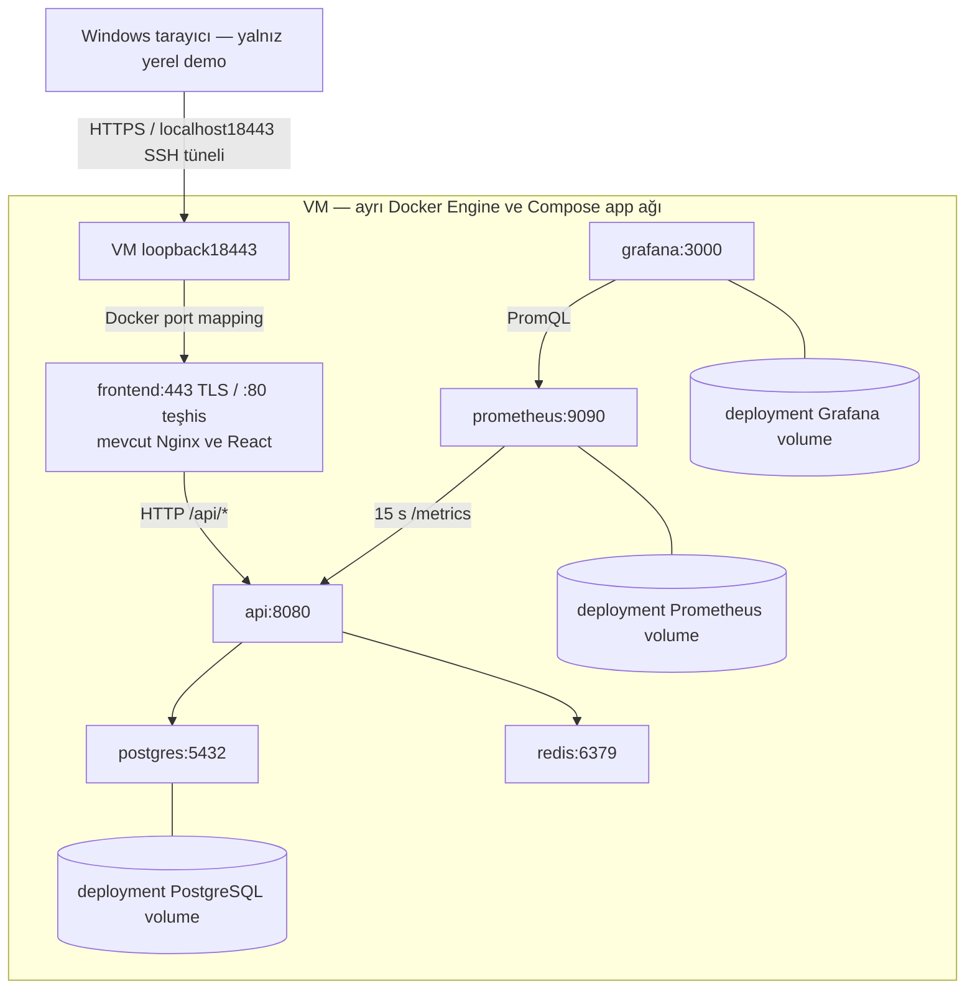

# Deployment Lab planı — GHCR, yerel Linux VM, HTTPS ve rollback

**22 Ekim ek durumu:** [Mevcut günlük arşivin manuel Windows kopyası ve izole restore/cleanup kabulü PASS](../infrastructure/deployment/backup/README.md#günlük-arşivin-windows-kopyası-izole-restore-ve-temizlik--22-ekim-2026);
bölüm33. Yeni dump yok; 21 Ekim setinin boş Task verisi/hash/history/şema/sequence
kabulü, hedef-only ID9/rollback ve kontrollü kaynak temizliği geçti. Kaynak veri/
sequence8, altı aynı healthy container ve VM/Windows günlük/manuel yedekler korundu.
Timer disabled/inactive; gerçek takvim/catch-up/çok günlük retention/RPO ve adım9 açık.

**21 Ekim ek durumu:** Günlük backup hazırlığı/fixture kabulünden (bölüm31) sonra
[VM kurulumu ve iki manuel service çalışması PASS](../infrastructure/deployment/backup/README.md#rehberli-vm-kurulumu-ve-iki-manuel-çalışma--21-ekim-2026);
bölüm32. Gerçek günlük dump ve aynı gün koruma doğrulandı; timer disabled/inactive.
Eski VM/Windows manuel setleri ve kaynak veri/altı container korundu. Takvim/catch-up,
çok günlük retention, yeni günlük arşivin Windows kopyası/restore'u,24h RPO ve
adım9 final lab kabulü açık.

**Plan tarihi:** 11 Ekim 2026. **Güncel durum (17 Ekim):** Önceki hazırlık/migration/HTTP-cache/asset/monitoring/yerel HTTPS ve PostgreSQL recreate kalıcılığı PASS. Adım7 rehberli A→B→A runtime kabulü de PASS: yalnız API/frontend her yönde recreate, doğru digest/revision, B ve A dönüşünde HTTPS/asset/CRUD, aynı ID5 ve final veri/history koruması. Final A aktif, altı healthy, dört altyapı container'ı aynı; yalnız test kayıtları/dosyaları temizlendi, stack ve tünel açık. Aktif A SHA/digestleri ve HTTPS kaynakları aynı. İlk Compose run/nginx-t exit124 nedeni ve gerçek kesinti süresi NOT VERIFIED. Backup/restore ve lab kapanışı bekliyor. Kanıtlar bölüm12–25'tedir; HTTPS Schannel/manual browser sınırları değişmedi.

**18 Ekim ek durumu:** Adım8 için [izole yedek/restore hazırlığı](../infrastructure/deployment/BACKUP-RESTORE.md)
ve bağımsız test Compose modeli hazır; yalnız statik kabul. Gerçek dump, ikinci
kopya, restore/sequence/cleanup ve günlük job henüz yapılmadı; bölüm26.
Ardından güncel envanter/public aktarım ön kontrolü PASS: altı aynı container healthy,
aktif A, source PostgreSQL18.6 ve dört dosyanın hash eşleşmesi doğrulandı; bölüm27.
17 Ekim A→B→A deneyi tekrarlanmadı; dump/restore henüz başlamadı.

**19 Ekim ek durumu:** Adım8'de [mantıksal dump ve Windows ikinci kopyası](../infrastructure/deployment/BACKUP-RESTORE.md#12-mantıksal-dump-ve-windows-ikinci-kopyası--19-ekim-2026)
PASS; özel klasör/env/model, gerçek custom dump/--list, source önce-sonra ve
Windows hash/ACL kanıtları bölüm28'de. Ardından [izole restore/veri/şema/history/
sequence kabulü](../infrastructure/deployment/BACKUP-RESTORE.md#13-izole-restore-ve-sequence-kabulü--19-ekim-2026)
PASS; bölüm29. ID8 ve restore kaynakları kullanıcı isteğiyle saklanıyor;
cleanup, günlük job/retention/RPO ve adım9 final lab tamamlanmadı.

**20 Ekim ek durumu:** Ayrı istenen [kontrollü cleanup](../infrastructure/deployment/BACKUP-RESTORE.md#14-kontrollü-temizlik-ve-yedek-koruması--20-ekim-2026)
PASS; bölüm30. Sahipli ID8 DELETE204/GET404, yalnız restore container/ağ/volume
kaldırıldı. Kaynak veri/history baseline'a döndü; sequence8, A/altı healthy
korundu. İki yedek seti hash/izinle tekrar doğrulandı, dosyalar silinmedi.
Günlük zamanlama/retention/RPO ve adım9 final lab açık.

Kaynak incelemesi: `0613f581009d18fee22aa0e57b99fadd65697b56`. Başlangıç `main` çalışma alanı temiz ve `origin/main` ile eşleşiyordu. [Issue #3](https://github.com/EnsarAslannn/fullstack-ops-lab/issues/3) salt okunur incelendi; issue değiştirilmedi. Bu belge [şartnamenin](../PROJECT_SPEC.md) **Advanced Lab E — Deployment** isteğe bağlı kapsamına dayanır. Zorunlu final kabul ve bekleyen manuel öğrenme değerlendirmesi değiştirilmez.

## 1. Amaç ve kullanıcı kararları

Mevcut uygulamayı bir sunucu gibi yönetilen ayrı ortamda, GHCR'den çekilmiş image'larla çalıştırmayı öğrenmek: ilk kurulum, HTTPS, veri kalıcılığı, güncelleme, rollback ve küçük bir yedek/restore pratiği.

| Konu | Kullanıcının kararı |
| --- | --- |
| Bütçe | Sunucu, domain ve yedekleme için toplam **0 TL**; satın alma yok |
| Hedef | Önce kendi bilgisayarında sunucu provası |
| Erişim | Domain yok; erişimi sınırlı, yalnız sahte verili demo |
| Kesinti | Güncellemede birkaç dakika kabul edilebilir |
| Veri kaybı hedefi | Günlük yedek; en fazla bir gün geriye dönme kabul edilebilir |
| İzolasyon | Development env, user-secrets, database ve volume'lar korunacak |

**Önerilen yol:** mevcut Windows bilgisayarda ayrı bir Linux x86_64 VM, VM içinde kendi Docker Engine'i ve altı servisli Compose. Bu **internete açık deployment değildir**. Yerel HTTPS pratiği, public domain ve internet üzerinden güvenilir sertifika kabulünün yerine geçmez. Issue'nun internet/domain gerektiren kısmı bu provayla tamamlandı sayılmaz; daha sonra ayrıca karar verilmelidir.

## 2. Ücretsiz ortam değerlendirmesi

11 Ekim 2026 tarihinde resmî belgeler incelendi. Hesap, ödeme yöntemi veya kaynak oluşturulmadı; bölgesel kapasite ve hesap uygunluğu denenmedi. Koşullar değişebilir; ileride kayıt öncesi yeniden okunmalıdır.

| Seçenek | Kart / süre | Sonradan ücret veya kayıp koşulu | Altı servis ve mevcut image'lar açısından değerlendirme |
| --- | --- | --- | --- |
| Oracle Cloud Always Free | Kimlik doğrulamada kredi kartı veya uygun debit kart, geçici provizyon; trial 300 USD / 30 gün. Always Free ayrı, süre sınırı olmayan kota | Ücretli hesaba geçişte kota üstü kullanım ücretlenir. Ücretsiz hesapta kapasite bulunmayabilir; düşük kullanımlı VM geri alınabilir | AMD Micro başına 1 GB RAM / 1⁄8 OCPU. ARM A1 toplam 2 OCPU / 12 GB RAM; mevcut GHCR amd64 image'ları ARM için uygun değil. Multi-arch yayın yeni kapsam olur; sırf ücretsiz sunucuya uymak için burada eklenmez. [Kotalar](https://docs.oracle.com/en-us/iaas/Content/FreeTier/freetier_topic-Always_Free_Resources.htm), [kart ve trial](https://www.oracle.com/cloud/free/faq/), [hesap yükseltme](https://docs.oracle.com/en-us/iaas/Content/FreeTier/freetier.htm) |
| Google Cloud Free Tier | Geçerli ödeme yöntemi; trial 300 USD / 90 gün. Free Tier için uygun billing hesabı gerekir | Trial yükseltilmezse süre/kredi sonunda kaynaklar durur. Paid hesapta kota dışı kullanım, ek disk/ağ/IP maliyetleri doğabilir | Uygun üç ABD bölgesinde bir e2-micro, 30 GB standart disk, 1 GB outbound kota. e2-micro 1 GB RAM ve paylaşımlı CPU; altı servis için ölçülmüş yeterlilik yok. [Free program](https://docs.cloud.google.com/free/docs/free-cloud-features), [makine özellikleri](https://docs.cloud.google.com/compute/docs/general-purpose-machines#e2-shared-core), [ayrı ağ fiyatları](https://cloud.google.com/vpc/network-pricing) |
| AWS Free Plan | Güncel FAQ'ya göre çoğu yeni kullanıcı için ödeme yöntemi zorunlu değil; kimlik doğrulamada istenebilir. En fazla 6 ay veya kredi tükenene kadar; 100 USD başlangıç, ek görevlerle toplam 200 USD'ye kadar | Free plan sonunda erişim askıya alınır; devam için paid plan gerekir. Paid plan kredi dışı kullanımı ücretlendirir. Eski hesapların uygunluğu farklıdır | Geçici x86 VM deneyi mümkün olabilir, ancak kalıcı ücretsiz altı servisli sunucu garantisi değildir; uygun shape/volume/ağ ve kredilerin süresi hesap açmadan kesinleştirilemez. [Güncel FAQ](https://aws.amazon.com/free/free-tier-faqs/) |
| Render Free | Ödeme yöntemi olmadan kullanım yolu belgelenir; web servisleri için aylık toplam 750 ücretsiz instance saati, boşta kapanma; ücretsiz PostgreSQL 30 gün sonra sona erer | Kart yoksa kota aşımında askıya alma/build durdurma; ödeme yöntemi varsa ek bandwidth/build kullanımına ücret. Paid servis/disk seçimi ayrıca ücretli | Tek Docker Engine üzerinde altı Compose servisi ve named volume sunmaz. Free web servisinde kalıcı disk ve inbound private networking yok; Prometheus/Grafana kalıcılığı da uyuşmaz. Managed DB/cache ve farklı servis ilişkileri mimari değişikliği gerektirir. [Free sınırları](https://render.com/docs/free), [servis modeli](https://render.com/docs/service-types) |

**Sonuç:** İncelenen teklifler arasında mevcut amd64 yayınlarını, altı servisi ve kalıcı veriyi uzun süreli, risksiz ve koşulsuz 0 TL sunucu olarak doğrulayabildiğimiz seçenek yok. Oracle ARM teknik açıdan daha geniş kaynak sunar fakat yayın mimarisi değişmeden kullanılamaz. 1 GB VM'lerde çalışmanın imkânsız olduğu iddia edilmez; yeterlilik testi yapılmadı ve kapasite planı olarak önerilmez. Güncel Compose yalnız Prometheus ve Grafana'ya ayrı ayrı 512 MB limit tanımlar; DB/API/OS da kaynak ister.

**Yerel VM** bulut faturası, kart ve domain gerektirmez. Mevcut bilgisayar, disk, internet ve elektrik kullanır; bunların fiziksel maliyetinin sıfır olduğu iddia edilmez. Ücretsiz URL/tünel hizmeti sunucu ve volume ihtiyacını çözmez; internet tüneli veya port forwarding bu plana eklenmez.

## 3. Sunucu provası ve gerçek mimari

Salt okunur host incelemesinde Windows 11 Pro, yaklaşık 32 GB RAM, 12 fiziksel çekirdek/24 mantıksal işlemci ve çalışan hypervisor görüldü. Hyper-V yönetim özelliği, boş disk ve aynı anda kullanılabilir RAM doğrulanmadı. [Hyper-V](https://learn.microsoft.com/en-us/windows-server/virtualization/hyper-v/get-started/Install-Hyper-V) mevcut Pro sürümünde kullanılabilecek ilk seçenektir; özellik açma/reboot kararı uygulama öncesinde ayrıca ele alınır. Docker Desktop/WSL'yi kapatmak veya mevcut sanallaştırma ayarını değiştirmek bu planın ön koşulu değildir.

Öneri: Ubuntu Server 24.04 LTS x86_64, başlangıçta 4 vCPU, 6 GB RAM ve 60 GB dinamik sanal disk. Bunlar rahat bir öğrenme ortamı için **öneridir**, ölçülmüş minimum veya performans garantisi değildir. Kullanılabilir disk/RAM kontrol edilmeden VM oluşturulmaz. [Ubuntu sürüm desteği](https://ubuntu.com/about/release-cycle).

VM kendi Docker Engine'ini kullanır; Windows development Engine'ine Docker context/DOCKER_HOST ile yönlenmez. Ayrı clone ve deployment project adı önerisi `fullstackops-deploy-lab`; development klasörleri, Docker socket'i ve veri dizinleri VM'e paylaşılmaz. NAT/hosta özel sanal ağ, yönetim için yalnız hosttan SSH; bridged/public erişim ve router port forwarding yoktur.

Altı Compose servisi ve mevcut roller korunur. İlk host Nginx önerisinin yerine, 15 Ekim hazırlığında mevcut frontend Nginx'in TLS sonlandırması seçildi: host paketi/yedinci servis veya image build eklenmez. Deployment'a özel config ve leaf certificate/key read-only bağlanır. VM127.0.0.1:18443 frontend443'e, frontend Docker DNS üzerinden api:8080'e gider. API bağlantısı HTTP'dir; tüm internal servislerde TLS iddiası yoktur. Bu akış 15–16 Ekim'de VM'de etkinleştirilip yerel HTTPS/browser/CRUD ile doğrulandı; bölüm21.

## 4. Adres, HTTPS ve açık/kapalı portlar

Yerel ad `tasks.fullstackops.test`, Windows hosts dosyasında127.0.0.1'e eşlendi; public DNS değildir. Doğrulanan erişim `https://tasks.fullstackops.test:18443/`: Windows127.0.0.1:18443 SSH tüneli → VM127.0.0.1:18443 → frontend443. İki hostta18443 boşluğu etkinleştirme öncesi kontrol edildi. HTTP28081→VM18081 teşhis/health için korunur; otomatik HTTP redirect eklenmez. Güncel IP her oturumda kontrol edilir. Tünel ve sertifika kurulum komutları ile gerçek sonuçlar [HTTPS rehberindedir](../infrastructure/deployment/HTTPS.md).

Yerel CA ile imzalanmış, bu ada SAN içeren sertifika kullanıldı. Lab public CA'sı kullanıcı tarafından Windows CurrentUser Root deposuna eklendi; CA/private key ve leaf dosyaları Git dışında kaldı. CA özel anahtarı VM/servis/image'larla paylaşılmadı; sunucu anahtarı VM'de600 izniyle tutuldu. Tarayıcı uyarısını geçmek veya TLS doğrulamasını kapatmak HTTPS kabulü değildir. Schannel çağrısındaki sınırlı best-effort iptal kontrolü bölüm21'de ayrı açıklanır. [Nginx HTTPS](https://nginx.org/en/docs/http/configuring_https_servers.html).

Gerçek internet deployment'ı ileride seçilirse erişilebilir sunucu, kontrol edilen ücretsiz alt domain veya domain, doğru A/AAAA kayıtları ve public sertifika gerekir. ACME HTTP-01 port 80 erişimi, DNS-01 ise DNS kontrolü ister; yalnız yerel `.test` adresi bu public kabulü karşılamaz. Sertifika yenileme ve reload deneyi ayrıca gerekir. [ACME challenge yöntemleri](https://letsencrypt.org/docs/challenge-types/).

| Bileşen | Yerel VM planı | İleride internet deployment'ı seçilirse |
| --- | --- | --- |
| Frontend Nginx TLS | VM loopback18443 → frontend443; Windows18443 SSH tüneli | Public CA/domain/port tasarımı ayrıca kararlaştırılır |
| SSH | VM özel ağında yalnız host yönetimi | Yönetici kaynağına sınırlı; Docker remote API açılmaz |
| frontend:80 | VM loopback18081; mevcut HTTP teşhisi ve healthcheck | İnternet yayını ayrı tasarım kararıdır |
| api:8080 | Host yayını yok | Host yayını yok |
| postgres:5432 / redis:6379 | Host yayını yok | Host yayını yok |
| prometheus:9090 / grafana:3000 | VM loopback; gerekirse localhost 19090/13000 SSH tünelleri | İnternete açık port yok; yönetim tüneli |
| /metrics, /health/*, /openapi/* | Internal API; frontend proxy route'u eklenmez | Internal kalır; public testte SPA HTML sağlık sonucu sayılmaz |

Uygulamada kullanıcı/rol yetkilendirmesi yoktur. HTTPS bağlantıyı korur, CRUD'a yetki kontrolü eklemez. Sınırlı demo kararı bu nedenle anlamlıdır; public erişim ileride yeniden değerlendirilir. Redis de mevcut internal yapıda parolasızdır; host portunu açmak uygun değildir.

HTTPS sınırı frontend Nginx'tir. Deployment config X-Forwarded-Proto için kendi $scheme değerini, Host için dış18443 portunu da içeren $http_host değerini gönderir. Mevcut API forwarded headers/HTTPS redirection kullanmaz; client IP/scheme'i otomatik doğru bildiği varsayılmaz. Backend sözleşmesi değiştirilmez. Docker published portları ile UFW etkileşimi nedeniyle loopback binding ve gerçek erişim testi birlikte kullanılır. [Docker firewall açıklaması](https://docs.docker.com/engine/network/packet-filtering-firewalls/).

## 5. Deployment yapılandırması ve GHCR digest'leri

Sonraki uygulamada `infrastructure/deployment/compose.deploy.yaml` önerilir; mevcut `compose.yaml` üzerine açık `-f` ile uygulanan, version-controlled küçük override. Compose'un ortama özel dosya yaklaşımı [resmî belgede](https://docs.docker.com/compose/how-tos/production/) anlatılır. Bu görevde dosya oluşturulmaz.

Override API/frontend `build` alanlarını kaldıracak ve digest referanslarını kullanacak; PostgreSQL external volume adı deployment'a özel olacak. Prometheus/Grafana volume'ları ayrı project prefix'iyle oluşacak. Compose `!reset`/`!override` desteği runner/server sürümünde doğrulanacak; ports listelerinin merge edilerek istenmeyen public port bırakmadığı kontrol edilecek. Monitoring bind mount'larının temel Compose dosyasına göre çözülen yolları salt okunur kalacak.

- API: `ghcr.io/ensaraslannn/fullstack-ops-lab-api@sha256:<api-digest>`.
- Frontend: `ghcr.io/ensaraslannn/fullstack-ops-lab-frontend@sha256:<frontend-digest>`.
- İkisi aynı **başarılı kaynak commit'inden** seçilecek; run URL, tam SHA, her iki digest ve migration SQL checksum'u birlikte release kaydına yazılacak.
- `sha-<commit>` kaynak izlemeyi kolaylaştırır; `latest` değişebilir. Deployment içerik kimliğini digest ile sabitler. [GHCR digest kullanımı](https://docs.github.com/en/packages/working-with-a-github-packages-registry/working-with-the-container-registry).
- Pull sonrası OCI `org.opencontainers.image.revision` kaynak SHA ile, RepoDigests seçilen referansla eşleştirilecek. Container `.Image`, o referans için Engine'den alınan local image ID ile karşılaştırılacak; manifest digest ile image ID'nin evrensel olarak eşit olduğu varsayılmayacak.
- Sunucuda uygulama Docker build yapılmayacak: açık pull, ardından `up --no-build` kullanılacak. Kaynak clone yalnız config/provisioning/migration hazırlığı içindir.
- Yayın script'i şu anda yalnız `linux/amd64` üretir. ARM sunucu, multi-arch yayın ayrı karar verilmeden seçilmeyecek.

Yeni release seçimi bu plan görevinde yapılmadı. [9 Ekim registry runtime kabulü](../labs/11-github-actions/README.md#registry-image-runtime-kabulü--9-ekim-2026), kaynak `4606fa2358ed2f559b96b2cd89f1801ef9c5e733` ve orada yazılı iki digest'e aittir. [10 Ekim run 38049277917](https://github.com/EnsarAslannn/fullstack-ops-lab/actions/runs/38049277917) kaynak `0613f581009d18fee22aa0e57b99fadd65697b56` için başarılı CI/yayın kaydıdır; onun yeni image'ları önceki digest-runtime kanıtını otomatik devralmaz.

VM'de anonim pull önce salt okunur denenir. Başarısızsa public/private ayarı değiştirilmez; gerekli en az yetkili registry erişimi ayrıca kararlaştırılır. Actions'ın geçici `GITHUB_TOKEN` değeri VM'e taşınmaz. Önceki anonim pull, bugünkü package visibility metadata'sının okunduğu veya gelecekte erişimin garantili olduğu anlamına gelmez.

## 6. Secret, volume ve ilk migration sırası

Deployment credential'ları yalnız VM'de, Git/build context dışında erişimi sınırlı dosyada hazırlanır; development `.env` veya user-secrets'tan kopyalanmaz. Öneri VM clone kökünde ayrı ignored `.env.deployment`; yeni dosya yoksa şablondan hazırlanır, varsa üzerine yazılmaz. Değerler shell history'ye, `compose config` çıktısına veya rapora yazılmaz. `.env` düz metin ve container environment `inspect` ile görülebilir; vault iddiası yoktur.

Anahtarlar mevcut sözleşmeyle aynı: `POSTGRES_USER`, `POSTGRES_DB`, `POSTGRES_PASSWORD`, `ASPNETCORE_ENVIRONMENT=Production`, isteğe bağlı pozitif `Cache__TasksTtlSeconds`, `GF_SECURITY_ADMIN_USER`, `GF_SECURITY_ADMIN_PASSWORD`. Compose DB/Redis bağlantısını `postgres:5432` / `redis:6379` ile kurar; `ConnectionStrings__Postgres` → `ConnectionStrings:Postgres` eşlemesi değişmez. User-secrets Compose tarafından okunmaz.

Volume önerileri: yalnız VM Engine'inde `fullstackops-deploy-lab-postgres` external named volume, project'e özel `prometheus_data` ve `grafana_data`. İlk hazırlıkta mevcut volume varsa sahipliği/içeriği belirlenmeden kullanma, sıfırlama veya silme. Volume'daki PostgreSQL initialization sırasında parola rolü oluşturur; initialized volume'da env değişikliği rol parolasını değiştirmez. Grafana ilk admin hesabı da kalıcı database nedeniyle benzer kontrol gerektirir.

**İlk kurulum sırası:**

1. VM/Docker Engine kimliği, disk ve ilgili kaynak envanterini doğrula; project adı/env/volume hedeflerinin development'tan ayrıldığını göster.
2. Başarılı yayın run'ından image çiftini ve aynı SHA'da temiz kaynak/config clone'unu seç. Digest ile pull ve kimlik kontrollerini yap.
3. Yalnız deployment env'ini hazırla; sorunlu anahtarları değer yazmadan denetle. `compose ... config -q` ile sessiz doğrula.
4. Yalnız gerçekten yoksa deployment external PostgreSQL volume'unu oluştur. Önce yalnız PostgreSQL'i başlat; pg_isready ve container içinden TCP `psql SELECT 1` ile hem readiness hem credential eşleşmesini doğrula.
5. Aynı kaynak commit'inde `dotnet tool restore`; mevcut `dotnet-ef` 10.0.12 ile `InitialCreate` SQL'ini üret. Yeni migration yok. API runtime image'ında SDK/EF CLI yok; .NET 10 SDK ayrı hazırlama makinesinde veya VM'in yalnız migration hazırlığı için kullanılan host aracıdır. Frontend için VM'de Node/npm gerekmiyor.
6. SQL üretiminde design-time validation için yalnız komut sürecine Production ve sahte, erişilemeyen DB/Redis config'i ver; user-secrets'ı değiştirme. SQL'i incele, migration kimliği `20260928113912_InitialCreate`, tasks/history ve checksum'u kaydet.
7. `psql -X -w -v ON_ERROR_STOP=1` ile doğru deployment DB'ye kontrollü uygula; native exit code kapısı olsun. İdempotent SQL history'deki uygulanmış migration'ı atlar; elle oluşturulmuş schema/history çelişkisini çözmez. Hata varsa API/frontend trafiğini açma. [EF migration uygulama](https://learn.microsoft.com/en-us/ef/core/managing-schemas/migrations/applying).
8. tasks ve `__EFMigrationsHistory` doğrula; altı servisi `--no-build --wait --wait-timeout` ile başlat. API'ye otomatik migration ekleme.
9. HTTPS katmanı, health, browser, CRUD/cache/monitoring kabulünü yap; kanıtları release kimliğiyle eşleştir.

Exact proje/komut temeli [Module 9 kurulum rehberinin 13. bölümüdür](../labs/09-environment-configuration/README.md#13-temiz-bilgisayar-kurulum-rehberi). SQL üretim kalıbı: `dotnet ef migrations script 0 InitialCreate --idempotent --project src/backend/FullStackOpsLab.Api --startup-project src/backend/FullStackOpsLab.Api --output <gecici-sql-yolu>`; CLI restore ve güvenli process config'i önce hazırlanır. SQL'i shell string'i olarak çalıştırma; UTF-8 dosya/stdin ve gerçek exit code kontrolü kullan. Linux komutları uygulama adımında uyarlanacak; PowerShell 5.1'in binary stdin/encoding davranışı Linux'ta varsayılmayacak.

Mevcut env preflight default `.env`, ana Compose ve sabit development volume adını denetler. Deployment env/override/volume'a bakıyormuş gibi körlemesine çalıştırılmaz. Uygulamada bu küçük fark için parametreli kontrol veya deployment'a özel ince wrapper değerlendirilir; eski preflight davranışı korunur. Secret scanner ayrıca tracked ve ignored olmayan yeni repository dosyalarını tarar; ignored deployment env'inin doğruluğunu veya secret güvenliğini kanıtlamaz.

## 7. Normal başlatma, güncelleme ve rollback

Hazırlık tamamlanınca digest'leri sabit deployment dosyasıyla `docker compose pull`, ardından `up -d --no-build --wait` sunucuyu başlatır. Her komutta deployment project/env/override seçimi açık olmalı. `restart` image güncellemez; yeni digest için container recreate gerekir. Healthcheck trafik yönlendiren load balancer değildir; başarısız `up --wait` otomatik rollback garantisi vermez.

**Güncelleme planı:**

1. Başarılı yeni run ve aynı kaynak SHA'lı API/frontend digest çiftini seç. Önceki çift, config revision, SQL checksum ve yedek kaydı korunur; yayın iki image için atomik değildir.
2. Yeni migration olup olmadığını mevcut DB history ile karşılaştır. Varsa inceleme, veri yedeği ve eski/yeni uygulamayla schema uyumu kararı olmadan devam etme.
3. Digest'leri çek, revision/image kimliğini kontrol et. Yeni release'in provisioning dosyaları da aynı kaynak revision'dan gelir; sadece image değiştirilmişken yeni config kullanıldı varsayma.
4. API/frontend'i recreate et; DB/Redis/monitoring image sürümlerini bu deneyde değiştirme. Birkaç dakikalık kesinti kabul edilir; blue-green veya sıfır kesinti iddiası yok.
5. HTTPS assets, internal ready, CRUD, cache ve volume'daki görev kimliği/alanlarını doğrula. Başarısızsa veri değişikliğini değerlendirmeden körlemesine tekrar deneme.

**Image rollback:** önceki API/frontend digest çiftine ve uyumlu config revision'a dön; aynı deployment PostgreSQL volume'u korunur. Nginx'in yeniden oluşturulan API'ye erişimi ve readiness tekrar doğrulanır. Görev ID/alanlarını karşılaştırarak rollback'in veriyi silmediğini kanıtla.

**Migration rollback farklıdır:** eski image'ın dönmesi DB schema'sını geri almaz. Mevcut `InitialCreate.Down` tasks tablosunu düşürür; normal rollback çözümü değildir. Geriye uyumsuz schema varsa image rollback güvenli olmayabilir; dur, uyumlu ileri düzeltme veya doğrulanmış yedekten ayrı DB restore planını değerlendir. Bu lab iki uyumlu release ile önce image rollback'i öğretecek; mümkünse backend/frontend davranışı aynı, kaynağı farklı iki yayın seçilir. Sadece aynı image'ı restart etmek rollback kabulü sayılmaz.

## 8. Günlük yedek ve ayrı restore pratiği

18 Ekim [uygulama rehberi ve kabul kapıları](../infrastructure/deployment/BACKUP-RESTORE.md)
hazırlandı. 19 Ekim gerçek dump/Windows ikinci kopya ve izole restore/veri/şema/
history/sequence kabulü geçti; bölüm28–29. Ayrı cleanup20 Ekim'de tamamlandı;
bölüm30. 21 Ekim [günlük backup dosyaları ve fixture kabulü](../infrastructure/deployment/backup/README.md)
hazırlandı; bölüm31. VM kurulumu/iki manuel service çalışması aynı gün geçti;
bölüm32. Timer kapalı, gerçek zamanlama/çok günlük retention bekliyor. Aşağıdaki yöntemler mevcut yedek
ve restore hedefini tekrar oluşturma veya ezme komutu değildir.
22 Ekim mevcut günlük setin Windows kopyası ve ayrı restore/sequence/cleanup
kabulü de geçti; bölüm33. Bu günlük arşiv boş tasks içerir;19 Ekim dolu manuel
arşivin kanıtından ayrıdır. Yeni dump veya retention silmesi yapılmadı.

Hedef RPO **24 saat**; kurtarma süresi henüz ölçülmedi. VM/PC kapalıysa günlük job çalışmaz; son başarılı yedek zamanı denetlenir, yedek 24 saatten eskiyse hedef sağlandı sayılmaz.

- Deployment PostgreSQL'in kendi araçlarıyla `pg_dump` custom format önerilir; parola komut argümanına yazılmaz. Binary dump önce Linux/PG container içinde dosyaya yazılır, sonra güvenli dosya kopyasıyla alınır; Windows PowerShell 5.1 text pipeline'ından binary geçirilmez.
- SQL şemasını ve migration history'yi taşıyan dump, zamanı, SHA/digest çiftini ve checksum'u ayrı kaydet. Dump checksum'u içerik bütünlüğünü kontrol eder; restore edilebilirliği tek başına kanıtlamaz. [pg_dump](https://www.postgresql.org/docs/18/app-pgdump.html).
- En az son yedi günlük lab yedeğini repository dışında, erişimi sınırlı dizinde saklamak önerilir; VM dışına ikinci kopya alınır. Aynı bilgisayarın disk kaybına karşı bu ikinci kopya bağımsız disaster-recovery garantisi değildir. Ücretli depolama gerektirmez.
- Restore deneyi ayrı project ve **yeni boş test volume** kullanır. `pg_restore --exit-on-error` sonrası tasks/history ile bilinen sahte kayıt ID/alanlarını doğrula. Deployment veya development database'inin üstüne restore yapılmaz. [pg_restore](https://www.postgresql.org/docs/18/app-pgrestore.html).
- Rol/credential kurtarma ayrı konudur: tek database dump'ı cluster rollerinin tamamını içermez. Restore hedefinin lab rolü ve ownership politikası önceden hazırlanır; rol secret'ı dump raporuna eklenmez.
- Temizlik ayrı istenen adımda yalnız restore deneyinin etiketli kaynaklarını hedefler; asıl deployment volume'u ve tamamlanmış yedekler kalır. Bu run'ın container/ağ/volume ve sahipli Task temizliği20 Ekim'de geçti; env/credential/TLS ve yedek dosyaları korunur. Redis cache kaynak veri değildir, yedek hedefi değil; PostgreSQL esas veridir.

## 9. En küçük uygulama adımları ve kabul kapıları

Her satır ayrı küçük görev; önceki sonuç incelenmeden topluca uygulanmaz. Bu tablo ilk planın sırasını korur. Adım1–4 kabulü 13–15 Ekim, adım5 yerel HTTPS kabulü 15–16 Ekim kanıtlarıyla karşılanır. Adım6 monitoring kısmı15 Ekim, PostgreSQL recreate kalıcılığı16 Ekim'de tamamlandı. Adım7 release/statik ve B image/TLS ön kontrolünden sonra17Ekim rehberli A→B→A runtime kabulüyle tamamlandı. Adım8 dump/kopya/restore/sequence kabulü19Ekim, kontrollü cleanup20Ekim'de geçti; günlük zamanlama/retention açık. Adım9 uygulanmadı. Geçmiş kanıtlar bugün yeniden çalıştırılmış gibi sunulmaz.

| Adım | Yapılacak iş | Kabul kanıtı |
| --- | --- | --- |
| 1 — VM hazırlık kararı | Hyper-V kullanılabilirliği, disk/RAM, NAT/SSH ve VM kaynak planını kesinleştir; sonra ayrıca VM oluşturma görevi | Ayrı x86_64 Linux Engine, development Engine'ine bağlantı yok, public/LAN port yok; başlangıç envanteri |
| 2 — Deployment dosyaları | Küçük image-only override, örnek deployment env/kimlik kaydı ve güvenli preflight | Build alanları yok, digest çifti aynı SHA, config-q, secret kontrolü, ayrı volume adı; local Compose değişmemiş |
| 3 — İlk veri hazırlığı | Yalnız lab volume/PostgreSQL; açık SQL üretme/inceleme/uygulama | TCP auth başarılı; tasks/history doğru; migration hata exit code kapısı; API auto-migration yok |
| 4 — GHCR runtime | Altı servisi çekilen image'larla başlat, kimliklerini eşleştir | Altı healthy; internal live/ready200; HTML/JS/CSS200; CRUD/Location/altı JSON alanı/nullable/400/404; cache miss/hit/TTL/invalidation |
| 5 — Yerel HTTPS | Mevcut frontend Nginx'e read-only config/leaf mount, lab CA ve localhost SSH | PASS; sertifika/trust/nginx -t, frontend-only recreate, uyarısız manuel browser/asset ve HTTPS contract; iptal durumu NOT VERIFIED, Schannel best-effort sınırı bölüm21'de |
| 6 — Kalıcılık ve gözlem | PostgreSQL recreate, Prometheus ve Grafana kontrolleri | PASS; aynı image/volume'da yeni PostgreSQL ID, test ID4/altı alan tekil GET ile korundu, aynı API ready200/RestartCount0 ve cleanup; bölüm22. Monitoring kabulü ayrı15 Ekim kanıtıdır, burada yeniden ölçülmedi |
| 7 — Güncelleme/rollback | PASS; A/B seçimi ve rehberli A→B→A; final A açık | Bölüm23–25: doğru image kimlikleri, API sonra frontend, B/A dönüşü HTTPS asset/CRUD ve aynı ID5; dört altyapı container'ı, veri/history korundu, owned cleanup PASS. Önceki nginx-t timeout nedeni ve sürekli kesinti ölçümü NOT VERIFIED |
| 8 — Yedek/restore | Manuel dolu arşiv kabulü, günlük kurulum/manuel service ve günlük boş arşiv Windows kopyası/restore/cleanup PASS; timer kapalı | Bölüm26–33:21 Ekim günlük dump3477 byte,22 Ekim kopya/hash/ACL, gerçek restore/şema/history/sequence ve hedef-only ID9/rollback. Kaynaklar korundu; yalnız restore container/ağ/volume temizlendi. Takvim/catch-up/çok günlük retention, otomatik Windows kopyası ve RPO açık |
| 9 — Lab kapanışı | Komutlar, runtime kanıtları, limitler ve kaynak envanteri | Development .env/user-secrets/volume değişmemiş; yalnız lab stack'i down; asıl lab verisi korunmuş |

[Mevcut registry kabul script'i](../tests/Module11.Compose.Smoke.py), [registry guard testleri](../tests/Module11.RegistryRuntime.Test.py), [CRUD smoke](../tests/Phase0B.Tasks.Smoke.ps1) ve [Module 8 testi](../tests/Module8.Readiness.Smoke.ps1) yeniden kullanılabilecek temeldir. CI Lab.prepare rastgele test env/volume oluşturur ve cleanup bunları siler: kalıcı deployment volume'unda **olduğu gibi çalıştırılmaz**. Sadece uygun assertion'lar veya ayrı, disposable ön kabul için kullanılır; hosted PASS gerçek VM deployment'ın yerine geçmez.

Normal kapatma `stop` veya project/env hedefi açık `down`; named volume'lar korunur. `down -v`, volume prune, system prune veya development volume'u silmek rutin işlem değildir. Restore test volume'unun kaldırılması yalnız sahiplik/project/tam isim kontrolüyle yapılır. VM silme kararı yedek ve lab kapanışından ayrıdır.

## 10. Issue kabulüyle eşleştirme ve açık kararlar

| Issue #3 maddesi | Bu plandaki karşılık | Bugünkü durum |
| --- | --- | --- |
| Sunucu, maliyet, domain | 0 TL yerel VM; public domain ertelendi | Yerel Ubuntu VM/Docker/Compose hazırlığı PASS; internet deployment kabulü yok |
| Ayrı config ve digest deployment | Image-only override + aynı SHA'lı digest çiftleri | Statik model/pull/kimlik, HTTP/cache ve asset/monitoring PASS; diğer lab kapıları bekliyor |
| Secret/volume/migration | VM'e özel kaynaklar ve açık SQL hazırlığı | PASS: ayrı env/volume/TCP auth ve InitialCreate uygulama/tekrar;16 Ekim aynı volume recreate sonrası test kaydı korundu, history tek ve aynı |
| Domain ve HTTPS erişimi | Yerel ad/TLS prova; public domain/internet erişimi ayrı gelecek karar | Yerel HTTPS/browser/CRUD PASS; iptal durumu ve public kabul NOT VERIFIED; issue tamamlandı sayılmaz |
| DB/Redis/API kapalı; monitoring sınırlı | Internal portlar, loopback ve SSH yönetimi | Gerçek Docker bind ve Windows loopback tünel PASS; geniş LAN/public ağ kabulü yapılmadı |
| Health, frontend ve CRUD | Gerçek VM/browser/HTTP kontrolü | Önceki health/HTTP-cache ile güncel asset/datasource/12 panel ve yeni örnek kabulü PASS; lab kapanışı bekliyor |
| Güncelleme ve rollback | İki uyumlu digest çifti + schema uyum kapısı | PASS:17 Ekim A→B→A; B/A dönüşü HTTP/HTTPS, aynı ID5 ve final veri/history; kesintisiz çalışma veya migration rollback iddiası yok, bölüm25 |
| Kayıt recreate sonrası korunur | Aynı lab external PostgreSQL volume'u | PASS;16 Ekim VM'de ID4/altı alan aynı, yeni PostgreSQL container ID, aynı volume/image; boş başlangıç ve kesinti gözlem sınırı bölüm22'de |
| Image / migration rollback farkı | Veri silmeyen image dönüşü; destructive InitialCreate.Down uyarısı | Ayrım açık; image A→B→A ve ayrı database restore PASS. Migration rollback uygulanmadı |
| Development ortamı korunur | Ayrı VM Engine/project/env/volume ve envanter | Rehberli kabul VM'de ayrı deployment kaynaklarıyla; Windows development Engine/verileri kullanılmadı |

Kullanıcının cevaplarıyla bütçe, erişim, kesinti ve RPO belirlenmiştir. Aşağıdaki
hazırlık soruları ilk planın tarihsel kaydıdır; VM/CA/HTTPS hazırlığı sonraki
tarihli bölümlerde tamamlandı. Yedek hedefi hâlâ ayrı karar gerektirir:

1. Hyper-V özelliği zaten açık mı; gerekiyorsa özellik kurulumu/reboot uygun mu? Windows/Docker ayarlarını değiştirmeden önce cevap beklenir.
2. VM için önerilen 60 GB disk alanı ve 6 GB RAM ayrılabilir mi? Bunlar sabit minimum değil; boş alan/kullanım doğrulanacak.
3. Yerel HTTPS için yalnız lab CA'sına istemcide güven verilmesini kabul ediyor musun? İstemci trust değişikliği bu görevde yapılmadı.
4. VM dışı günlük yedek kopyası mevcut hangi diskte/dizinde tutulmalı? Konum ve dosya izinleri uygulamada seçilir; secret veya kişisel dosya paylaşman gerekmez.

İlk planda önerilen **en küçük görev** hazırlık kararları ve salt okunur host
kontrolleriydi. O planlama görevinde kaynak oluşturulmadı; sonraki VM/HTTPS
uygulamalarının gerçek sonuçları aşağıdaki tarihli bölümlerde kaydedilir.

## 11. Kaynaklar ve bu görevin doğrulama sınırı

| Dayanak | Plan için kullanılan bilgi |
| --- | --- |
| [AGENTS.md](../AGENTS.md), [PROJECT_SPEC.md](../PROJECT_SPEC.md), [PROJECT_STATUS.md](../PROJECT_STATUS.md) | Öğrenme/kapsam, Advanced Lab E, historical acceptance ve manuel öğrenme sınırı |
| [Kök README](../README.md), [mimari](architecture.md) | Güncel altı servis ve belgelenmiş ilk kurulum |
| [compose.yaml](../compose.yaml) | Internal service adları, localhost ports, healthcheck, external PG, monitoring volume/retention |
| [API Dockerfile](../src/backend/FullStackOpsLab.Api/Dockerfile), [frontend Dockerfile](../src/frontend/Dockerfile) | Runtime stage; SDK/Node ve EF CLI runtime'da yok |
| [nginx.conf](../src/frontend/nginx.conf), [API client](../src/frontend/src/api/tasks.ts) | api:8080, relative /api, mevcut forwarded header davranışı |
| [Program.cs](../src/backend/FullStackOpsLab.Api/Program.cs), [ApiConfiguration.cs](../src/backend/FullStackOpsLab.Api/Configuration/ApiConfiguration.cs) | Auth yok, startup validation, cache/failure, internal health/metrics; OpenAPI Development-only |
| [InitialCreate](../src/backend/FullStackOpsLab.Api/Migrations/20260928113912_InitialCreate.cs), [tool manifest](../dotnet-tools.json), [kurulum rehberi](../labs/09-environment-configuration/README.md#13-temiz-bilgisayar-kurulum-rehberi) | Migration kimliği, destructive Down, açık idempotent SQL ve credential/readiness ayrımı |
| [Module 11 GHCR belgesi](../labs/11-github-actions/README.md), [publisher](../scripts/Module11.PublishImages.py), [CI](../.github/workflows/ci.yml) | main-only publishing, amd64, SHA/digest/revision, deployment yapmayan CI |
| [Prometheus config](../monitoring/prometheus/prometheus.yml), [Grafana datasource](../monitoring/grafana/provisioning/datasources/prometheus.yml), [dashboard](../monitoring/grafana/dashboards/overview.json) | Internal scrape ve otomatik provisioning korunacak |

Bu görevde repository/issue ve resmî hizmet belgeleri incelendi; host donanımı salt okunur sorgulandı. `.env` veya user-secrets değerleri okunmadı. Repository secret kontrolü exit 0, 28 yerel dosya/anchor bağlantısı PASS, yeni belgenin whitespace/son newline kontrolü PASS ve `git diff --check` exit 0; bunlar deployment testi değildir. Sunucu/VM/hizmet kurulmadı, container başlatılmadı, sertifika/DNS değiştirilmedi, migration/backup/restore uygulanmadı; commit/push yok. Cloud teklifleri için ücretsiz kaynak bulunacağı veya sonradan hiçbir maliyet doğmayacağı garantisi verilmez.

## 12. Image-only dosya hazırlığı — 13 Ekim 2026

Kullanıcı ayrı Hyper-V VM'de Ubuntu24.04.5, 4vCPU, yaklaşık6GiB RAM, 60GB VHDX,
SSH/DNS/HTTP erişimi, Docker active/Client+Server, Compose5.6.0 ve hello-world
başarısını bildirdi. Bunlar rehberli kullanıcı doğrulamalarıdır; bu görev VM'ye
uzaktan komut göndermedi. DHCP adresi değişebilir.

[Deployment dosyaları ve kullanım rehberi](../infrastructure/deployment/README.md)
hazırlandı. Kaynak SHA `1b52633776279b1661a7cac53392d385cbf10444`,
[run38239884132](https://github.com/EnsarAslannn/fullstack-ops-lab/actions/runs/38239884132)
ve iki başarılı publish job yeniden sorgulandı. Yeni API/frontend digest çifti
[release.json](../infrastructure/deployment/release.json) içinde kayıtlıdır;
GHCR anonim manifest/config okumasında SHA256, OCI source revision ve linux/amd64
platformu doğrulandı. Önceki registry runtime kanıtı bu yeni çiftin VM runtime
kanıtı değildir.

Windows Compose5.3.0 ile yalnız sahte temporary env kullanılarak `config -q` ve
bellekte JSON model doğrulaması, statik test **2/2 PASS**: build alanları kaldırılmış,
altı servis/aynı ağ rolleri korunmuş, üç loopback port ve üç ayrı deployment volume
hedefi var; development modelinin build/volume hedefleri aynı. `!reset`/`!override`
birleşimini gerçek parser doğruladı. İlk statik görevde VM parse/pull/runtime NOT VERIFIED idi; sonraki rehberli sonuçlar aşağıdadır.

Mevcut plan korunur; `.env`, user-secrets veya Docker kaynakları kullanılmadı ya da
değiştirilmedi. Image/container/volume/network oluşturulmadı; yalnız testin temporary
dosyaları temizlendi. Bu ilk statik görevde commit/push yoktu; sonraki hedef VM aktarımı ve PostgreSQL ön hazırlığıydı. Aşağıdaki rehberli adımlarla bunlar tamamlandı; migration, tam stack, HTTPS ve yedekleme henüz uygulanmadı.

## 13. Rehberli VM aktarımı ve PostgreSQL hazırlığı — 13 Ekim 2026

Komutları kullanıcı Ubuntu SSH terminalinde çalıştırdı ve secret içermeyen sonuçları
paylaştı; bunlar agent tarafından tekrar çalıştırılan runtime deneyleri değildir.
Kaynak SHA değişmedi. Git archive ile kaynak, açıkça seçilen beş deployment/test
dosyası ayrı arşivle taşındı; iki arşivin SHA256 eşleşmesi doğrulandı. Development
secret veya build çıktıları aktarılmadı. VM'de ayrı `.env.deployment` yeni ve farklı
credential'larla oluşturuldu; izin `600`, sahibi `labadmin`. Değerler kaydedilmez.

VM Engine `unix:///var/run/docker.sock`, platform linux/amd64. Başlangıçta container
ve volume listeleri boştu; 18081/19090/13000 portları boştu. Gerçek deployment env
ile `config -q` ve bellekte birleşmiş model kontrolü PASS: altı servis, API/frontend
build yok, release digest eşleşiyor, yalnız üç loopback bind, ayrı volume adları.
Her iki digest pull exit0; OCI revision ve platform doğrulandı. API ilk pull denemesi
başarısızdı; nedeni belirlenmedi. Sınırlı süreli tekrar ve frontend pull başarılıydı;
ilk başarısız deneme başarı gibi değerlendirilmedi.

Yalnız `fullstackops-deploy-lab-postgres` external volume'u oluşturuldu; yalnız
`postgres --no-deps --no-build --wait` başlatıldı. Mount Type=volume,
Destination=/var/lib/postgresql, PublishedPorts={}, State=running, Health=healthy.
`pg_isready` accepting connections/exit0. Loopback HBA kuralları trust olduğundan
127.0.0.1 ile ilk negatif parola testi authentication kanıtı değildi. HBA değiştirilmeden
`postgres:5432` hedefinde yanlış parola beklenen authentication hatasıyla reddedildi,
doğru deployment parolasıyla SELECT1 ve loopback olmayan TCP/5432 doğrulandı;
stdout/stderr parola ve canary içermedi. Beklenen database/role PASS.
`tasks` ve `__EFMigrationsHistory` yok; migration öncesinde bu beklenen durumdur.

Son envanter: yalnız `fullstackops-deploy-lab-postgres-1` healthy, 5432/tcp (host
publish yok), yalnız deployment PostgreSQL volume'u; project app ağı korunuyor.
PostgreSQL sonraki adım için çalışır bırakıldı. API/frontend/Redis/Prometheus/Grafana
başlatılmadı. Migration, test tablosu/kayıt, HTTPS ve backup uygulanmadı. Development
kaynaklarına dokunulmadı. Sonraki küçük adım aynı kaynaktan InitialCreate SQL üretimi,
inceleme ve yalnız deployment database'e açık uygulamadır; tam runtime kabulü bekliyor.

## 14. Rehberli InitialCreate kabulü — 14 Ekim 2026

[Deployment rehberindeki güncel migration kaydı](../infrastructure/deployment/README.md#initialcreate-sql-uygulaması--14-ekim-2026)
Windows'ta kaynak `1b52633776279b1661a7cac53392d385cbf10444` için ayrı geçici detached
checkout ve local EF10.0.12/SDK10.0.401 ile üretimi, SQL incelemesini ve VM'de yalnız
deployment database'e uygulamayı kaydeder. Yeni migration, VM SDK/EF kurulumu veya
API/frontend image build yapılmadı. Seçilmiş image çifti korundu.

Özgün SQL1059byte; SHA256 `ce23c018c2000cc8143df02f0fb8d2525de0717385a8c29f84b4888507bd5b53`
Windows/VM'de eşleşti ve release.json'a kaydedildi. İlk EF üretimi exit1 idi, nedeni
belirlenmedi; ayrı Release build exit0 ve --no-build SQL üretimi exit0 geçti.
İlk psql uygulaması exit3: kontrol bloğu önüne eklenen SQL dosyasının UTF-8 BOM'u
akış ortasına taşındı. Güvenli log tanısı bunu doğruladı; iki tablo da yoktu.
Özgün dosya değiştirilmeden yalnız gönderilen payload'dan BOM kaldırıldı.
Düzeltilmiş uygulama ve ikinci idempotent uygulama exit0/COMMIT geçti.

Altı sütun/tip/nullability/default, identity/primary key, tek InitialCreate history
kaydı (EF10.0.12) ve Task count0 PASS. İkinci uygulama öncesi/sonrası şema ve
tablo/sequence OID'lerini kapsayan snapshot SHA256
`c1219d7a88dd073c257a46ffb039368631cd8120d7394037755c05fa8ade1f49` değişmedi.
Sonuçlar kullanıcının paylaştığı SSH/PowerShell çıktılarıdır; agent ayrıca VM'ye
bağlanıp deneyi tekrarlamadı. Parola/ham log paylaşılmadı, development kaynakları
korundu. PostgreSQL çalışır bırakıldı; diğer beş servis başlatılmadı.

Sonraki küçük adım image-only stack başlangıcı/health/image identity ve localhost
SSH tüneli erişimidir. Tam uygulama runtime, update/rollback, HTTPS ve backup/restore
kabulü henüz yoktur; bu kayıt bunları tamamlandı saymaz.

## 15. Altı servis başlangıcı ve Windows SSH erişimi — 14 Ekim 2026

[Gerçek komutlar ve sonuçlar](../infrastructure/deployment/README.md#stack-başlangıcı-ve-ssh-erişimi--14-ekim-2026):
PostgreSQL/volume/history ve gerçek-env sessiz model kontrolü sonrası --no-build/
--pull missing/--wait ile up exit0. Altı running/healthy; API/frontend tam digest,
OCI source1b52633776279b1661a7cac53392d385cbf10444/linux-amd64 ve container image ID
eşleşmesi PASS. İki yeni deployment monitoring volume'u oluşturuldu, mevcut PG
volume'u korundu. API/PG/Redis host portu yok; VM127.0.0.1:18081/19090/13000 bind.
Doğrudan api:8080 GET /health, /health/live, /health/ready200/bodyHealthy PASS.

Windows127.0.0.1:28081/29090/23000 listener'ları aynı SSH process'iyle doğrulandı;
VM'nin ilgili loopback portlarına gider. İlk tünel yanlışlıkla VM'de açılmıştı:
WindowsHTTP000 sonrası yalnız o tünel kapatılıp Windows'ta yeniden açıldı; stack
restart edilmedi. Curl frontend200, gerçek browser frontend/Prometheus açılışı ve
Grafana deployment admin girişi kullanıcı tarafından bildirildi. Credential
değerleri kaydedilmedi. Overview/panel/new-sample kontrolü ayrıca yapılmadı.

Kullanıcının manuel create/complete/delete bildirimi ayrı gözlemdir; tüm HTTP/cache
sözleşmesini veya tüm runtime kabulünü kanıtlamaz. Stack ve üç lab volume'u çalışır/
korunmuş bırakıldı; development kaynaklarına dokunulmadı. Bu tarihli kayıt agent'ın
VM'de tekrar çalıştırdığı bir test değildir. Sıradaki en küçük iş adım4'ün kalan
Nginx CRUD/Location/JSON/nullable/400/404 ve cache miss/hit/TTL/invalidation kabulüdür.
HTTPS, persistence recreate, update/rollback, backup/restore sonraki ayrı kapılardır.

## 16. Nginx HTTP contract ve Redis cache — 14 Ekim 2026

[Rehberli kabul sonuçları](../infrastructure/deployment/README.md#nginx-http-contract-ve-redis-cache-kabulü--14-ekim-2026)
önceki manuel browser turundan ayrı gerçek assertion'lara dayanır. Windows tüneli
yeniden açıldı, 127.0.0.1:28081 listener ve frontend HTTP200 doğrulandı. Ubuntu
kontrolleri VM127.0.0.1:18081 Nginx adresini ve deployment Redis container'ını kullandı.
Source1b52633776279b1661a7cac53392d385cbf10444 ve iki GHCR digest değişmedi.

Liste GET200; POST201/Location `/api/tasks/2`; tekil GET/PUT200, altı JSON alanı,
nullable description ve güncellenmiş DTO tekrar okuması PASS. Whitespace POST/PUT400
ve gerçekten bulunmayan ID için GET/PUT/DELETE404 PASS. Sahipliği doğrulanan yalnız
test ID2 DELETE204 ile temizlendi, sonraki GET404; diğer DTO'lar silme adımı öncesi/
sonrası aynıydı. Başlangıçtaki bütün DB'nin snapshot'ı alınmış gibi sunulmaz.

İlk doğal cache yokluğunda MISS ardından HIT logları; POST/PUT/DELETE key invalidation;
400/404'te key ve bellekte DUMP checksum korunması PASS. Etkin API TTL60 ile gerçek
yeni key TTL60 eşleşti. Key elle silinmeden doğal expiration EXISTS0/TTL-2 ve sonraki
GET ile key1/TTL60, yeni MISS → HIT, aynı liste ve test ID yokluğu doğrulandı.

Komutları kullanıcı çalıştırdı; agent VM runtime deneyini ayrıca tekrarlamadı.
FLUSH/DEL, kesinti/restart, volume veya secret değişikliği yapılmadı. Stack açık
bırakıldı; normal liste cache'i kendi TTL'siyle bırakıldı, test kaydı kalmadı.
Adım4'ün JS/CSS asset erişimi ve monitoring/provisioning kabulü sonraki küçük
kontrollere ayrılır; persistence recreate, HTTPS, update/rollback ve backup/restore
henüz uygulanmadı. Release tam runtime alanı NOT VERIFIED kalır.

## 17. Frontend asset ve VM monitoring — 15 Ekim 2026

[Ayrıntılı gerçek sonuçlar](../infrastructure/deployment/README.md#frontend-asset-ve-vm-monitoring-kabulü--15-ekim-2026)
kullanıcının çalıştırdığı SSH/PowerShell blokları ve Windows browser gözlemine dayanır.
Başlangıç Git temiz, HEAD aee802e; seçilmiş uygulama kaynağı1b52633776279b1661a7cac53392d385cbf10444
ve digest çifti değişmedi. Güncel VM IP172.30.249.139; altı healthy, üç VM loopback
portu doğru, internal servislerde host publish yok. Windows üç port boşken tünel
yeniden açıldı. Stack zaten sağlıklı olduğu için up/build/recreate çalıştırılmadı.

HTML200/text/html, HTML'in gerçek referansları CSS index-6SMY9-rQ.css200/text/css
ve JS index-CKhYhs0u.js200/application/javascript PASS. Prometheus api:8080/metrics
UP/lastError boş/interval15s ve iki farklı scrape PASS. Tek seferlik altı liste GET200
ile HTTP list13→19, hit2→7, miss11→12 ve invalidation6→6; liste yanıtları aynıydı.
Baseline09:58:49.959 UTC, trafik10:00:30.346271–10:00:30.356416 UTC,
Prometheus yeni örnek10:00:34.960 UTC. Grafana datasource aynı değerleri daha yeni
10:01:34.960 UTC örnekleriyle verdi; yalnız eski grafik görünmesi kanıt sayılmadı.

Grafana datasource UID/internal URL/default/read-only/healthOK, provision edilmiş
Overview12 panel/refresh15s ve tüm native panel sorguları PASS. Instant panel3/4/8
null/nonfinite döndü; sorgu hatası yoktu ve sıfıra çevrilmedi. Diğer panellerde sonlu
örnekler vardı; bu pozitif rate veya benchmark iddiası değildir. Kullanıcı gerçek
browser'da scrape başarısı, toplam7/12/6 ve görünür hata olmadığını doğruladı;
otomatik browser console/DOM/network testi yapılmadı.

POST/PUT/DELETE, cache temizleme, kesinti, HTTPS veya backup uygulanmadı. Yeni
Docker kaynağı/geçici test dosyası oluşmadı. Secret'lar çıktıya yazılmadı; development
kaynakları korunarak mevcut VM stack'i ve tünel açık bırakıldı. Agent VM deneyini
tekrarlamadı. Bu üç doküman dışında config/release değişmedi; lab bütünü tamamlanmış
sayılmaz. Sonraki küçük adım sonuç incelemesi ardından ayrı yetkiyle adım5 yerel
HTTPS hazırlığıdır; persistence recreate ve diğer kapılar açık kalır.

## 18. Yerel HTTPS statik hazırlığı — 15 Ekim 2026

Bu bölüm ilk statik aşamanın kaydıdır; sonraki Windows hazırlığı bölüm19'dadır.

Önceki beklenti VM'de ayrı host Nginx ile TLS idi. Kullanıcının mevcut image'ı
değiştirmeden read-only config talebi doğrultusunda TLS frontend container'ına
alındı. Aynı altı servis/digest, daha az host kurulumu ve tek Nginx proxy zinciri
tercih edildi. Bu public deployment veya production hardening kararı değildir.

[HTTPS rehberi](../infrastructure/deployment/HTTPS.md), üçüncü overlay,
Nginx config ve path placeholder örneği hazır. TLS adı tasks.fullstackops.test;
Windows18443 → VM18443 → frontend443. CA Windows'ta kalacak; yalnız leaf cert/key
VM'de repository dışında saklanıp iki ayrı read-only mount ile bağlanacak.
HTTP18081 ve mevcut healthcheck/monitoring topolojisi korunur. HTTP redirect,
HSTS veya API forwarded-header değişikliği eklenmedi.

Gerçek Compose parser/model ile5/5 statik test PASS: no-build/digestler, diğer
beş servisin aynı modeli, altı servis/ağ/volume'lar, loopback portlar, üç read-only
bind/create_host_path false, eksik/boş TLS path reddi ve Git ignore davranışı.
Başlangıçta yeni guard'ların eksik overlay/ignore nedeniyle başarısız olduğu görüldü.
Test fixture dışında gerçek env/user-secrets okunmadı; testler Engine kullanmadı.
Nginx syntax/SSL modülü, certificate/key uyumu ve HTTPS health/browser/API
kontrolleri NOT VERIFIED. Sertifika/trust/hosts veya VM stack değişikliği yoktur.
Plan adım5 henüz runtime Completed değildir. Sıradaki küçük iş dosya/komut
incelemesi, ardından ayrı rehberli CA/leaf/güven hazırlığıdır; otomatik uygulanmaz.

## 19. Windows CA, leaf ve hosts hazırlığı — 15 Ekim 2026

Bu bölüm Windows aşamasının tarihsel kaydıdır; sonraki VM hazırlığı bölüm20'dedir.

Statik hazırlık b19f620 commit'iyle push edilip CI geçtikten sonra kullanıcı
Windows'ta portable mkcert1.4.4 hash/sürümünü doğruladı. Ayrılmış lab CA ve leaf
repository dışında oluşturuldu; public CA CurrentUser Root deposunda thumbprint
ile bulundu. Tek SAN tasks.fullstackops.test, UTC15Ekim2026 10:59:05 →
15Ocak2029 10:59:05 geçerlilik, OpenSSL CA zinciri/hostname ve key eşleşmesi PASS.
Hosts başlangıçta ilgili kaydı içermiyordu; kullanıcı yalnız127.0.0.1 eşlemesini
ekledi, tek kayıt ve Windows çözümlemesi PASS. Public kimlikler ve depo/kaldırma
bilgisi [ayrıntılı kayıtta](../infrastructure/deployment/HTTPS.md#12-windows-ca-leaf-ve-hosts-kabulü--15-ekim-2026).

Sonuçlar kullanıcı komut çıktılarıdır; agent private key/secret okumadı veya
Windows ayarlarını kendisi değiştirmedi. CA private key Windows'ta kaldı;
VM'ye dosya aktarımı, .env.https, nginx -t, TLS frontend recreate ve yeni SSH
tüneli yapılmadı. Mevcut VM/Docker/volume/tüneller ile seçilmiş source/digestler
korundu. Sonraki küçük adım ayrı rehberli VM config/leaf aktarımı ve nginx -t
hazırlığıdır; otomatik uygulanmaz. Plan adım5 gerçek HTTPS/browser/API kabulü
hâlâ bekliyor; persistence recreate, update/rollback, backup/restore ve kapanış
adımlarına geçilmedi. Commit/push yapılmadı.

## 20. VM TLS aktarımı ve nginx -t — 15 Ekim 2026

Windows hazırlığı b0d2fea ile push/CI sonrasında kullanıcı mevcut172.30.249.139
VM'ye SSH erişimini doğruladı. Başlangıçta altı healthy servis,18443 listener yok;
yeni config/leaf/env hedefleri yoktu. Yalnız üç public HTTPS dosyası SCP ve üç
checksum OK ile aktarıldı; VM kaynak ağacı topluca değiştirilmedi. Leaf crt/key
repository dışında ayrı lab yolunda; CA private key Windows'ta kaldı. Üst/tls
klasörleri700, crt644, key600 ve ayrı .env.https600/labadmin PASS.

Gerçek env ile config -q ve birleşmiş model PASS: altı servis, aynı source/digest
çifti/no-build, ayrı volume adları/ağ, doğru üç read-only bind ve loopback model
portları. Seçilmiş frontend local image kimliği çalışan frontend ile eşleşti.
Geçici nginx -t exit0, syntax is ok ve test is successful PASS; yalnız test
container'ı temizlendi ve altı servis ID'si korundu. Finalde aynı altı healthy,
eski HTTP/monitoring yayınları ve18443 listener yokluğu tekrar doğrulandı.
Hash/ID/kabul tablosu: [VM hazırlık kaydı](../infrastructure/deployment/HTTPS.md#13-vm-tls-aktarımı-ve-geçici-nginx--t-kabulü--15-ekim-2026).

Agent VM'ye bağlanmadı; kanıt kullanıcı komut çıktılarıdır. Mevcut env, user-secrets,
development kaynakları, veriler/volume'lar ve seçilmiş image çifti korundu.
Bu adım çalışan frontend'e TLS etkinleştirmesi değildir. Yeni tünel, gerçek HTTPS
HTML/asset/API/CRUD/browser ve TLS sonrası monitoring kabulü bekliyor; nginx -t
bunların yerine geçmez. Sonraki küçük adım ayrı rehberli etkinleştirme/erişimdir;
PostgreSQL recreate, update/rollback veya backup'a geçilmedi. Commit/push yok.

## 21. Yerel HTTPS etkinleştirme ve kabul — 15–16 Ekim 2026

Başlangıç HEAD a5fb235/Git temiz. Kullanıcı VM/Windows komutlarını çalıştırıp
kanıtları paylaştı; agent secret/private key okumadı veya VM'ye komut göndermedi.
Gerçek config -q, aynı image ve mount'larla geçici nginx -t exit0 sonrasında yalnız
frontend üç Compose/iki env ile --no-build/--no-deps/--pull never/--wait kullanılarak
yeniden oluşturuldu. Kaynak1b52633776279b1661a7cac53392d385cbf10444 ve release.json
digest çifti korundu. Üç bind read-only; frontend Image kimliği seçilmiş digest ile
aynı, HTTP18081 GET200 ve HTTPS yalnız VM127.0.0.1:18443→443 PASS.

Windows18443 boşluğu ve ssh sahibi loopback listener PASS. Uyarısız tarayıcı,
mkcert zinciri/tarihleri, gerçek HTTPS JS/CSS200 ve manuel Console'da hata/mixed
content görülmemesi PASS; otomatik browser/network/console testi yapılmadı.
Varsayılan Schannel curl CRYPT_E_NO_REVOCATION_CHECK/exit35 verdi. Public leaf
hash'i aynı, CRL/AIA yok; yalnız --ssl-revoke-best-effort ile HTTP200/VERIFY0/exit0
ve Windows loopback alındı. Zincir/hostname/zaman doğrulaması korundu; iptal durumu
kanıtlanmadı. -k/insecure veya sistem genelinde kontrol kapatma kullanılmadı.

HTTPS liste GET200/JSON; POST201/test ID3/relative Location aynı HTTPS originine
çözüldü; tekil GET200, altı alan/null description, PUT200/createdAt korunması ve
updatedAt ilerlemesi/tekrar GET PASS. Boş title POST400/PUT400, eksik ID GET404
ve bu kontrollerin test kaydını değiştirmemesi PASS. Sahiplik doğrulandıktan sonra
yalnız Task3 DELETE204/boş gövde ve GET404; istemci geçici dosyaları temizlendi.
Geçerli charset'i yanlış reddeden ilk regex düzeltildi; uygulama/config değişmedi.

16 Ekim oturumunda Hyper-V konsolu yanıt vermeyince SSH ile VM172.30.249.139 ve
aynı altı healthy container kontrol edildi. VM/Docker restart veya yeni recreate
yapılmadı; kapanmış HTTPS tüneli port boşluğu kontrolünden sonra yeniden açıldı.
Son inspect: frontend e401eb7fbff5; api4d572817ca12, postgres e9296c518548,
redis d98d34cc73c5, prometheus84eaf1ceebb5, grafana ed9398e62129; diğer beş ID aynı.
Frontend18081/18443 ve monitoring19090/13000 yalnız VM loopback; internal üç servis
host portu açmadı. Yeni monitoring sorguları çalıştırılmadı; önceki15 Ekim kanıtı
ayrıdır. [Ayrıntılı HTTPS kabulü](../infrastructure/deployment/HTTPS.md#14-https-etkinleştirme-ve-runtime-kabulü--1516-ekim-2026).

Plan adım5 yerel HTTPS küçük adımı tamamlandı; public/domain/internet/production
kabulü değildir. Mevcut veriler, development ayarları ve volume'lar korundu; elle
cache temizlenmedi. Stack ve HTTPS tüneli açık bırakıldı. Sonraki öneri plan
adım6 kapsamında yalnız deployment PostgreSQL recreate kalıcılığının ayrı kabulüdür;
bu görevde başlanmadı. Güncelleme/rollback, günlük yedek/restore ve final lab
kapanışı bekliyor. Manuel öğrenme NOT VERIFIED; commit/push yapılmadı.

## 22. PostgreSQL recreate kalıcılığı — 16 Ekim 2026

Temiz ana çalışma alanı HEAD fe8c5b88ac0d98d7d185e9aabb4871d7c562ec20.
Kullanıcı Ubuntu SSH ve Windows PowerShell komutlarını yürüttü; agent VM'ye
bağlanmadı veya gerçek env/secret okumadı. API/frontend kaynak SHA'sı
1b52633776279b1661a7cac53392d385cbf10444/digest çifti, mevcut HTTPS overlay ve
iki env kaynağı aynı kaldı. [Ayrıntılı kabul ve komut](../infrastructure/deployment/README.md#postgresql-recreate-kalıcılık-kabulü--16-ekim-2026).

Başlangıç altı healthy, PostgreSQL external volume fullstackops-deploy-lab-postgres
→ /var/lib/postgresql. Çalışan image ve local postgres:18-alpine ImageID eşitliği
77f585114c32... ile kontrol edildi. READ ONLY başlangıç Task sayısı0/IDs[],
satır SHA256 e3b0c44298fc1c149afbf4c8996fb92427ae41e4649b934ca495991b7852b855;
tek InitialCreate/EF10.0.12 history kaydı. HTTPS üzerinden benzersiz test görevi
POST201/ID4, doğru Location ve altı alanlık Windows TEMP snapshot oluşturuldu;
recreate öncesi doğrudan DB endpoint'inden GET200 ile aynı alanlar doğrulandı.

Gerçek env config -q ve başlangıç image/mount eşleşmeleri sonrasında yalnız
postgres, üç Compose/iki env ile --no-build/--no-deps/--force-recreate/--pull never
ve sınırlı --wait kullanılarak yeniden oluşturuldu. ID e9296c518548... →
b67a87f2d83f...; aynı image, Type=volume/aynı ad/hedef, healthy ve host portu yok.
5.9s Compose health beklemesidir; API kesinti süresi ölçümü değildir.

Aynı API4d572817ca12... running/healthy/RestartCount0; internal readiness200.
HTTPS tekil GET /api/tasks/4 HTTP200 ve altı alan snapshot ile birebir aynı:
null description/false isCompleted, aynı title ve UTC10:42:50.816497 tarihleri.
Liste cache hit'i kanıt sayılmadı. Diğer beş ID aynı; final inspect'te altısı
running/healthy/RestartCount0, portlar yalnız önceki loopback yayınları.
API veya diğer servisler restart edilmedi; geçici hatayı gizleyen müdahale yok.

Sahiplik ve altı alan kontrolünden sonra yalnız Task4 DELETE204/boş gövde,
GET404; test snapshot/geçici istemci dosyaları temizlendi. Son READ ONLY sorgusu
başlangıçla aynı count0/IDs[]/SHA256 ve HISTORY_COUNT1/aynı InitialCreate/EF
sonucunu verdi. Başlangıçta başka Task yoktu; dolu dataset korunması denenmedi.
Satır hash'i fiziksel veritabanı/şema/sequence eşitliği değildir; ID sayacı
sıfırlanmadı. Recreate boyunca sürekli API/probe gözlemi yoktu: hiç geçici
5xx/503/unhealthy oluşmadığı NOT VERIFIED; örneklenen isteklerde hata yoktu.

Named volume yeni container'a yeniden bağlanarak veri korunur; container/image
sürümü değiştirme ve yedekten restore ayrı konulardır. Stack ve tüneller çalışır
bırakıldı; development verileri, volume'lar, TLS ve credential'lar korundu.
Build/pull, migration veya cache temizleme yapılmadı. Plan adım6 tamamlandı;
monitoring'in15 Ekim kanıtı yeniden koşulmadı. Sonraki öneri yalnız ayrıca
istenirse adım7 sürüm güncelleme/rollback hazırlığıdır; burada başlanmadı.
Backup/restore, final lab kabulü ve manuel öğrenme kapanışı hâlâ bekliyor.
Commit/push yapılmadı.

## 23. A/B release seçimi ve güncelleme planı — 16 Ekim 2026

Bu küçük adım yalnız inceleme ve hazırlıktır. Ana çalışma alanı main/69fe741 ile
temiz başladı; aktif A [release.json](../infrastructure/deployment/release.json)
ve mevcut deployment/HTTPS Compose kaynakları değiştirilmedi. Yeni
[rehber](../infrastructure/deployment/UPDATE-ROLLBACK.md),
[kanıt kaydı](../infrastructure/deployment/releases/update-rollback.json) ve
[A](../infrastructure/deployment/releases/compose.version-a.yaml)/
[B](../infrastructure/deployment/releases/compose.version-b.yaml) seçimleri hazır.

A: source1b52633776279b1661a7cac53392d385cbf10444, run38239884132;
B adayı: source69fe741fba69de8834789cc2e657fedbb5e6c3dd,
[başarılı main push run38890534827](https://github.com/EnsarAslannn/fullstack-ops-lab/actions/runs/38890534827).
İki publishing job'ı, public digestler, registry manifest/config SHA256,
OCI revision/source ve linux/amd64 doğrulandı; tam referanslar kayıttadır.
Anonim metadata okumak VM layer pull veya visibility ayarı kabulü değildir.

A/B backend/frontend ağaçları ve Dockerfile'lar, migration/EF model/paketler,
API/configuration, ana Compose ve monitoring aynı; yeni schema değişikliği yok.
Uygulama özelliği eklenmemiştir. Bununla birlikte iki image'ın layer/rootfs
kimlikleri farklı: public config sürümleri .NET/ASP.NET10.0.12→10.0.13,
Nginx1.30.5→1.30.6, NJS1.0.1→1.0.2. Yalnız metadata rebuild iddiası yok;
tüm binary/package farklarının audit'i veya B runtime kabulü yapılmadı.

Statik gerçek Compose testi önce eksik iki dosyada beklenen FAIL, sonra7/7 PASS:
A tüm HTTPS modelini korur, B yalnız API/frontend image'larını değiştirir,
A tekrar aynı modeli sağlar. Gelecekte API sonra frontend --no-build/--no-deps/
--pull never/--force-recreate ve bounded wait uygulanacak; mevcut TLS ve diğer
dört servis korunacak. Bir kalıcılık görevi üç aşamada aynı altı alanla tekil
GET'ten karşılaştırılacak; ayrı CRUD görevleri temizlenecek. Image rollback
migration'ı geri almaz, InitialCreate.Down veri siler; bu deneyde migration yok.

VM'de pull/recreate, nginx -t veya veri değişikliği yapılmadı. A→B→A,
HTTPS/asset/CRUD, dört altyapı container kimliği/kayıt korunması ve kesinti
ölçümü NOT VERIFIED. Sonraki küçük adım yalnız public dosya aktarımı, A/B
digest erişimi/kimliği ve geçici B nginx -t hazırlığını rehberli doğrulamaktır;
geçiş sonuç incelemesinden sonra ayrı yapılır. Backup/restore/final lab ve manuel
öğrenme açık; secret kaynakları ve çalışan VM/tünellerine dokunulmadı.

## 24. Rehberli B image ve TLS ön kontrolü — 17 Ekim 2026

Kullanıcı komutları çalıştırıp sonuçları paylaştı; agent VM'ye bağlanmadı.
Repository9371046/Git temiz, VM Running ve SSH172.30.249.139/hostname/eth0 UP,
altı mevcut healthy ve A ref/ImageID/revision doğrulandı. Hyper-V konsolu giriş
almadı ama SSH çalıştı; VM/Docker restart veya ağ değişikliği yapılmadı.

Yalnız rehber ve üç public releases/ dosyası SCP ile aktarıldı; dört SHA256 OK.
Kaynak ağaç/env/TLS ezilmedi. B API/frontend exact digest pull, RepoDigests,
revision69fe741fba69de8834789cc2e657fedbb5e6c3dd ve linux/amd64 doğrulandı.
A source1b52633776279b1661a7cac53392d385cbf10444 exact referansları local kaldı.
Tam referanslar aynı [kayıtta](../infrastructure/deployment/releases/update-rollback.json);
aktarılmış rehber hash'i sonraki yerel dokümantasyon eklemesinden öncesine aittir.

Gerçek iki env/üç Compose ve dördüncü A/B overlay'leriyle üç config-q PASS.
JSON yalnız bellekte karşılaştırıldı: A mevcut HTTPS modelinin tamamıyla aynı,
B yalnız iki image alanını değiştiriyor; altı servis/build yok/readonly mount/
port/env/ağ/volume koruması PASS. Değerler veya ham config çıktısı gösterilmedi.

Compose run --rm/--no-deps/--pull never ile nginx-t ilk90s denemesi exit124 FAIL;
test container'ı temizlendi ve altı ID/health korundu. Çalışan frontend'in üç
read-only bind'i ve app ağı incelendikten sonra aynı B frontend ile doğrudan
Docker create ve start --attach ayrı30s sınırlarla PASS; Nginx syntax/TLS okuma
başarı mesajları kontrol edildi, ikinci test container'ı temizlendi. Önceki
timeout'un aşaması/kök nedeni doğrulanmadı; alternatifin geçmesi ilk denemeyi
PASS yapmaz. [Tam kanıt, hash ve envanter](../infrastructure/deployment/UPDATE-ROLLBACK.md#8-rehberli-vm-aktarımı-b-image-ve-nginx-kontrolü--17-ekim-2026).

Son postgres b67a87f2d83f, frontend e401eb7fbff5, api4d572817ca12,
prometheus84eaf1ceebb5, redis d98d34cc73c5, grafana ed9398e62129 başlangıçla
aynı; altısı running/healthy/RestartCount0. API/frontend A, loopback portları
aynı, test prefix'li ps boş. Stack açık, tünellere işlem yok; Windows listener
durumu yeniden ölçülmedi. Build/recreate/migration/Task/cache veya volume
değişikliği yapılmadı; development ve secret kaynakları korunuyor.

Bu yalnız B image/TLS ön kabulüdür. B API servis container'ı, A→B→A ve
HTTPS/CRUD/readiness/veri koruması/kesinti ölçümü bekliyor. Sonraki görev ayrıca
istenirse A başlangıç kabulü ve sahipli test kaydının hazırlanması; ardından
sonuç kapılarıyla kontrollü geçiş/dönüştür. Backup/restore/final lab açık;
bu görevde commit/push yok.

## 25. Rehberli A→B→A runtime kabulü — 17 Ekim 2026

Repository temiz main/cd11b47c842f524e108c91c9046df165ce847256; kullanıcı Ubuntu
SSH ve Windows PowerShell komutlarını çalıştırıp sonuçları paylaştı. Agent VM'ye
bağlanmadı/secret okumadı. Aynı seçilmiş A1b526337/B69fe741 digest çiftleri,
aktif release.json, dört-file Compose ve iki env/HTTPS kaynakları korundu.
[Tam UTC çizelgesi, komutlar ve kabul tablosu](../infrastructure/deployment/UPDATE-ROLLBACK.md#9-rehberli-aba-runtime-kabulü--17-ekim-2026).

Başlangıç altı A/healthy, PostgreSQL aynı volume/mount, read-only count0/IDs[] ve
tek InitialCreate/EF10.0.12. Eksik Windows HTTPS tüneli kontrol hatasında duruldu;
VM172.30.249.139 loopback18443 doğrulanıp yalnız Windows localhost18443 SSH
tüneli yeniden açıldı. Listener ssh, HTTPS200/VERIFY0/exit0; güven ayarı değişmedi.

Sahipli kalıcılık kaydı ID5 POST201 ve altı alan snapshot'ı; A başlangıç, B ve
A dönüşünde doğrudan DB tekil GET200 ile birebir aynı kaldı. Ayrı B CRUD ID6 ve
A CRUD ID7 kullanıldı; GET/PUT/GET200, relative Location/doğru HTTPS origin,
nullable description/altı alan, updatedAt ilerlemesi/createdAt koruması, boş
title POST/PUT400, bulunmayan GET404, sahipli DELETE204/boş body ve GET404 PASS.
Kalıcılık görevi hiç güncellenmedi; list-cache kanıtı kullanılmadı.

API sonra frontend `--no-build --no-deps --force-recreate --pull never --wait
--wait-timeout 90`; her API sonrası internal live/ready200 kapısı. Dört native
komut exit0/dış120s timeout False: B API5.966s/frontend6.142s,
A API5.975s/frontend6.103s. B/A dönüşünde exact ref/localId/container.Image/
revision/linux-amd64, altı healthy/RestartCount0, HTTPS HTML ve dinamik JS/CSS200
doğrulandı. Kullanıcı iki aşamada uyarısız browser/Console gözlemi bildirdi;
otomatik browser testi veya iptal durumu kabulü değil. Süreler komut süresi,
sürekli probe/gerçek downtime ölçümü yapılmadı; sıfır kesinti iddiası yok.

Final API8b3d9f24f627/frontend15a93fef4000 A; diğer dört container ID/image'ı
başlangıçla aynı. Yalnız loopback portları korunuyor, internal üç serviste host
portu yok. ID5 son sahiplik/altı alan kontrolüyle DELETE204/GET404 temizlendi.
13:52:25.120940 UTC final read-only state başlangıçla aynı: count0/IDs[], boş
satır SHA256, aynı tek InitialCreate/EF10.0.12 ve aynı volume/mount. Başlangıçta
başka Task yoktu; dolu dataset/sequence/physical DB veya yedek kanıtı değil.
Kullanıcı yalnız bu deneyin Windows TEMP ve Ubuntu /tmp klasörlerinin kontrollü
temizliğini doğruladı; Docker/volume/env/TLS/tünellere temizlik işlemi yapılmadı.

Final stack/tünel A'da açık. Migration, image build/pull/yayın, volume silme,
FLUSH/prune, development kaynağı değişikliği yok. Başarılı B'den planlı A dönüşü
kanıtlandı; başarısız update enjekte edilmedi. İlk nginx-t Compose exit124 nedeni
hâlâ NOT VERIFIED; başarılı runtime bunu açıklamaz. Monitoring yeniden koşulmadı.
Adım7 tamamlandı; adım8 yedek/restore ve9 final lab, manuel öğrenme ve internet/
production kabulü açık. Sonraki küçük adım yalnız ayrıca istenirse adım8 için
izole yedek/restore hazırlığı; bu görevde başlanmadı. Commit/push yapılmadı.

## 26. İzole PostgreSQL yedek/restore hazırlığı — 18 Ekim 2026

Yalnız hazırlık; temiz main/4a11d0c6684b10e4fdf94b21127af9901be21c5f.
[Rehber](../infrastructure/deployment/BACKUP-RESTORE.md),
[bağımsız Compose](../infrastructure/deployment/compose.restore.yaml),
[placeholder örneği](../infrastructure/deployment/restore.env.example) ve
[statik test](../tests/Deployment.BackupRestore.Configuration.Test.py) eklendi.
Aktif A/release/digestler ve deployment/HTTPS Compose kaynakları değiştirilmedi.

Kaynak PostgreSQL kendi18 pg_dump aracıyla custom archive; canlı volume dosyası
kopyalanmaz. VM Git dışı700/600 dosyalar ve Windows kullanıcı ACL'li ikinci SCP
kopyası/SHA256 karşılaştırması. Başarı zamanı, image kimliği/hash ve snapshot'lar
private manifest'te; env/credential yok. --no-owner/--no-privileges restore
ownership'i yeni hedef role verir; role parola kurtarması bu dump'ın kapsamı değil.
Kaynağın doğrulanacak exact local PG ImageID'si/pull-never ile tek restore servisi;
farklı RUN_ID/project/container/internal network/yeni volume, sıfır host portu,
deployment volume bind yok. Kök Compose ile birleştirme veya kaynağa restore yok.

Kabul için önce source baseline, ayrı HTTPS sentinel POST/snapshot, sakin pencere
dump öncesi/sonrası veri/history; sonra hedefte altı alan/row hash/history/şema ve
generated ID>max sequence INSERT. Probe ROLLBACK satırı kaldırır; sequence
tüketimi geri alınmaz ve yalnız atılacak restore ortamındadır. Sahiplik label'lı
restore kaynaklarının temizliği ile source sentinel DELETE204/GET404 ayrıldı;
mevcut veri, tamamlanmış backup setleri, altı servis/A/HTTPS korunacak.

Günlük02:00/son yedi başarılı günlük set, ayrı dump/ikinci-kopya başarı zamanları,
bounded timeout/nonzero/failure kontrolü önerildi; timer/unit kurulmadı. PC/VM
kapalı veya ikinci kopya eskiyken24h hedefi garanti değil; aynı host off-site değil.
Yeni4 statik test önce eksik config/ignore nedeniyle beklenen FAIL, sonra gerçek
Compose parser'ıyla PASS. VM/Engine runtime işlemi, yeni kayıt/yedek/restore,
zamanlama aktivasyonu, kaynak silme, commit/push yok. Adım8 runtime ve9 final lab
bekliyor; sonraki küçük görev güncel VM envanteri/public dosya aktarımı ön
kontrolü, ancak ayrıca istenirse.

## 27. Yedek/restore VM envanteri ve public aktarım — 18 Ekim 2026

Başlangıç temiz main/5a00317614354d8c4377918d32d0def4432ee05f. Kullanıcı komut
çıktılarıyla [ön kontrol kaydı](../infrastructure/deployment/BACKUP-RESTORE.md#11-vm-envanteri-ve-public-aktarım--18-ekim-2026)
PASS: SSH172.30.249.139/VM Engine, aktif A exact digest/revision/ImageID; kaynak
PG18.6/server/pg_dump/pg_restore ve aynı yerel linux/amd64 ImageID77f585114c32...
doğrulandı. fullstackops-deploy-lab-postgres → /var/lib/postgresql korunuyor.
Database/role container ayarlarıyla eşleşti; socket sorgusu yeni TCP authentication
kanıtı değil. Database7976639 byte; gerçek dump boyutu ölçülmedi.

VM backups-private konumu Git dışında/henüz yok/43,30 GiB boş; Windows LOCALAPPDATA
konumu Git/OneDrive dışında/henüz yok/432,09 GiB boş. Dört public guide/config/example/
test dosyası yok-hedef kontrolünden sonra SCP ile aktarıldı, SHA256 dört OK; mevcut
env/TLS/release ezilmedi. Aktarılan rehber hash'i son yerel dokümantasyon eki öncesini
tanımlar. Restore RUN_ID4756810b5b43 isimleri ve project etiketi boş; rezerve değil.

Final altı container başlangıçla aynı tam kimliklerde healthy, üç volume listesi
ve ağ kimlikleri aynı. Tüneller değiştirilmedi, Windows erişimi yeniden ölçülmedi.
Kaynaklara temizlik gerekmedi: restore kaynağı/credential, backup klasörü, Task,
dump veya ikinci yedek kopyası oluşturulmadı; migration/pull/build/recreate/silme/
zamanlama yok. Agent private dosya okumadı/VM'ye bağlanmadı. Adım8 yalnız bu ön
kontrol kadar ilerledi; izinler, gerçek dump/kopya/restore/sequence/cleanup ve adım9
final lab henüz NOT VERIFIED. Sonraki küçük adım ayrıca istenirse private çalışma
alanı/restore ayarları ve sentinel öncesi source baseline hazırlığıdır; otomatik
başlanmaz. Aktif A/HTTPS/development korunur; commit/push yok.

## 28. Mantıksal yedek ve Windows ikinci kopyası — 19 Ekim 2026

Temiz main/3514d9bd361dbe68ccf4964a607c59405771fbbd üzerinde kullanıcı rehberli
PowerShell/SSH komutları çalıştırdı; [gerçek kanıtlar](../infrastructure/deployment/BACKUP-RESTORE.md#12-mantıksal-dump-ve-windows-ikinci-kopyası--19-ekim-2026).
Aktif A/digest çifti ve PG yerel ImageID77f585114c32... korundu. Altı healthy/aynı
container kimlikleri ve üç mevcut volume; SSH172.30.249.139. Yalnız eksik Windows
HTTPS tüneli loopback18443 olarak açıldı, manuel browser uyarısız; otomatik yeni
browser/asset/Console kabulü yok, Schannel revocation best-effort sınırı aynı.

RUN_ID4756810b5b43 için Git dışı VM kök/run700, dosyalar600; bağımsız restore
credential'ı600 dosyaya yazıldı, gerçek env ile yalnız tek izole model config-q/
JSON kontrolü PASS. Restore kaynağı oluşturulmadı. Windows aynı RUN_ID klasörü
Git/OneDrive dışında; inheritance kapalı/current-user ACL, dosyalarda yalnız aynı
hesap Allow. Baseline11:34:24.809352UTC Task0/history1; HTTPS POST201 ID8 ve
Location/tekil GET200/altı alan snapshot; dump öncesi11:39:53.232320 ve sonrası
11:44:24.411327UTC Task1/IDs[8]/tam hash/history aynı. SQL READ ONLY ve UTC;
pg_dump ile ortak snapshot veya çok kayıtlı veri seti kabulü değil.

Source PG18.6 araçlarıyla custom pg_dump exit0/boş loglar, /tmp dosyası üretildi;
volume fiziksel kopyası yok. VM partial600, kaynak/VM SHA256 ve pg_restore--list
exit0/tasks-data/history/sequence kaydı sonrası database.pgdump3578 byte.
SHA256 f4eeadd74cacdf90ec68024117e9d015d8008531865a3b4ad8e5556ef0fcb687.
Manifest4b29c61a0ea8022f56671f7103cdc92e106c99421820ebfee8baa61c924f38db ve11
dosyanın Windows boyut/SHA256 değerleri aynı;10 dosya SCP, mevcut snapshot hash
eşitliğiyle korundu. Windows kabul11:59:45.3912258UTC/private receipt; env/TLS/
credential/ham log aktarılmadı. Aynı fiziksel host kopyası off-site değildir.

İlk genel final kontrol RuntimeError; nedeni NOT VERIFIED. Sudo/frontend dar
tanısı ve ayrı envanter/SQL/dosya kontrolleri geçti; dump veya stack tekrarlanmadı.
Final12:08:48.906339UTC ID8/altı alan/veri hash/history aynı; altı container ve
mevcut volume'lar korundu, restore kaynağı yok. **ID8, VM/Windows backup setleri
ve source /tmp dump'ı silinmedi.** Adım8 yalnız dump/ikinci kopya kadar ilerledi;
restore/şema/history/sequence ve sahipli cleanup NOT VERIFIED. Ayrı yetkiyle bu
izole restore kabulü sonraki küçük adımdır; mevcut kaynaklara restore yapılmaz.
Adım9, günlük zamanlama/retention/RPO garantisi ve manuel öğrenme açık.
Agent private dosya okumadı/VM'ye bağlanmadı; commit/push yok.

## 29. İzole restore ve sequence kabulü — 19 Ekim 2026

Temiz main/76bdb2c638967dadd3206cf1103ef9453e1c5667 üzerinden kullanıcı Ubuntu
SSH komutlarını gruplar halinde çalıştırdı; [ayrıntılı gerçek kanıtlar ve tam
kaynak adları](../infrastructure/deployment/BACKUP-RESTORE.md#13-izole-restore-ve-sequence-kabulü--19-ekim-2026).
Önceki3578 byte custom dump kullanıldı; yeni dump/sentinel yok. Aktif A kaynağı
1b52633776279b1661a7cac53392d385cbf10444 ve digestleri değişmedi.

Private hash/izin/env/model ve üç hedef adının/project etiketinin yokluğu geçti.
Kaynağın exact yerel PostgreSQL ImageID77f585114c32.../linux-amd64/18.6 ile tek
restore-postgres, no-build/no-deps/pull-never/90s health/120s dış sınır: exit0,
timeout yok,5.828s. Yeni local restore volume ve tek üyeli internal ağ, doğru
owner etiketleri, no-port doğrulandı. Hedef ID90c817d6a25b...; restore_lab database/
role/18.6 ve başlangıçta public tablo0. Socket sorgusu yeni TCP parola kanıtı değil.

Kayıtlı hedef kimliği/mount/ağ/image, boş database ve dump/manifest hash kapısı
ardından binary stdin ile pg_restore --exit-on-error --single-transaction
--no-owner --no-privileges --no-password:180s sınır, exit0/no timeout/0.114s ve
boş stdout/stderr. Bu komut süresi uçtan uca kurtarma/deployment kesinti ölçümü değil.

13:54:27.572348UTC count1/IDs[8]/altı alan/null/UTC zamanlar/tüm satır hash ve tek
InitialCreate/EF10.0.12 history dump kayıtları/HTTPS snapshot ile eşleşti.
13:55:49.327273UTC kaynak ve hedef katalogları/migration beklentisi: altı Task
sütunu/tip/nullable/default, BY DEFAULT identity/PK, history sütunları/PK eşit;
hedef tablolar restore rolüne ait. Yapı hash3fbbbd404decc8ab7908aad214a3ebde5610ec61b4cb068028eeb9b3a95143bc.
13:57:47.837576UTC yalnız restore'da id belirtilmeden9>8 üretildi, probe satırı
ROLLBACK; veri/history korundu. Kaynak sequence8/true, restore9/true. Sequence
tüketimi rollback ile geri alınmaz; kaynak INSERT/nextval/setval yok.

13:59:00.616526UTC kaynak altı tam container ID/image aynı, healthy/RestartCount0;
A ve PostgreSQL volume/mount korundu, restore de healthy.14:00:06.805475UTC kaynak
ID8/altı alan/count/ID/tam hash/history/sequence dump sonrası ve restore öncesi
kayıtlarla aynı. Dump/manifest/sentinel boyut/SHA256/600 ve klasör700/env600 geçti.
Windows ikinci kopyası yeniden aktarılmadı; önceki tarihli kabulü korunur.

**Kullanıcı isteğiyle temizlik yok:** project fullstackops-restore-4756810b5b43,
onun -postgres container/volume ve -net ağı; kaynak ID8, source /tmp dump,
private restore kanıtları ve iki tamamlanmış backup seti korunuyor. Orijinal
manifest'in tarihsel stage'i değiştirilmedi; yeni restore kabulü ayrı600 dosyalarda.
Kaynak A/HTTPS/env/TLS/development ve tünellere işlem yapılmadı; build/pull,
migration veya yeni browser/API/monitoring deneyi yok.

Adım8 restore/veri/şema/history/sequence kapıları PASS; sahipli cleanup ayrı görev.
Günlük timer/retention/failure/RPO ve adım9 final lab hâlâ açık. Tek sahte kayıt ve
aynı fiziksel host, production/off-site/PITR veya manuel öğrenme PASS değildir.
Önceki nginx-t exit124/son kontrol RuntimeError nedenleri belirsiz kalır.
Agent VM'ye bağlanmadı/private dosya okumadı; commit/push yok.

## 30. Kontrollü cleanup ve yedek koruması — 20 Ekim 2026

Önceki dört modified belge korunarak kullanıcı rehberli PowerShell/Ubuntu SSH
komutlarını çalıştırdı; [gerçek kanıt tablosu](../infrastructure/deployment/BACKUP-RESTORE.md#14-kontrollü-temizlik-ve-yedek-koruması--20-ekim-2026).
Restore deneyi tekrarlanmadı, yeni dump alınmadı. VM172.30.249.139/altı kaynak
container ve restore healthy; restore project/service/owner etiketleri, mount/
ağ kimliği ve tek kullanıcı/üye kontrolü geçti, kaynak volume'dan farklıydı.
Windows18443 boşluğu ardından yalnız loopback HTTPS SSH tüneli açıldı; manuel
browser uyarısız. Schannel best-effort/revocation NOT VERIFIED sınırı değişmedi.

15:26:40.2502233UTC GET200/JSON, altı alan ve Windows snapshot/ACL kapısı;
15:28:30.1881807UTC yalnız sahipli ID8 DELETE204/boş gövde ve GET404.
15:31:19.306181UTC yeniden kimlik/etiket/mount ve dump/manifest hash kapılarıyla
restore container stop/rm, boş ağ network rm, kullanılmayan volume rm exit0.
fullstackops-restore-4756810b5b43-postgres container/volume ve
fullstackops-restore-4756810b5b43-net ağı yokluk kontrolünden geçti.

15:32:45.854736UTC kaynak altı tam ID/image/ref aynı, healthy/RestartCount0;
aktif A ve PostgreSQL volume/mount aynı. Task0/IDs[]/boş satır hash ve tek
InitialCreate/EF10.0.12 history sentinel-öncesi baseline ile aynı. Source
sequence8/true kaldı; tüketilen ID sıfırlanmadı.15:34:00.604504UTC VM manifest+11
dosya boyut/SHA256/600 ve klasör700/env600;15:35:17.6280647UTC Windows aynı
manifest+11 dosya boyut/hash, iki klasör protected ACL ve owner/Allow yalnız
mevcut kullanıcı PASS. Ek karşılaştırma/restore/cleanup kanıtları da saklandı.

Dump3578 byte ve orijinal manifest/snapshot'lar değişmedi; iki backup setinde
ID8'in kalması tarihsel veri için doğrudur. Hash kontrolü yeni dump/güncel
ikinci kopya üretmez ve günlük backup başarı yaşını yenilemez. Env/credential/
TLS ve tamamlanmış yedek/kanıt dosyaları silinmedi; geçici dosya temizliği yok.
Kaynak deployment down-v/prune/recreate, migration/build/pull/image değişikliği,
sequence reset ve development işlemi yapılmadı. Stack ve tünel açık bırakıldı.
Adım8 deney cleanup'ı tamamlandı; günlük timer/retention/failure/RPO, adım9 final
lab ve manuel öğrenme açık. Agent VM/private dosyaları okumadı; commit/push yok.

## 31. Günlük backup ve retention hazırlığı — 21 Ekim 2026

Temiz main/8fc9b623418ce93cda4e53c1a88b72d90d86d4ab üzerinden yalnız yerel
hazırlık yapıldı. [İşletim rehberi](../infrastructure/deployment/backup/README.md),
Python standart-kütüphane script'i ve systemd oneshot/timer hazır:02:00
Europe/Istanbul, Persistent=true, tek telafi (geçmiş tarihli dump üretmez),
nonblocking OS kilidi ve güvenli aşama/exit logları. VM kurulumu yok.

Ayrı root-owned /var/lib/fullstackops-deploy-lab-backup700/files600;
source project/service/ID/healthy/volume/no-host-port/server-tool18.x kapısı,
custom dump/private container tmp, VM partial checksum/--list, atomik günlük
set ve last-success UTC. Aynı gün tekrar seti doğrular/skip eder; zamanı
ve dump'ı yenilemez. Son7 başarılı farklı günün yalnız owner manifest'li,
bütünlüğü doğrulanmış setlerine retention uygulanır; yabancı/manuel/partial
setler ve Windows kopyaları kapsam dışındadır. Eski öneriden fark: Windows
kopya onayı VM retention'ını bekletmez, kopya manuel SCP ve ayrıca izlenir.

Fixture14/14 PASS: önce eksik uygulama FAIL, sonra başarı/hata/timeout/warning/
checksum, eski backup koruma, iki gerçek Windows süreci kilidi,10 günlük
fixture'dan son7 gün, aynı gün tekrar/retention hatasını gizlememe, bozuk/ek
dosyalı setlerde fail-closed silme, partial/yabancı/manuel koruma, kesik pointer
onarımı, yanlış kaynak/sürüm kapısı ve24h yaş/son hata durum kontrolleri.
Docker subprocess sınırı taklit edildi; gerçek backup dosyası kullanılmadı.
İlk Temp sandbox erişim hatası scoped fixture izniyle aşıldı; sahipli test
kaynakları temizlendi. Linux flock/izinleri ve systemd gerçek yorumlayıcısı bu
Windows testleriyle doğrulanmış sayılmaz. Mevcut deployment7/7, restore4/4,
secret fixture23/23, repository scanner/diff check,164 yerel bağlantı/anchor,
Python AST/LF/BOM/unit statik parse ve bash -n kontrolleri PASS.

Gerçek script dump/timer/catch-up/retention, yeni Windows ikinci kopyası ve günlük
arşivden izole restore NOT VERIFIED. VM kapalı/Windows kopyası eskiyken24h RPO
garantisi yok; VM ve Windows aynı fiziksel host'ta, off-site koruma yok. Önce
ayrı rehberli public aktarım/hash/kurulum, ardından tek gerçek service run ve
kopya/restore/izin kabulü, daha sonra ayrı timer enable/gözlem gerekir. Bu görev
bunları başlatmadı; stack/A/HTTPS/tüneller/development/release/volume/env/TLS
aynı bırakıldı, güncel runtime yeniden ölçülmedi. Final lab ve manuel öğrenme
kabulü açık; önceki exit124/RuntimeError nedenleri çözülmüş gösterilmedi.

## 32. Günlük backup VM kurulumu ve manuel çalışma kabulü — 21 Ekim 2026

Temiz `main/5ab86228b7317dbffe6a7e904b2ba825245044a0` üzerinden kullanıcı
Windows PowerShell/Ubuntu SSH komutlarını küçük gruplarla çalıştırdı;
[aktarım hash'leri ve ayrıntılı sonuçlar](../infrastructure/deployment/backup/README.md#rehberli-vm-kurulumu-ve-iki-manuel-çalışma--21-ekim-2026).
Agent VM'ye bağlanmadı/private dosya okumadı. Uygulama aktif A revision'ı
1b52633776279b1661a7cac53392d385cbf10444 ve seçilmiş digestlerde kaldı.

VM172.30.249.139, altı healthy container, kaynak PostgreSQL image/volume/mount ve
üç deployment volume doğrulandı. Yalnız üç public script/unit ayrı staging'e
SCP ile aktarıldı, SHA256 eşleşti; VM kaynakları/env/TLS/release ezilmedi.
Python3.12.3/fcntl/file_digest ve Docker29.9.0 Client/Server çalıştı. Script
root:root/644, üst klasör755; iki unit root:root/644; ayrı otomasyon root700 ve
ilk çalışma öncesi boş. Gerçek iki süreç Linux kilit fixture'ı tutulurken75,
bırakılınca0; yalnız geçici fixture temizlendi, iki gerçek dump işi denenmedi.

systemd verify ve calendar geçti;02:00 Europe/Istanbul sonraki takvim zamanı
21 Ekim23:00UTC/22 Ekim02:00 İstanbul olarak yorumlandı. Units loaded,
service User=root/UMask0077/StateDirectoryMode0700. Timer hiç enable/start
edilmedi; disabled/inactive/dead kaldı. Calendar çıktısı gerçek tetik/catch-up
kanıtı değildir.

Yalnız `sudo systemctl start fullstackops-pg-backup.service` iki kez çalıştırıldı:

| UTC | Gerçek sonuç |
| --- | --- |
| 09:55:36 | start exit0; Result=success/ExecMainStatus0; completed exit0 removed_sets0 |
| 09:55:36.710981 | Asıl tamamlanma UTC; 2026-10-21 seti, dump3477 byte/SHA25643e0f6545c2a0f7bbf3fbe205910b8df603e261db3e9203cadfcb09639e8adeb |
| 10:01:14 | İkinci start exit0; already-complete exit0 removed_sets0 |
| 10:02:22.146167 | Dump/manifest boyut/hash/mtime aynı; last-success içerik/hash ve asıl başarı zamanı aynı. Tek set, partial yok |

İlk dump manifest/last-success/checksum ile eşleşti; gerçek VM arşivinin bağımsız
pg_restore--list sonucu0, tasks/history verisi ve sequence kayıtları mevcut.
Root/gün klasörleri700, otomasyon dosyaları600. Komut makbuzları tam saniye ile
0s gösterdi; benchmark veya kesinti süresi değildir. Oneshot sonrası inactive/dead
normaldir. Gerçek eski yedek silinmedi; çok günlük retention yalnız önceki
fixture kanıtıdır. Yeni günlük arşiv boş Task durumuna aittir ve restore edilmedi.

Başlangıç09:44:58.476113 ve kapanış10:04:31.155526UTC READ ONLY karşılaştırması:
Task0/IDs[]/boş satır SHA256, tek InitialCreate/EF10.0.12 ve sequence8/true aynı.
Altı tam container ID/image/port/mount/restart kaydı aynı ve hepsi healthy;
stack/HTTPS/tünel/development değişmedi. Sürekli erişim ölçümü yapılmadı.

10:06:17.374026UTC VM'de44 manuel dosyanın metadata'sı ve orijinal manifest+11
dosyanın hash'leri aynı; klasör700/dosya600, env içeriği okunmadı.
10:08:32.8788788UTC Windows'ta manifest+11 dosya boyut/hash/ACL aynı; iki klasörün
kalıtımı kapalı, sahip/Allow yalnız mevcut hesap. Eski manuel dump3578 byte/hash
f4eeadd74cacdf90ec68024117e9d015d8008531865a3b4ad8e5556ef0fcb687 korundu.
Bu yeni günlük dump'ın Windows kopyası değildir. Özel günlük kabul makbuzları
Git dışında700/600 korundu; hiçbir yedek/env/credential Git'e alınmadı.

Sonraki ayrı küçük adım: yeni günlük arşivin manuel Windows kopyası ve izole
restore kabulü. Timer enable, gerçek takvim/catch-up ve çok günlük retention
ayrıca doğrulanmalı. Windows SCP manuel kalır; VM kapalı/ikinci kopya eskiyken24h
RPO garantisi yok; aynı fiziksel host off-site değildir. Adım9 final kabul ve
manuel öğrenme açık; önceki exit124/RuntimeError nedenleri çözülmüş sayılmaz.
Commit/push yapılmadı; stack ve mevcut tüneller değiştirilmedi.

## 33. Günlük arşivin Windows kopyası ve izole restore kabulü — 22 Ekim 2026

Temiz `main/e0dd23cbb6bd360e49a7d0f306bf0bffaef9755a` sonrasında kullanıcı
PowerShell/Ubuntu SSH komutlarını sonuç beklenerek uyguladı. [Ayrıntılı arşiv,
hedef ve cleanup kanıtları](../infrastructure/deployment/backup/README.md#günlük-arşivin-windows-kopyası-izole-restore-ve-temizlik--22-ekim-2026).
Agent VM'ye bağlanmadı/private dosya okumadı. Script/unit5ab86228 ve aktif A
revision1b52633776279b1661a7cac53392d385cbf10444/digestleri değişmedi.

Mevcut 2026-10-21 seti3477 byte/hash43e0f6545c2a0f7bbf3fbe205910b8df603e261db3e9203cadfcb09639e8adeb;
manifest616 byte/hash78f6e8fa1070709ace8b467dd3456eff583963e4f0aa8fb3bc036ad081932f5f.
Asıl başarı21 Ekim09:55:36.710981UTC; last-success/manifest eşit. Tarihsel
09:44:58.476113/10:04:31.155526UTC snapshot'ları aynı Task0/hash/history/sequence8
durumunda ve dump zamanını çevreliyor; pg_dump ile ortak snapshot iddiası yok.
Güncel22 Ekim kaynağı otomatik dump referansı yapılmadı; ayrı koruma baseline'ı alındı.

RUN_ID4fd14392436e özel VM çalışma/staging dizinleri700, dosyalar600. Root backup
izinleri açılmadan yalnız dump/manifest kopyalandı; Windows Git dışındaki
backups-private/daily/2026-10-21 hedefine SCP exit0. Boyut/hash ve mevcut kullanıcı
ACL/sahiplik kabulü07:08:30.7989435UTC; eski manuel kabul seti ezilmedi.

Yeni fullstackops-restore-4fd14392436e project'i, aynı prefix-postgres container/
yeni volume ve prefix-net internal ağ; host portu/build/pull/source mount yok.
Kaynağın yerel PostgreSQL18.6/linux-amd64 image'ı77f585114c32... kullanıldı.
Gerçek env/config/model, yokluk/etiket/image/mount/boş database kapıları geçti.
Yalnız restore up --no-build/--no-deps/--pull never, bounded health: exit0/5.841s.
VM staging'deki günlük arşiv binary stdin ile hedefe pg_restore exit-on-error/
single-transaction/no-owner/no-privileges ile yüklendi: exit0/no timeout/0.113s/
stdout0/stderr0. Windows geri aktarımı yapılmadı; byte eşitliği ayrıca doğrulandı.
Bu süreler RTO/deployment kesintisi veya benchmark değildir.

07:20:12.859694UTC restore Task0/IDs[]/boş satır hash, tek InitialCreate/EF10.0.12
history ve sequence8/true tarihsel referanslarla aynı.07:21:40.523557UTC altı sütun/
tip/nullable/default/identity BY DEFAULT, iki PK/history sütunları ve restore rolü
ownership PASS; yapı hash20fb7d505d9bdf82013b347158a57013cbceed1d852ab91b07133a69071b96ba.
07:22:54.982539UTC yalnız hedef INSERT9 üretti, satır rollback; veri/history aynı,
restore sequence9.07:24:42.127387UTC kaynak sequence8 ve veri baseline ile aynı;
altı kaynak container/image/port/mount/restart aynı/healthy, aktif A korunuyor.
Günlük arşiv boş tasks içerir;19 Ekim ID8/altı alan dolu arşiv kanıtı ayrı kalır.

07:26:22.288932UTC exact kimlik/etiket/mount/ağ ve asıl yedek hash kapılarından
sonra yalnız restore container stop/rm.07:27:45.588770UTC aynı ID/etiketli boş ağ
ve kullanılmayan sahipli volume kaldırıldı; üç yokluk kontrolü PASS. Kaynak
deployment down-v/prune veya dosya/image silme yok.07:29:33.229274UTC kaynak altı
container yine aynı/healthy; Task0/hash/history/sequence8, üç kaynak volume ve
timer inactive/disabled korundu.07:31:04.665193UTC VM günlük/staging iki dosya ve
manuel manifest+11 dosya hash/izin,07:32:20.1101891UTC Windows aynı dosyalar
hash/ACL bakımından korundu. Asıl kopya zamanı tazelenmedi; ayrı kapanış makbuzları
ve bağımsız restore env Git dışında tutuldu. Yeni dump/kaynak Task/servis tetiki yok.

Bu belirli günlük arşivin kopya/restore/cleanup kabulü tamamlandı. Sonraki ayrı
adım belge incelemesidir; ayrıca istenmeden timer etkinleştirilmez. Gerçek takvim/
catch-up/çok günlük retention/otomatik ikinci kopya,24h RPO ve adım9 final lab/
manuel öğrenme açık. VM/Windows aynı fiziksel host, off-site değil. Önceki
exit124/RuntimeError nedenleri çözülmüş sayılmaz. Stack/HTTPS/tüneller/development
korundu; yalnız belgeler güncellendi, commit/push yapılmadı.
