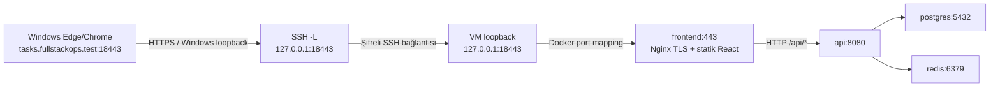

# Yerel HTTPS — hazırlık ve sonraki uygulama rehberi

15 Ekim 2026: statik yapılandırma b19f620 commit'iyle yayımlandı; ardından
Windows lab CA, sunucu sertifikası ve hosts hazırlığı b0d2fea ile kaydedildi.
**VM dosya aktarımı, izinler, gerçek Compose modeli ve geçici nginx -t doğrulandı**.
Windows sonuçları bölüm12, VM hazırlığı bölüm13'tedir; agent private dosyaları
okumadı veya işlemleri kullanıcı yerine çalıştırmadı. Çalışan frontend'e TLS
uygulanmadı; yeni HTTPS tüneli ve gerçek HTTPS/browser kabulü henüz yapılmadı.
Mevcut altı VM container'ı aynı kimliklerle healthy ve eski portlarla çalışır bırakıldı.
Komut grupları sırayla sonuç incelenerek uygulanacak; bir grup başarısızsa sonraki
gruba geçilmez. Bütün belge tek seferde terminale yapıştırılmaz.

## 1. Karar ve istek yolu

[İlk plandaki](../../docs/deployment-plan.md) host Nginx önerisi, kullanıcının
image build olmadan read-only deployment config isteğiyle değiştirildi: TLS mevcut
frontend container'ındaki Nginx'te sonlanır. Altı servis, aynı GHCR digest çifti,
PostgreSQL volume'u ve monitoring adresleri korunur; host Nginx kurulmaz.



TLS browser ile frontend Nginx arasındadır; SSH yalnız TCP taşır. API bağlantısı
mevcut internal Docker ağında HTTP kalır. Bu uçtan uca tüm servislerin TLS kullandığı
veya internet deployment'ı iddiası değildir. Uygulamaya kullanıcı yetkilendirmesi eklenmez.

| Erişim | Windows loopback | VM loopback → container |
| --- | --- | --- |
| Yeni HTTPS | 18443 | 18443 → frontend443 |
| Mevcut HTTP teşhisi | 28081 | 18081 → frontend80 |
| Prometheus | 29090 | 19090 → prometheus9090 |
| Grafana | 23000 | 13000 → grafana3000 |
| API / PostgreSQL / Redis | Yok | Host publish yok |

VM18443 için başlangıç ve bitiş ss kontrollerinde listener yoktu. Windows18443
boşluğu bu adımda kontrol edilmedi; etkinleştirmeden önce yeniden bakılmalı.
Eski tüneller değiştirilmedi; yeni HTTPS tüneli henüz açılmadı.

## 2. Dosyalar ve davranış

- [compose.https.yaml](compose.https.yaml): üçüncü, isteğe bağlı overlay.
- [nginx/https.conf](nginx/https.conf): yalnız deployment frontend config'i.
- [https.env.example](https.env.example): tek non-secret path placeholder'ı.
- [release.json](release.json): image kaynağı/digestleri; bu görevde değişmedi.
- [Statik test](../../tests/Deployment.Configuration.Test.py): gerçek Compose
  parser/model guard'ları; Docker Engine gerektirmez.

Komut sırası daima `compose.yaml`, `compose.deploy.yaml`, `compose.https.yaml`.
Bind source yolları **ilk dosyanın/repository kökünün** konumuna göre çözülür.
HTTPS overlay'i tek başına kullanılmaz. [Compose merge açıklaması](https://docs.docker.com/compose/how-tos/multiple-compose-files/merge/).

Nginx config, server certificate ve server private key için üç ayrı bind mount
read-only'dir; `create_host_path: false` yanlış/eksik source için sessizce dizin
oluşturmayı engeller. Sertifika yokken `config -q` yine başarılı olabilir: dosyanın
varlığını, PEM içeriğini, SAN'ını veya certificate/key eşleşmesini kanıtlamaz.
[Bind mount uzun biçimi](https://docs.docker.com/reference/compose-file/services/#long-syntax-5).

Nginx80 ve443 dinler; mevcut HTTP80 root healthcheck'i ve statik/API routing korunur.
HTTP otomatik HTTPS'e yönlendirilmez: loopback teşhis erişimi bilerek açık kalır.
HTTPS erişimini kullanmak ile bütün HTTP'yi zorunlu TLS'e geçirmek ayrı kararlardır.
Healthcheck'in çalışması da TLS güven/SAN doğrulaması yerine geçmez.

HTTPS'te `Host $http_host` dış18443 portunu korur; `X-Forwarded-Proto $scheme`
TLS isteğinde https olur. Backend'e yeni forwarded-header middleware eklenmez;
header varlığı API'nin client IP/scheme bilgisine güvendiğini kanıtlamaz.
`absolute_redirect off` Nginx'in kendi redirect'lerini göreli yapar; browser dış
origin/18443'ü korur. API'nin relative POST Location sözleşmesi değişmez.
[Nginx redirect açıklaması](https://nginx.org/en/docs/http/ngx_http_core_module.html#absolute_redirect).

Image'ın EXPOSE80 metadata'sı443 dinlenmesini/publish edilmesini engellemez;
gerçek listener ve Docker mapping ayrıca doğrulanacak. Dockerfile değişmez.

## 3. Sertifika adı, yerleşim ve güven

Tek SAN: **DNS:tasks.fullstackops.test**. DHCP VM IP'si ve localhost SAN değildir;
browser URL'si `https://tasks.fullstackops.test:18443/` olmalıdır. `.test` için public
DNS/domain satın alınmaz; Windows hosts eşlemesi127.0.0.1 olarak doğrulandı.

Önerilen araç Windows'ta [resmî mkcert](https://github.com/FiloSottile/mkcert).
Yerel CA Windows'ta oluşturulur; CA private key **VM'ye veya container'a gönderilmez**.
Nginx'e yalnız leaf `server.crt` ve `server.key` gider. Windows tarayıcısı yerel CA'nın
public sertifikasına güvenmesi için mkcert `-install` uygulandı;
`TRUST_STORES=system` diğer store'lara otomatik işlem yapılmasını sınırlar.
v1.4.4 Windows implementasyonu `CertOpenSystemStoreW("ROOT")` kullanır:
hedef **Geçerli Kullanıcı → Güvenilen Kök Sertifika Yetkilileri**, PowerShell'de
`Cert:\CurrentUser\Root` deposudur; LocalMachine değildir. Kullanıcının public CA
thumbprint'i bu depoda bulundu. Kaynaklar: [mkcert v1.4.4 Windows kodu](https://github.com/FiloSottile/mkcert/blob/v1.4.4/truststore_windows.go),
[Microsoft depo kapsamı](https://learn.microsoft.com/en-us/windows/win32/api/wincrypt/nf-wincrypt-certopensystemstorew#remarks).
Bu depo kontrolü, henüz açılmamış HTTPS adresinin tarayıcı kabulü değildir.

| Dosya | Gelecekte önerilen yer | Git durumu |
| --- | --- | --- |
| CA public/private dosyaları | Windows LOCALAPPDATA/FullStackOpsLab/deployment-tls/ca | Repository dışında; CA private key paylaşılmaz |
| Leaf certificate/private key | Windows aynı lab dizininde ayrı server alt klasörü | Repository dışında, yalnız bu çift VM'ye aktarılır |
| VM leaf dosyaları | /home/labadmin/.local/share/fullstackops-deploy-lab/tls | Repository dışında; server.key izin600 |
| VM path ayarı | VM repository kökünde .env.https | Git ignored; yalnız path, credential içermez |

`.gitignore`, `.env.https` yanında key/pem/crt/cer/pfx/p12/csr/der/srl ve tls-private
dizinlerini dışlar. Bu savunma, ignored bir private key'in güvenli saklandığı veya
zorla eklenemeyeceği anlamına gelmez. Yeni örnek env takip edilebilir; gerçek .env.deployment
ve user-secrets değiştirilmez. Sertifika yenileme ayrı bir işlemdir; güven/hosts
kaldırma yönergeleri bölüm10'dadır ve bu hazırlıkta uygulanmaz.

## 4. Ön kontrol — sonraki uygulama, salt okunur

**Ubuntu SSH:** önce IP/hostname, project durumları ve18443 portunu tekrar kontrol et.

```bash
hostname
ip -4 -brief address show eth0
sudo docker ps -a --filter label=com.docker.compose.project=fullstackops-deploy-lab --format 'table {{.Names}}\t{{.Status}}\t{{.Ports}}'
sudo ss -ltnp '( sport = :18443 )'
```

**Windows PowerShell:** Ubuntu prompt'unda çalıştırma. Boş portta listener çıkmamalı.

```powershell
Get-NetTCPConnection -State Listen -LocalPort 18443 -ErrorAction SilentlyContinue
$mkcertExe = Join-Path $env:LOCALAPPDATA 'FullStackOpsLab\tools\mkcert\mkcert.exe'
Get-Item -LiteralPath $mkcertExe -ErrorAction Stop | Select-Object FullName
& $mkcertExe -version
if ($LASTEXITCODE -ne 0) { throw 'mkcert kullanilamiyor' }
```

mkcert yoksa burada durulur; resmî Windows release'inin ayrı indirme/kurulum ve
bütünlük incelemesi gerekir. Kullanıcının 15 Ekim'de indirdiği portable v1.4.4 ve
doğruladığı hash bölüm12'de kayıtlıdır. PATH değişikliği gerekmedi; komutlar tam
araç yolunu kullanır. Ücretli hizmet gerekmez.

## 5. Dosya aktarımı — ilk aktarım referansı

Bu aktarım bölüm13'teki hash sonuçlarıyla tamamlandı; komutlar otomatik tekrar
çalıştırılmaz. Mevcut VM kaynak ağacı topluca güncellenmedi.

Yeni repository dosyaları henüz commit edilmediyse clone tek başına getirmez.
Seçilmiş kaynak1b52633776279b1661a7cac53392d385cbf10444 ağacı ve mevcut release çifti
korunur; yalnız üç yeni public HTTPS config dosyası aktarılır. Root compose.yaml,
compose.deploy.yaml, image digestleri ve development dosyaları değiştirilmez.

**Ubuntu SSH**, mevcut VM repository kökü:

```bash
(
  set -eu
  cd ~/fullstack-ops-lab
  test -f compose.yaml
  test -f infrastructure/deployment/compose.deploy.yaml
  test ! -e infrastructure/deployment/compose.https.yaml
  test ! -e infrastructure/deployment/https.env.example
  test ! -e infrastructure/deployment/nginx/https.conf
  install -d -m 755 infrastructure/deployment/nginx
)
```

Kontrollerden biri başarısızsa aktarım durdurulup mevcut dosya incelenir; üzerine
yazılmaz. **Windows PowerShell**, ana repository kökü (IP önce yeniden doğrulanır):

```powershell
& {
$vmAddress = '172.30.249.139'
scp infrastructure/deployment/compose.https.yaml infrastructure/deployment/https.env.example "labadmin@${vmAddress}:~/fullstack-ops-lab/infrastructure/deployment/"
if ($LASTEXITCODE -ne 0) { throw 'HTTPS config aktarimi basarisiz' }
scp infrastructure/deployment/nginx/https.conf "labadmin@${vmAddress}:~/fullstack-ops-lab/infrastructure/deployment/nginx/"
if ($LASTEXITCODE -ne 0) { throw 'Nginx config aktarimi basarisiz' }
Get-FileHash infrastructure/deployment/compose.https.yaml, infrastructure/deployment/nginx/https.conf -Algorithm SHA256
}
```

**Ubuntu SSH:** `sha256sum` ile aynı public dosya hash'leri eşleştirilir.

```bash
sha256sum infrastructure/deployment/compose.https.yaml infrastructure/deployment/nginx/https.conf
```

## 6. Yerel CA ve leaf hazırlığı — ilk kurulum örneği

Bu grup **sertifika ve güven deposu değiştirir; şimdi tekrar çalıştırılmayacak**.
Kullanıcı CA/leaf hazırlığını ayrı küçük komut gruplarıyla tamamladı (bölüm12).
Ayrı yeni PowerShell oturumu kullanılır; aşağıdaki env ayarları yalnız bu oturum
içindir, setx kullanılmaz. Repo dışı bu lab dizini zaten varsa önce içeriği/sahipliği
incelenir; komut mevcut dosyaları sıfırlamak için tekrar çalıştırılmaz.

```powershell
& {
$tlsLab = Join-Path $env:LOCALAPPDATA 'FullStackOpsLab\deployment-tls'
if (Test-Path -LiteralPath $tlsLab) { throw 'TLS lab dizini mevcut; once incele' }
$mkcertExe = Join-Path $env:LOCALAPPDATA 'FullStackOpsLab\tools\mkcert\mkcert.exe'
if (!(Test-Path -LiteralPath $mkcertExe -PathType Leaf)) { throw 'mkcert bulunamadi' }
$env:CAROOT = Join-Path $tlsLab 'ca'
$env:TRUST_STORES = 'system'
$leafDir = Join-Path $tlsLab 'server'
New-Item -ItemType Directory -Path $env:CAROOT, $leafDir -ErrorAction Stop | Out-Null
& $mkcertExe -install
if ($LASTEXITCODE -ne 0) { throw 'Yerel CA guven kurulumu basarisiz' }
& $mkcertExe -cert-file (Join-Path $leafDir 'server.crt') -key-file (Join-Path $leafDir 'server.key') tasks.fullstackops.test
if ($LASTEXITCODE -ne 0) { throw 'Leaf sertifika uretimi basarisiz' }
Get-FileHash (Join-Path $env:CAROOT 'rootCA.pem'), (Join-Path $leafDir 'server.crt') -Algorithm SHA256
}
```

Yalnız public certificate fingerprint'i paylaşılabilir; private key, PFX veya CA
key içeriği paylaşılmaz. Tarayıcı yeniden açılabilir. Bu güven sadece yerel lab
içindir; production CA çözümü değildir. CA private key veya CAROOT klasörünü SCP ile
gönderme. Windows/VM SSH host fingerprint kontrolü TLS sertifika güveninden farklıdır.

## 7. VM leaf yerleşimi ve ayrı path env — ilk hazırlık referansı

Bu hazırlık bölüm13'teki sonuçlarla tamamlandı; mevcut dosyaların üzerine yazmak
veya .env.https dosyasını yeniden oluşturmak için tekrar çalıştırma.

**Ubuntu SSH**, aynı oturumda repository kökünde:

```bash
tls_directory="$HOME/.local/share/fullstackops-deploy-lab/tls"
(
  set -eu
  test ! -e "$tls_directory/server.crt"
  test ! -e "$tls_directory/server.key"
  install -d -m 700 "$tls_directory"
)
```

Hedef zaten varsa aktarımı durdur; otomatik overwrite/rotation yapma. **Windows
PowerShell**, güncel VM IP'siyle yalnız leaf çiftini aktar:

```powershell
& {
$vmAddress = '172.30.249.139'
$leafDir = Join-Path $env:LOCALAPPDATA 'FullStackOpsLab\deployment-tls\server'
scp (Join-Path $leafDir 'server.crt') (Join-Path $leafDir 'server.key') "labadmin@${vmAddress}:~/.local/share/fullstackops-deploy-lab/tls/"
if ($LASTEXITCODE -ne 0) { throw 'Leaf aktarimi basarisiz' }
}
```

**Ubuntu SSH:** dosya izinlerini ayarla; env dosyası mevcutsa noclobber işlemi durdurur.

```bash
(
  set -eu
  cd ~/fullstack-ops-lab
  chmod 600 "$tls_directory/server.key"
  chmod 644 "$tls_directory/server.crt"
  sha256sum "$tls_directory/server.crt"
  umask 077
  set -C
  printf 'DEPLOYMENT_TLS_DIR=%s\n' "$tls_directory" > .env.https
)
```

Public leaf hash'i Windows ile eşleşmeli. Örnek `https.env.example` aynı key'in
placeholder'ını gösterir; gerçek path VM'de belirlenir. Bu key credential değildir.
.env.deployment'a ekleme veya secret kopyalama yapılmaz. VM izinleri ve aynı
image'ın gerçek TLS dosyalarını okuyabilmesi nginx -t ile doğrulandı (bölüm13).

## 8. Sessiz config ve nginx -t — doğrulama komutları

Kullanıcı bu adımı aynı env/-f sırası ve seçilmiş image ile tamamladı (bölüm13).
Gerçek çalışmada Python stdout/stderr'i bellekte yakaladı, 90 saniye timeout,
benzersiz container adı ve cleanup kontrolü ekledi. Aşağıdaki kısa komutlar
mekanizmayı gösterir; başarılı deneyi yeniden çalıştırma zorunluluğu yoktur.

**Ubuntu SSH**, repository kökünde bir yardımcı shell fonksiyonu tanımla:

```bash
deploy_https() {
  (
    set -eu
    cd ~/fullstack-ops-lab
    sudo docker compose --project-name fullstackops-deploy-lab \
      --env-file .env.deployment --env-file .env.https \
      -f compose.yaml -f infrastructure/deployment/compose.deploy.yaml \
      -f infrastructure/deployment/compose.https.yaml "$@"
  )
}
deploy_https config -q
```

İkinci env yalnız TLS path içermeli; process environment dosyaları ezebilir.
Çözümlenmiş config/env çıktısını paylaşma. [Çoklu env dosyası davranışı](https://docs.docker.com/compose/how-tos/environment-variables/variable-interpolation/).

Sertifika/key dosyaları hazır olduktan sonra, stack'i değiştirmeden kendi geçici
frontend test container'ında syntax ve key eşleşmesini kontrol et:

```bash
deploy_https run --rm --no-deps --pull never --entrypoint nginx frontend -t
```

Bu komut geçici container oluşturur; bölüm13'teki gerçek çalışmada test container'ı
kaldırıldı. Image build/pull yapmaz; build alanı modelden kaldırılmış ve seçilmiş image önceden local'dir.
`run` için service-ports kullanılmaz; mevcut frontend portlarına bind olmaz.
nginx -t başarısızsa burada durulur. Bu test certificate trust/hostname süresinin
browser kabulü yerine geçmez. [Nginx HTTPS yapılandırması](https://nginx.org/en/docs/http/configuring_https_servers.html).

## 9. Etkinleştirme ve tünel — ancak sonraki onaylı adımda

**Ubuntu SSH:** yalnız frontend yeni mount/port için yeniden oluşturulur. Diğer
beş servise dokunulmaz; kısa frontend kesintisi beklenir.

```bash
deploy_https up -d --no-deps --no-build --pull never --wait --wait-timeout 90 frontend
```

`deploy_https ps` ve güvenli inspect alanlarıyla yeni mount'lar/loopback portu/image
kimliği/health yeniden kontrol edilir. Doğru deployment env ve üç -f dosyası bundan
sonraki frontend yönetiminde birlikte kullanılır; iki dosyalı up TLS mount'larını
kaldırabilir. TLS private key loglanmaz, nginx -T/full inspect çıktısı paylaşılmaz.

**Windows hosts:** aşağıdaki eşleme 15 Ekim'de kullanıcı tarafından eklendi ve
doğrulandı; tekrar ekleme. İlk kurulumda yönetici olarak yalnız bu satır eklenir;
var olan satırlar silinmez ve VM DHCP IP'si bu satıra yazılmaz:

```text
127.0.0.1 tasks.fullstackops.test
```

Eşleme önceden varsa tekrar ekleme; bu laboratuvarda satır ekleyip eklemediğini
not et. Daha sonraki kaldırma işlemi yalnız kendi eklediğin eşlemeyi hedeflemeli.

Yol `%SystemRoot%\System32\drivers\etc\hosts`. **Ayrı Windows PowerShell** tüneli,
güncel VM IP'siyle; mevcut HTTP/monitoring tünelleri açık kalır:

```powershell
ssh -N -T -o ConnectTimeout=10 -o ExitOnForwardFailure=yes -o ServerAliveInterval=30 -o ServerAliveCountMax=3 -L 127.0.0.1:18443:127.0.0.1:18443 labadmin@172.30.249.139
```

Browser: `https://tasks.fullstackops.test:18443/`. Uyarıyı geçmek veya curl -k
kullanmak kabul değildir. **Diğer Windows PowerShell** penceresinde ilk GET:

```powershell
curl.exe --noproxy "*" --resolve "tasks.fullstackops.test:18443:127.0.0.1" --max-time 10 -sS -o NUL -w "HTTPS HTTP=%{http_code}\n" https://tasks.fullstackops.test:18443/
if ($LASTEXITCODE -ne 0) { throw 'HTTPS dogrulamasi basarisiz' }
```

--resolve yalnız DNS yönlendirmesidir; doğru SNI/hostname ve varsayılan TLS
doğrulaması korunur. Browser ayrıca Windows hosts çözümlemesini doğrular. curl TLS
backend'i Windows güven deposunu kullanmıyorsa public CA dosyasıyla açık --cacert
doğrulaması ayrı raporlanır; bu Windows browser trust kabulü sayılmaz.

## 10. Windows değişikliklerini kaldırma — gelecekte, gerektiğinde

Bu bölüm **şimdi çalıştırılmayacak**; Windows CA güveni ve hosts eşlemesi
hazırlandı, kaldırma deneyi yapılmadı. İleride lab erişimini kapatmak istersen:

1. Yalnız yeni HTTPS tünelinin çalıştığı PowerShell penceresinde Ctrl+C kullan.
   Mevcut HTTP/Prometheus/Grafana tünellerini ve VM stack'ini değiştirme.
2. Yönetici olarak `%SystemRoot%\System32\drivers\etc\hosts` dosyasını aç.
   Yalnız bu lab için eklediğin `127.0.0.1 tasks.fullstackops.test` eşlemesini
   kaldır. Önceden var olan kayıtları veya aynı satırdaki başka adları silme.
   Tarayıcıyı kapatıp yeniden aç; gerekirse Windows PowerShell'de
   `ipconfig /flushdns` ile resolver önbelleğini yenile.
3. CA güvenini kaldırmak için kurulumdaki **aynı Windows kullanıcı hesabını**,
   aynı CAROOT dizinini ve `TRUST_STORES=system` seçimini kullan. Önce public
   `rootCA.pem` dosyasının SHA256 hash'ini bölüm6'da kaydettiğin değerle eşleştir.
   Dosya yoksa veya hash eşleşmiyorsa dur; varsayılan/başka CA ile deneme yapma.

**Windows PowerShell**, yalnız kaldırma kararı verildiğinde; bu blok sertifika
deposunu değiştirir. İstenecek hash public certificate dosyasının hash'idir,
private key veya credential değildir:

```powershell
& {
$env:CAROOT = Join-Path $env:LOCALAPPDATA 'FullStackOpsLab\deployment-tls\ca'
$env:TRUST_STORES = 'system'
$mkcertExe = Join-Path $env:LOCALAPPDATA 'FullStackOpsLab\tools\mkcert\mkcert.exe'
if (!(Test-Path -LiteralPath $mkcertExe -PathType Leaf)) { throw 'mkcert bulunamadi' }
$publicCA = Join-Path $env:CAROOT 'rootCA.pem'
if (!(Test-Path -LiteralPath $publicCA -PathType Leaf) -or
    !(Test-Path -LiteralPath (Join-Path $env:CAROOT 'rootCA-key.pem') -PathType Leaf)) {
    throw 'Ayni lab CA dosyalari yok; kaldirma durdu'
}
$expectedHash = (Read-Host 'Kurulumda kaydedilen public rootCA.pem SHA256').Trim()
if ($expectedHash -notmatch '^[0-9a-fA-F]{64}$' -or
    (Get-FileHash -LiteralPath $publicCA -Algorithm SHA256 -ErrorAction Stop).Hash -ne $expectedHash) {
    throw 'Public CA hash eslesmedi; kaldirma durdu'
}
& $mkcertExe -uninstall
if ($LASTEXITCODE -ne 0) { throw 'Lab CA guven kaldirma basarisiz; durumu incele' }
}
```

mkcert `-uninstall` CA dosyalarını silmez. Windows implementasyonu yüklenen CA'nın
seri numarasıyla eşleşen güven kayıtlarını kaldırır; genel ada göre tüm mkcert
sertifikalarını silen bir komut kullanılmaz. Kaynak:
[mkcert uninstall davranışı](https://github.com/FiloSottile/mkcert/blob/master/truststore_windows.go).
Kaldırmadan önce CA dizinini silme veya farklı bir CA üretme. Ardından Windows
sertifika yöneticisinde kaydettiğin public CA'nın parmak izi/seri numarasıyla
eşleşen güven kaydının kaldırıldığını kontrol et; başka sertifikaları silme.
Bu işlemler VM leaf dosyalarını, mount'ları veya frontend'i otomatik değiştirmez;
HTTPS listener açık kalsa bile artık tarayıcı güveni kabulü beklenmez.
VM TLS kaldırma/yenileme ve private dosyaların güvenli temizliği ayrı rehberli
işlemlerdir; burada volume veya sertifika dizini silme komutu verilmez.
Windows hazırlığı bölüm12'deki sonuçlarla **PASS**; gerçek kaldırma ve tarayıcı
HTTPS kabulü hâlâ **NOT VERIFIED**.

## 11. Statik sonuç ve açık kabul maddeleri

Gerçek Compose parser ile testler: **5/5 PASS**. Önce HTTPS overlay eksikliği ve
ignore eksikleri nedeniyle beklenen RED, dosyalardan sonra GREEN görüldü.
Windows Git stdin newline farkı test taşımasında NUL ayırıcıyla giderildi.

| Madde | Durum |
| --- | --- |
| Gerçek iki env dosyasıyla sessiz config/model parse | PASS; yalnız sahte fixture değerleri |
| Aynı altı servis/network/volume ve seçilmiş image çiftleri; build yok | PASS |
| HTTPS yalnız127.0.0.1:18443; HTTP18081/monitoring aynı; diğer beş servis modeli aynı | PASS |
| Üç read-only bind ve create_host_path false; CA dizini mount edilmez | PASS |
| TLS path eksik/boş ise güvenli anahtar adıyla hata | PASS |
| Sertifika/key/env ignored, örnek takip edilebilir; eski deployment/development testleri | PASS |
| Rehberdeki7 PowerShell ve8 Bash bloğunun yalnız sözdizimi | PASS; statik aşamada yürütülmedi; Windows hazırlık sonuçları bölüm12'de |
| Statik aşamadaki secret leakage,62 yerel belge bağlantısı/anchor ve diff whitespace kontrolü | PASS; b19f620 hazırlık kanıtı |
| Windows hosts/güven yönergeleri | Uygulama PASS, kaldırma NOT VERIFIED; bölüm12 |
| Windows certificate SAN/süre, CA zinciri ve leaf private key eşleşmesi | PASS; kullanıcı OpenSSL çıktıları, bölüm12 |
| VM aktarımı, izinler, gerçek model ve Nginx SSL syntax/certificate-key okuması | PASS; kullanıcı nginx -t exit0 ve iki başarı mesajını doğruladı, bölüm13 |
| VM18443 listener yokluğu | PASS; başlangıç/bitiş ss; Windows port boşluğu bu adımda NOT VERIFIED |
| Gerçek HTTPS HTML/JS/CSS ve API Location/same-origin davranışı | NOT VERIFIED |
| HTTPS sonrası health, image kimliği ve monitoring erişiminin korunması | NOT VERIFIED |
| Yenileme/reload, public CA/domain/internet kabulü | NOT VERIFIED |

YAML/static test, Windows sertifika hazırlığı ve nginx -t başarılı HTTPS bağlantısı
anlamına gelmez. Sonraki küçük adım ayrı rehberli frontend TLS etkinleştirmesi ve
yeni tünel/HTTPS kabulüdür; mevcut frontend bu görevde yeniden oluşturulmadı.

Gerçekte çalıştırılan yerel komut `py -3 tests/Deployment.Configuration.Test.py`;
test kendi sahte env dosyalarıyla `docker compose ... config -q` ve JSON model
kontrolü yapar. Ayrıca secret scanner, git diff --check ve yalnız parser kontrolleri
çalıştırıldı. Git Bash -n ilk sandbox çağrısında signal pipe erişim engeli verdi;
aynı syntax-only kontrol izinli yerel süreçte geçti. Bu bir VM komut hatası değildir.
Statik aşamadaki temporary fixture dosyaları test sonunda kaldırıldı; o aşamada
certificate/key üretilmedi. Bu statik hazırlık daha sonra b19f620 ile commit/push
edildi. Windows hazırlığı aşağıda ayrı kaydedilir; VM/tünel/Docker kaynaklarına
bu hazırlık sırasında hiçbir işlem gönderilmedi.

## 12. Windows CA, leaf ve hosts kabulü — 15 Ekim 2026

Bu bölüm b0d2fea ile kaydedilen Windows hazırlığının tarihsel kapanışıdır;
ondan sonraki VM aktarımı/nginx -t sonucu bölüm13'tedir.

Kanıt kullanıcı tarafından Windows PowerShell'de çalıştırılan grupların paylaşılan
çıktılarıdır; agent private key, gerçek env veya user-secrets içeriğini okumadı.
Başlangıçta mkcert PATH'te bulunmadı, ayrılmış lab dizini/CA/leaf dosyaları ve
CAROOT process ayarı yoktu. Yeni CA yalnız bu ayrılmış lab için oluşturuldu.

| Kontrol | Gerçek sonuç |
| --- | --- |
| Portable mkcert | Resmî GitHub v1.4.4 Windows amd64 dosyası; SHA256 eşleşmesi ve sürüm PASS |
| Araç yeri | `%LOCALAPPDATA%\FullStackOpsLab\tools\mkcert\mkcert.exe`; PATH değiştirilmedi |
| CA yeri | `%LOCALAPPDATA%\FullStackOpsLab\deployment-tls\ca`; repository dışında |
| Windows güveni | `TRUST_STORES=system`, `mkcert -install`; beklenen thumbprint `Cert:\CurrentUser\Root` içinde PASS |
| Leaf yeri | `%LOCALAPPDATA%\FullStackOpsLab\deployment-tls\server\server.crt` ve `server.key`; repository dışında |
| OpenSSL | Git for Windows içindeki OpenSSL3.5.6; çıktı `7 Apr 2026` |
| SAN | Tek DNS adı `tasks.fullstackops.test` PASS |
| Geçerlilik | `notBefore=Oct 15 10:59:05 2026 GMT`, `notAfter=Jan 15 10:59:05 2029 GMT` |
| Zincir/amaç/hostname/zaman | Explicit lab CA ile `openssl verify -purpose sslserver -verify_hostname ...` exit0, PASS |
| Leaf key eşleşmesi | x509 `-pubkey` ile pkey `-pubout` çıktıları bellekte case-sensitive eşit; yalnız PASS yazdırıldı |
| Hosts başlangıcı | İlgili ad için aktif kayıt YOK; kullanıcı gerekli tek satırı ekledi |
| Hosts son kontrol | Tam bir adet `127.0.0.1 tasks.fullstackops.test` kaydı ve Windows DNS çözümlemesi127.0.0.1 PASS |

mkcert binary SHA256:
`D2660B50A9ED59EADA480750561C96ABC2ED4C9A38C6A24D93E30E0977631398`.
Kaynak [resmî v1.4.4 yayını](https://github.com/FiloSottile/mkcert/releases/tag/v1.4.4);
karşılaştırma değeri [Microsoft WinGet manifestinden](https://github.com/microsoft/winget-pkgs/blob/master/manifests/f/FiloSottile/mkcert/1.4.4/FiloSottile.mkcert.installer.yaml)
alındı; ayrı bir yayıncı imzalı checksum doğrulaması iddia edilmez.

Aşağıdaki kimlikler **public sertifika metadata'sıdır**, private key değildir:

- CA thumbprint: `BCEB2EF69B3D6D487495B49F9EDF10F66BD96E49`.
- Public rootCA.pem dosyası SHA256: `A154DBB8BC935F93A50D4FB39212682F9F8C372E30DB5CBD9D3C3B3F72ACDF6E`.
- Public server.crt dosyası SHA256: `356FA31482DCC3BD07BAFBC45A159CD052E392156A2DCA299416209878D8770D`.

Sonraki aktarımda public leaf hash'i eşleştirilir; CA private key Windows'ta kalır.
Güveni kaldırma gerektiğinde bölüm10'daki aynı CA kimliği/dizini kontrolü kullanılır;
hosts için yalnız bu görevde eklenen satır kaldırılır. Şimdi kaldırma yapılmadı.
OpenSSL explicit CA doğrulaması ile Windows depo kaydının varlığı ayrı kontrollerdir;
hiçbiri henüz kurulmamış VM HTTPS listener'ı veya browser TLS kabulü yerine geçmez.
Kullanılan OpenSSL davranışı: [x509](https://docs.openssl.org/3.5/man1/openssl-x509/),
[pkey](https://docs.openssl.org/3.5/man1/openssl-pkey/),
[verify](https://docs.openssl.org/3.5/man1/openssl-verify/).

VM'ye config/leaf aktarımı, `.env.https` hazırlığı, nginx -t, yeni18443 SSH tüneli,
frontend TLS recreate ve HTTPS HTML/asset/API/CRUD/browser kabulü **NOT VERIFIED**.
Bu görevde build, migration, kesinti veya veri işlemi yapılmadı. Seçilmiş
source1b52633776279b1661a7cac53392d385cbf10444/GHCR digest çifti ve release.json
değişmedi; VM stack'i ve mevcut tüneller değişmedi. Commit/push yapılmadı.

Bu Windows hazırlığı kaydının repository kontrolleri: secret leakage exit0,
64 yerel belge bağlantısı/anchor PASS, rehberdeki7 PowerShell bloğu syntax-only
PASS ve git diff --check exit0. Yalnız bu rehber, deployment README/planı ve
PROJECT_STATUS güncellendi; index boş. Windows/VM işlemleri agent tarafından
tekrarlanmadı; private dosyalar Git'e eklenmedi.

## 13. VM TLS aktarımı ve geçici nginx -t kabulü — 15 Ekim 2026

Kullanıcı Windows PowerShell ve Ubuntu SSH gruplarını çalıştırıp sonuçları
paylaştı. Agent VM'ye bağlanmadı, private key veya gerçek env içeriği okumadı.
Başlangıç Git temizdi (HEAD b0d2fea). VM hostname fullstackopslabvm,
IP172.30.249.139/20 ve Windows'tan SSH hostname kontrolü PASS. Altı servis
başlangıçta healthy idi; VM18443 ss çıktısı yalnız başlık içeriyordu.
Public HTTPS config/overlay/örnek, .env.https ve VM leaf dosyalarının hedefte
başlangıçta bulunmadığı kontrol edildi; mevcut dosyalar ezilmedi.

Yalnız üç public config SCP ile mevcut VM kaynak ağacına eklendi; root Compose,
deployment overlay, release.json ve diğer kaynaklar topluca değiştirilmedi.
Windows dosya byte hash'leri VM'de sha256sum --check ile üç kez OK verdi:

| Aktarılan public dosya | SHA256 |
| --- | --- |
| compose.https.yaml | `533F3B78C5D8E86876DAC7DEB61EFDCC11A3D4C10F9B96870211E313848E1F9D` |
| https.env.example | `E2C469AF9062509E4EA491F5C6E14852EEBFB5C6643C46971FAE94D07F2244B1` |
| nginx/https.conf | `1CDEE6ACA92F5FB641972980173F3C67548124E3245928AA826D8588EF5E4628` |

Bu değerler Windows→VM aktarım bütünlüğüdür; Git blob hash'i değildir, checkout
satır sonu dönüşümleriyle karıştırılmaz. Ardından yalnız server.crt/server.key
tekil yollarıyla aktarıldı; CA private key ve development secret'ları aktarılmadı.
Public leaf SHA256 bölüm12'deki356FA314... değeriyle VM'de OK verdi.

| Kontrol | Gerçek sonuç |
| --- | --- |
| VM lab üst klasörü ve tls klasörü | /home/labadmin/.local/share/fullstackops-deploy-lab ve altındaki tls:700, sahibi labadmin |
| Sunucu dosyaları | server.key600, server.crt644; sahibi labadmin, repository dışında |
| Ayrı path dosyası | VM checkout kökünde .env.https600/labadmin; yalnız DEPLOYMENT_TLS_DIR, noclobber ile oluşturuldu; mevcut .env.deployment ezilmedi |
| Sessiz Compose config | Gerçek deployment/TLS env dosyalarıyla config -q exit0; stdout/stderr değerleri paylaşılmadı |
| Birleşmiş model | Altı servis/fullstackops-deploy-lab project/mevcut app ağı PASS |
| Image seçimi | Source1b52633776279b1661a7cac53392d385cbf10444 ve release.json API/frontend digest eşleşmesi; build alanları yok PASS |
| Host portları | API/PostgreSQL/Redis yok; frontend127.0.0.1:18081 ve18443, Prometheus127.0.0.1:19090, Grafana127.0.0.1:13000 yalnız modelde PASS |
| Mount'lar | Tam üç farklı hedef; doğru config/iki leaf dosyası, bind/read-only/create_host_path false PASS; CA mount yok |
| Volume ayarları | Ayrı deployment PostgreSQL/Prometheus/Grafana adları, PostgreSQL external PASS; volume işlemi yok |
| Mevcut frontend probe'u | Modelde HTTP80 wget healthcheck korunuyor PASS |
| Image kimliği | Seçilmiş frontend digestinin local image ID'si mevcut frontend container Image kimliğiyle eşleşiyor PASS |
| Geçici test | Aynı Compose modeliyle run --rm --no-deps --pull never -T --entrypoint nginx frontend -t; benzersiz tls-check adı, 90s timeout |
| nginx -t sonucu | Exit0 ve yakalanan çıktıda hem syntax is ok hem test is successful; yalnız güvenli PASS/status yazdırıldı |
| Cleanup | --rm ve gerekirse yalnız benzersiz test adına rm -f; son name sorgusunda container yok PASS |
| Çalışan stack | Başlangıç/bitiş altı container kimlikleri eşit PASS; final tabloda hepsi running/healthy |
| Etkin HTTPS portu | Final ss18443 listener yok; çalışan frontend yalnız127.0.0.1:18081→80; TLS henüz etkin değil |

Başlangıç ve bitişte korunan container ID'leri:

| Servis | Kısa container ID |
| --- | --- |
| frontend | 469774f333b6 |
| api | 4d572817ca12 |
| prometheus | 84eaf1ceebb5 |
| redis | d98d34cc73c5 |
| grafana | ed9398e62129 |
| postgres | e9296c518548 |

Finalde monitoring yayınları19090→9090 ve13000→3000 loopback olarak kaldı;
API8080/Redis6379/PostgreSQL5432 yalnız container portlarıdır. TLS klasörü700,
crt644, key600 ve .env.https600 final stat çıktısıyla tekrar doğrulandı.
Test host portu yayınlamadı; frontend recreate, build/pull, migration, CRUD,
cache temizleme veya kesinti yapılmadı. Mevcut kaynak ağacı/volume/network
silme veya prune işlemi yoktur;
tüm Docker network/volume ID envanterinin ayrıca tekrar ölçüldüğü iddia edilmez.
Seçilmiş GHCR çifti ve release.json korundu; stack mevcut haliyle çalışır bırakıldı.

Sınır: nginx -t, SSL yönergelerini ve gerçek mount'lardaki cert/key dosyalarının
okunmasını test eder; çalışan bir HTTPS listener, tarayıcı güveni, HTTP/API/CRUD
veya monitoring regresyon kabulü değildir. Yeni18443 tüneli açılmadı, frontend
etkinleştirilmedi; bu kontroller **NOT VERIFIED**. Sonraki küçük adım yalnız ayrı
rehberli frontend TLS etkinleştirmesi ve HTTPS erişim kabulüdür; otomatik başlanmaz.
Bu görevde yalnız dört repository belgesi güncellenir; commit/push yapılmadı.

Repository belge kontrolleri: secret leakage exit0,66 yerel dosya/anchor bağlantısı
PASS,7 PowerShell bloğu syntax-only PASS ve git diff --check exit0. Uygulama,
Compose, release.json ve test kodu değiştirilmedi; index boş, yeni dosya yok.
