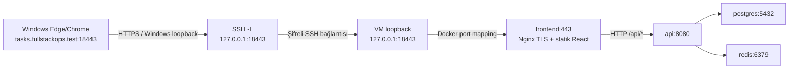

# Yerel HTTPS — hazırlık ve sonraki uygulama rehberi

15 Ekim 2026: **yalnız repository dosyaları ve statik Compose modeli hazır**.
Bu sayfadaki Windows/Ubuntu kurulum komutları **bu görevde çalıştırılmadı**.
Sertifika üretimi, Windows güven deposu/hosts değişikliği ve frontend recreate
ancak sonraki rehberli uygulamada yapılacak. Çalışan VM stack'i ve mevcut tüneller korunur.
Komut grupları sırayla sonuç incelenerek uygulanacak; bir grup başarısızsa sonraki
gruba geçilmez. Bütün belge tek seferde terminale yapıştırılmaz.

## 1. Karar ve istek yolu

[İlk plandaki](../../docs/deployment-plan.md) host Nginx önerisi, kullanıcının
image build olmadan read-only deployment config isteğiyle değiştirildi: TLS mevcut
frontend container'ındaki Nginx'te sonlanır. Altı servis, aynı GHCR digest çifti,
PostgreSQL volume'u ve monitoring adresleri korunur; host Nginx kurulmaz.



TLS browser ile frontend Nginx arasındadır; SSH yalnız TCP taşır. API bağlantısı
mevcut internal Docker ağında HTTP kalır. Bu uçtan uca tüm servislerin TLS kullandığı
veya internet deployment'ı iddiası değildir. Uygulamaya kullanıcı yetkilendirmesi eklenmez.

| Erişim | Windows loopback | VM loopback → container |
| --- | --- | --- |
| Yeni HTTPS | 18443 | 18443 → frontend443 |
| Mevcut HTTP teşhisi | 28081 | 18081 → frontend80 |
| Prometheus | 29090 | 19090 → prometheus9090 |
| Grafana | 23000 | 13000 → grafana3000 |
| API / PostgreSQL / Redis | Yok | Host publish yok |

Yeni port18443'ün iki hostta boş olduğu henüz kontrol edilmedi. Eski tüneller
aynı şekilde bırakılır; sonraki adımda yalnız HTTPS için ayrı bir tünel açılabilir.

## 2. Dosyalar ve davranış

- [compose.https.yaml](compose.https.yaml): üçüncü, isteğe bağlı overlay.
- [nginx/https.conf](nginx/https.conf): yalnız deployment frontend config'i.
- [https.env.example](https.env.example): tek non-secret path placeholder'ı.
- [release.json](release.json): image kaynağı/digestleri; bu görevde değişmedi.
- [Statik test](../../tests/Deployment.Configuration.Test.py): gerçek Compose
  parser/model guard'ları; Docker Engine gerektirmez.

Komut sırası daima `compose.yaml`, `compose.deploy.yaml`, `compose.https.yaml`.
Bind source yolları **ilk dosyanın/repository kökünün** konumuna göre çözülür.
HTTPS overlay'i tek başına kullanılmaz. [Compose merge açıklaması](https://docs.docker.com/compose/how-tos/multiple-compose-files/merge/).

Nginx config, server certificate ve server private key için üç ayrı bind mount
read-only'dir; `create_host_path: false` yanlış/eksik source için sessizce dizin
oluşturmayı engeller. Sertifika yokken `config -q` yine başarılı olabilir: dosyanın
varlığını, PEM içeriğini, SAN'ını veya certificate/key eşleşmesini kanıtlamaz.
[Bind mount uzun biçimi](https://docs.docker.com/reference/compose-file/services/#long-syntax-5).

Nginx80 ve443 dinler; mevcut HTTP80 root healthcheck'i ve statik/API routing korunur.
HTTP otomatik HTTPS'e yönlendirilmez: loopback teşhis erişimi bilerek açık kalır.
HTTPS erişimini kullanmak ile bütün HTTP'yi zorunlu TLS'e geçirmek ayrı kararlardır.
Healthcheck'in çalışması da TLS güven/SAN doğrulaması yerine geçmez.

HTTPS'te `Host $http_host` dış18443 portunu korur; `X-Forwarded-Proto $scheme`
TLS isteğinde https olur. Backend'e yeni forwarded-header middleware eklenmez;
header varlığı API'nin client IP/scheme bilgisine güvendiğini kanıtlamaz.
`absolute_redirect off` Nginx'in kendi redirect'lerini göreli yapar; browser dış
origin/18443'ü korur. API'nin relative POST Location sözleşmesi değişmez.
[Nginx redirect açıklaması](https://nginx.org/en/docs/http/ngx_http_core_module.html#absolute_redirect).

Image'ın EXPOSE80 metadata'sı443 dinlenmesini/publish edilmesini engellemez;
gerçek listener ve Docker mapping ayrıca doğrulanacak. Dockerfile değişmez.

## 3. Sertifika adı, yerleşim ve güven

Tek SAN: **DNS:tasks.fullstackops.test**. DHCP VM IP'si ve localhost SAN değildir;
browser URL'si `https://tasks.fullstackops.test:18443/` olmalıdır. `.test` için public
DNS/domain satın alınmaz; Windows hosts eşlemesi127.0.0.1 olacaktır.

Önerilen araç Windows'ta [resmî mkcert](https://github.com/FiloSottile/mkcert).
Yerel CA Windows'ta oluşturulur; CA private key **VM'ye veya container'a gönderilmez**.
Nginx'e yalnız leaf `server.crt` ve `server.key` gider. Windows tarayıcısı yerel CA'nın
public sertifikasına güvenir. Bunun için ileride mkcert `-install` gerekir;
`TRUST_STORES=system` diğer store'lara otomatik işlem yapılmasını sınırlar.
Yönetici onayı gerekebilir; bu görevde hiçbiri uygulanmadı.

| Dosya | Gelecekte önerilen yer | Git durumu |
| --- | --- | --- |
| CA public/private dosyaları | Windows LOCALAPPDATA/FullStackOpsLab/deployment-tls/ca | Repository dışında; CA private key paylaşılmaz |
| Leaf certificate/private key | Windows aynı lab dizininde ayrı server alt klasörü | Repository dışında, yalnız bu çift VM'ye aktarılır |
| VM leaf dosyaları | /home/labadmin/.local/share/fullstackops-deploy-lab/tls | Repository dışında; server.key izin600 |
| VM path ayarı | VM repository kökünde .env.https | Git ignored; yalnız path, credential içermez |

`.gitignore`, `.env.https` yanında key/pem/crt/cer/pfx/p12/csr/der/srl ve tls-private
dizinlerini dışlar. Bu savunma, ignored bir private key'in güvenli saklandığı veya
zorla eklenemeyeceği anlamına gelmez. Yeni örnek env takip edilebilir; gerçek .env.deployment
ve user-secrets değiştirilmez. Sertifika yenileme ayrı bir işlemdir; güven/hosts
kaldırma yönergeleri bölüm10'dadır ve bu hazırlıkta uygulanmaz.

## 4. Ön kontrol — sonraki uygulama, salt okunur

**Ubuntu SSH:** önce IP/hostname, project durumları ve18443 portunu tekrar kontrol et.

```bash
hostname
ip -4 -brief address show eth0
sudo docker ps -a --filter label=com.docker.compose.project=fullstackops-deploy-lab --format 'table {{.Names}}\t{{.Status}}\t{{.Ports}}'
sudo ss -ltnp '( sport = :18443 )'
```

**Windows PowerShell:** Ubuntu prompt'unda çalıştırma. Boş portta listener çıkmamalı.

```powershell
Get-NetTCPConnection -State Listen -LocalPort 18443 -ErrorAction SilentlyContinue
Get-Command mkcert -ErrorAction Stop
mkcert -version
if ($LASTEXITCODE -ne 0) { throw 'mkcert kullanilamiyor' }
```

mkcert yoksa burada durulur; resmî Windows release'inin ayrı indirme/kurulum ve
bütünlük incelemesi gerekir. Bu hazırlıkta araç indirilmedi/kurulmadı; belirli bir
binary hash'i doğrulanmış gibi sunulmaz. Ücretli hizmet gerekmez.

## 5. Dosya aktarımı — sonraki uygulama

Yeni repository dosyaları henüz commit edilmediyse clone tek başına getirmez.
Seçilmiş kaynak1b52633776279b1661a7cac53392d385cbf10444 ağacı ve mevcut release çifti
korunur; yalnız üç yeni public HTTPS config dosyası aktarılır. Root compose.yaml,
compose.deploy.yaml, image digestleri ve development dosyaları değiştirilmez.

**Ubuntu SSH**, mevcut VM repository kökü:

```bash
(
  set -eu
  cd ~/fullstack-ops-lab
  test -f compose.yaml
  test -f infrastructure/deployment/compose.deploy.yaml
  test ! -e infrastructure/deployment/compose.https.yaml
  test ! -e infrastructure/deployment/https.env.example
  test ! -e infrastructure/deployment/nginx/https.conf
  install -d -m 755 infrastructure/deployment/nginx
)
```

Kontrollerden biri başarısızsa aktarım durdurulup mevcut dosya incelenir; üzerine
yazılmaz. **Windows PowerShell**, ana repository kökü (IP önce yeniden doğrulanır):

```powershell
& {
$vmAddress = '172.30.249.139'
scp infrastructure/deployment/compose.https.yaml infrastructure/deployment/https.env.example "labadmin@${vmAddress}:~/fullstack-ops-lab/infrastructure/deployment/"
if ($LASTEXITCODE -ne 0) { throw 'HTTPS config aktarimi basarisiz' }
scp infrastructure/deployment/nginx/https.conf "labadmin@${vmAddress}:~/fullstack-ops-lab/infrastructure/deployment/nginx/"
if ($LASTEXITCODE -ne 0) { throw 'Nginx config aktarimi basarisiz' }
Get-FileHash infrastructure/deployment/compose.https.yaml, infrastructure/deployment/nginx/https.conf -Algorithm SHA256
}
```

**Ubuntu SSH:** `sha256sum` ile aynı public dosya hash'leri eşleştirilir.

```bash
sha256sum infrastructure/deployment/compose.https.yaml infrastructure/deployment/nginx/https.conf
```

## 6. Yerel CA ve leaf hazırlığı — gelecekte Windows PowerShell

Bu grup **sertifika ve güven deposu değiştirir; şimdi çalıştırılmayacak**.
Ayrı yeni PowerShell oturumu kullanılır; aşağıdaki env ayarları yalnız bu oturum
içindir, setx kullanılmaz. Repo dışı bu lab dizini zaten varsa önce içeriği/sahipliği
incelenir; komut mevcut dosyaları sıfırlamak için tekrar çalıştırılmaz.

```powershell
& {
$tlsLab = Join-Path $env:LOCALAPPDATA 'FullStackOpsLab\deployment-tls'
if (Test-Path -LiteralPath $tlsLab) { throw 'TLS lab dizini mevcut; once incele' }
$env:CAROOT = Join-Path $tlsLab 'ca'
$env:TRUST_STORES = 'system'
$leafDir = Join-Path $tlsLab 'server'
New-Item -ItemType Directory -Path $env:CAROOT, $leafDir -ErrorAction Stop | Out-Null
mkcert -install
if ($LASTEXITCODE -ne 0) { throw 'Yerel CA guven kurulumu basarisiz' }
mkcert -cert-file (Join-Path $leafDir 'server.crt') -key-file (Join-Path $leafDir 'server.key') tasks.fullstackops.test
if ($LASTEXITCODE -ne 0) { throw 'Leaf sertifika uretimi basarisiz' }
Get-FileHash (Join-Path $env:CAROOT 'rootCA.pem'), (Join-Path $leafDir 'server.crt') -Algorithm SHA256
}
```

Yalnız public certificate fingerprint'i paylaşılabilir; private key, PFX veya CA
key içeriği paylaşılmaz. Tarayıcı yeniden açılabilir. Bu güven sadece yerel lab
içindir; production CA çözümü değildir. CA private key veya CAROOT klasörünü SCP ile
gönderme. Windows/VM SSH host fingerprint kontrolü TLS sertifika güveninden farklıdır.

## 7. VM leaf yerleşimi ve ayrı path env — sonraki uygulama

**Ubuntu SSH**, aynı oturumda repository kökünde:

```bash
tls_directory="$HOME/.local/share/fullstackops-deploy-lab/tls"
(
  set -eu
  test ! -e "$tls_directory/server.crt"
  test ! -e "$tls_directory/server.key"
  install -d -m 700 "$tls_directory"
)
```

Hedef zaten varsa aktarımı durdur; otomatik overwrite/rotation yapma. **Windows
PowerShell**, güncel VM IP'siyle yalnız leaf çiftini aktar:

```powershell
& {
$vmAddress = '172.30.249.139'
$leafDir = Join-Path $env:LOCALAPPDATA 'FullStackOpsLab\deployment-tls\server'
scp (Join-Path $leafDir 'server.crt') (Join-Path $leafDir 'server.key') "labadmin@${vmAddress}:~/.local/share/fullstackops-deploy-lab/tls/"
if ($LASTEXITCODE -ne 0) { throw 'Leaf aktarimi basarisiz' }
}
```

**Ubuntu SSH:** dosya izinlerini ayarla; env dosyası mevcutsa noclobber işlemi durdurur.

```bash
(
  set -eu
  cd ~/fullstack-ops-lab
  chmod 600 "$tls_directory/server.key"
  chmod 644 "$tls_directory/server.crt"
  sha256sum "$tls_directory/server.crt"
  umask 077
  set -C
  printf 'DEPLOYMENT_TLS_DIR=%s\n' "$tls_directory" > .env.https
)
```

Public leaf hash'i Windows ile eşleşmeli. Örnek `https.env.example` aynı key'in
placeholder'ını gösterir; gerçek path VM'de belirlenir. Bu key credential değildir.
.env.deployment'a ekleme veya secret kopyalama yapılmaz. Private key chmod/mount
uygunluğu henüz VM'de denenmedi; mevcut image root master süreci sertifikayı okur.

## 8. Sessiz config ve nginx -t — sonraki uygulama

**Ubuntu SSH**, repository kökünde bir yardımcı shell fonksiyonu tanımla:

```bash
deploy_https() {
  (
    set -eu
    cd ~/fullstack-ops-lab
    sudo docker compose --project-name fullstackops-deploy-lab \
      --env-file .env.deployment --env-file .env.https \
      -f compose.yaml -f infrastructure/deployment/compose.deploy.yaml \
      -f infrastructure/deployment/compose.https.yaml "$@"
  )
}
deploy_https config -q
```

İkinci env yalnız TLS path içermeli; process environment dosyaları ezebilir.
Çözümlenmiş config/env çıktısını paylaşma. [Çoklu env dosyası davranışı](https://docs.docker.com/compose/how-tos/environment-variables/variable-interpolation/).

Sertifika/key dosyaları hazır olduktan sonra, stack'i değiştirmeden kendi geçici
frontend test container'ında syntax ve key eşleşmesini kontrol et:

```bash
deploy_https run --rm --no-deps --pull never --entrypoint nginx frontend -t
```

Bu komut **gelecekte geçici container oluşturur**; bugün çalıştırılmadı. Image
build/pull yapmaz; build alanı modelden kaldırılmış ve seçilmiş image önceden local'dir.
`run` için service-ports kullanılmaz; mevcut frontend portlarına bind olmaz.
nginx -t başarısızsa burada durulur. Bu test certificate trust/hostname süresinin
browser kabulü yerine geçmez. [Nginx HTTPS yapılandırması](https://nginx.org/en/docs/http/configuring_https_servers.html).

## 9. Etkinleştirme ve tünel — ancak sonraki onaylı adımda

**Ubuntu SSH:** yalnız frontend yeni mount/port için yeniden oluşturulur. Diğer
beş servise dokunulmaz; kısa frontend kesintisi beklenir.

```bash
deploy_https up -d --no-deps --no-build --pull never --wait --wait-timeout 90 frontend
```

`deploy_https ps` ve güvenli inspect alanlarıyla yeni mount'lar/loopback portu/image
kimliği/health yeniden kontrol edilir. Doğru deployment env ve üç -f dosyası bundan
sonraki frontend yönetiminde birlikte kullanılır; iki dosyalı up TLS mount'larını
kaldırabilir. TLS private key loglanmaz, nginx -T/full inspect çıktısı paylaşılmaz.

**Windows:** yönetici yetkisiyle hosts dosyasını elle açıp yalnız şu eşlemeyi ekle;
var olan satırları silme ve VM DHCP IP'sini bu satıra yazma:

```text
127.0.0.1 tasks.fullstackops.test
```

Eşleme önceden varsa tekrar ekleme; bu laboratuvarda satır ekleyip eklemediğini
not et. Daha sonraki kaldırma işlemi yalnız kendi eklediğin eşlemeyi hedeflemeli.

Yol `%SystemRoot%\System32\drivers\etc\hosts`. **Ayrı Windows PowerShell** tüneli,
güncel VM IP'siyle; mevcut HTTP/monitoring tünelleri açık kalır:

```powershell
ssh -N -T -o ConnectTimeout=10 -o ExitOnForwardFailure=yes -o ServerAliveInterval=30 -o ServerAliveCountMax=3 -L 127.0.0.1:18443:127.0.0.1:18443 labadmin@172.30.249.139
```

Browser: `https://tasks.fullstackops.test:18443/`. Uyarıyı geçmek veya curl -k
kullanmak kabul değildir. **Diğer Windows PowerShell** penceresinde ilk GET:

```powershell
curl.exe --noproxy "*" --resolve "tasks.fullstackops.test:18443:127.0.0.1" --max-time 10 -sS -o NUL -w "HTTPS HTTP=%{http_code}\n" https://tasks.fullstackops.test:18443/
if ($LASTEXITCODE -ne 0) { throw 'HTTPS dogrulamasi basarisiz' }
```

--resolve yalnız DNS yönlendirmesidir; doğru SNI/hostname ve varsayılan TLS
doğrulaması korunur. Browser ayrıca Windows hosts çözümlemesini doğrular. curl TLS
backend'i Windows güven deposunu kullanmıyorsa public CA dosyasıyla açık --cacert
doğrulaması ayrı raporlanır; bu Windows browser trust kabulü sayılmaz.

## 10. Windows değişikliklerini kaldırma — gelecekte, gerektiğinde

Bu bölüm **şimdi çalıştırılmayacak**; henüz hosts veya güven deposu değişmediği
için bugün kaldırılacak bir kayıt yoktur. Sertifika kurulumu sonrasında lab
erişimini kapatmak istersen:

1. Yalnız yeni HTTPS tünelinin çalıştığı PowerShell penceresinde Ctrl+C kullan.
   Mevcut HTTP/Prometheus/Grafana tünellerini ve VM stack'ini değiştirme.
2. Yönetici olarak `%SystemRoot%\System32\drivers\etc\hosts` dosyasını aç.
   Yalnız bu lab için eklediğin `127.0.0.1 tasks.fullstackops.test` eşlemesini
   kaldır. Önceden var olan kayıtları veya aynı satırdaki başka adları silme.
   Tarayıcıyı kapatıp yeniden aç; gerekirse Windows PowerShell'de
   `ipconfig /flushdns` ile resolver önbelleğini yenile.
3. CA güvenini kaldırmak için kurulumdaki **aynı Windows kullanıcı hesabını**,
   aynı CAROOT dizinini ve `TRUST_STORES=system` seçimini kullan. Önce public
   `rootCA.pem` dosyasının SHA256 hash'ini bölüm6'da kaydettiğin değerle eşleştir.
   Dosya yoksa veya hash eşleşmiyorsa dur; varsayılan/başka CA ile deneme yapma.

**Windows PowerShell**, yalnız kaldırma kararı verildiğinde; bu blok sertifika
deposunu değiştirir. İstenecek hash public certificate dosyasının hash'idir,
private key veya credential değildir:

```powershell
& {
$env:CAROOT = Join-Path $env:LOCALAPPDATA 'FullStackOpsLab\deployment-tls\ca'
$env:TRUST_STORES = 'system'
$publicCA = Join-Path $env:CAROOT 'rootCA.pem'
if (!(Test-Path -LiteralPath $publicCA -PathType Leaf) -or
    !(Test-Path -LiteralPath (Join-Path $env:CAROOT 'rootCA-key.pem') -PathType Leaf)) {
    throw 'Ayni lab CA dosyalari yok; kaldirma durdu'
}
$expectedHash = (Read-Host 'Kurulumda kaydedilen public rootCA.pem SHA256').Trim()
if ($expectedHash -notmatch '^[0-9a-fA-F]{64}$' -or
    (Get-FileHash -LiteralPath $publicCA -Algorithm SHA256 -ErrorAction Stop).Hash -ne $expectedHash) {
    throw 'Public CA hash eslesmedi; kaldirma durdu'
}
mkcert -uninstall
if ($LASTEXITCODE -ne 0) { throw 'Lab CA guven kaldirma basarisiz; durumu incele' }
}
```

mkcert `-uninstall` CA dosyalarını silmez. Windows implementasyonu yüklenen CA'nın
seri numarasıyla eşleşen güven kayıtlarını kaldırır; genel ada göre tüm mkcert
sertifikalarını silen bir komut kullanılmaz. Kaynak:
[mkcert uninstall davranışı](https://github.com/FiloSottile/mkcert/blob/master/truststore_windows.go).
Kaldırmadan önce CA dizinini silme veya farklı bir CA üretme. Ardından Windows
sertifika yöneticisinde kaydettiğin public CA'nın parmak izi/seri numarasıyla
eşleşen güven kaydının kaldırıldığını kontrol et; başka sertifikaları silme.
Bu işlemler VM leaf dosyalarını, mount'ları veya frontend'i otomatik değiştirmez;
HTTPS listener açık kalsa bile artık tarayıcı güveni kabulü beklenmez.
VM TLS kaldırma/yenileme ve private dosyaların güvenli temizliği ayrı rehberli
işlemlerdir; burada volume veya sertifika dizini silme komutu verilmez.
Kurulum ve kaldırmanın gerçek Windows kabulü hâlâ **NOT VERIFIED**.

## 11. Statik sonuç ve açık kabul maddeleri

Gerçek Compose parser ile testler: **5/5 PASS**. Önce HTTPS overlay eksikliği ve
ignore eksikleri nedeniyle beklenen RED, dosyalardan sonra GREEN görüldü.
Windows Git stdin newline farkı test taşımasında NUL ayırıcıyla giderildi.

| Madde | Durum |
| --- | --- |
| Gerçek iki env dosyasıyla sessiz config/model parse | PASS; yalnız sahte fixture değerleri |
| Aynı altı servis/network/volume ve seçilmiş image çiftleri; build yok | PASS |
| HTTPS yalnız127.0.0.1:18443; HTTP18081/monitoring aynı; diğer beş servis modeli aynı | PASS |
| Üç read-only bind ve create_host_path false; CA dizini mount edilmez | PASS |
| TLS path eksik/boş ise güvenli anahtar adıyla hata | PASS |
| Sertifika/key/env ignored, örnek takip edilebilir; eski deployment/development testleri | PASS |
| Rehberdeki7 PowerShell ve8 Bash bloğunun yalnız sözdizimi | PASS; komutlar yürütülmedi |
| Secret leakage,62 yerel belge bağlantısı/anchor ve diff whitespace kontrolü | PASS |
| Windows hosts/güven uygulama ve kaldırma yönergeleri | Statik inceleme PASS; hiçbir değişiklik uygulanmadı |
| Nginx SSL modülü/syntax/sertifika ve private key eşleşmesi | NOT VERIFIED; nginx -t çalıştırılmadı |
| Certificate SAN/süre, Windows trust/hosts, VM dosya izinleri ve port boşluğu | NOT VERIFIED |
| Gerçek HTTPS HTML/JS/CSS ve API Location/same-origin davranışı | NOT VERIFIED |
| HTTPS sonrası health, image kimliği ve monitoring erişiminin korunması | NOT VERIFIED |
| Yenileme/reload, public CA/domain/internet kabulü | NOT VERIFIED |

YAML/static test sonucu başarılı HTTPS deployment anlamına gelmez. Sertifika/key
üretilmedi; VM/Windows ayarları değiştirilmedi. Sonraki küçük adım dosyaların ve
komutların incelenmesi; ardından ayrı rehberli sertifika/güven hazırlığıdır.

Gerçekte çalıştırılan yerel komut `py -3 tests/Deployment.Configuration.Test.py`;
test kendi sahte env dosyalarıyla `docker compose ... config -q` ve JSON model
kontrolü yapar. Ayrıca secret scanner, git diff --check ve yalnız parser kontrolleri
çalıştırıldı. Git Bash -n ilk sandbox çağrısında signal pipe erişim engeli verdi;
aynı syntax-only kontrol izinli yerel süreçte geçti. Bu bir VM komut hatası değildir.
Temporary fixture dosyaları test sonunda kaldırıldı; certificate/key dosyası
üretilmedi. Index boş, commit/push yok; başlangıçtaki VM/tünel/Docker kaynaklarına
hiçbir işlem gönderilmedi.
